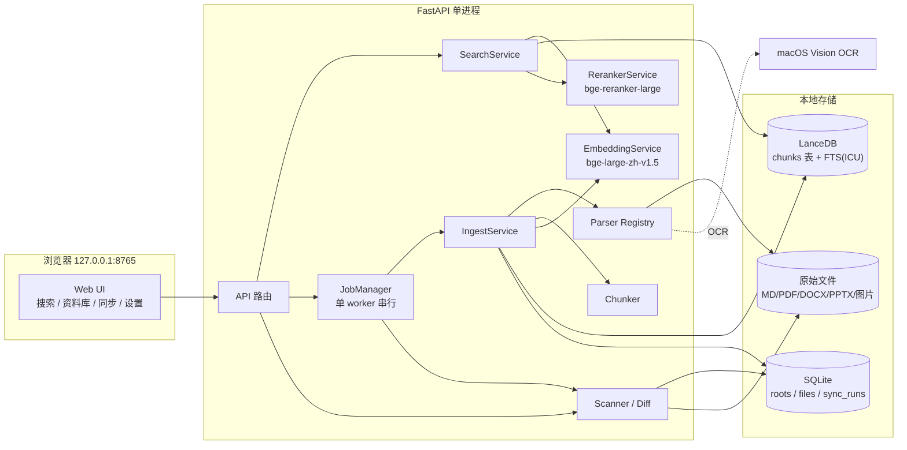
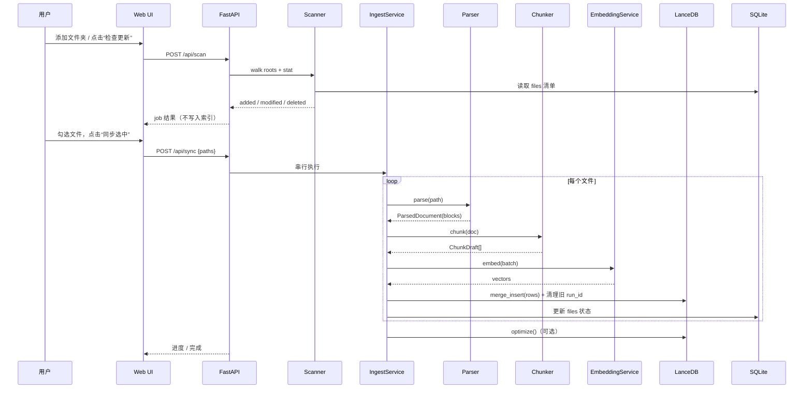
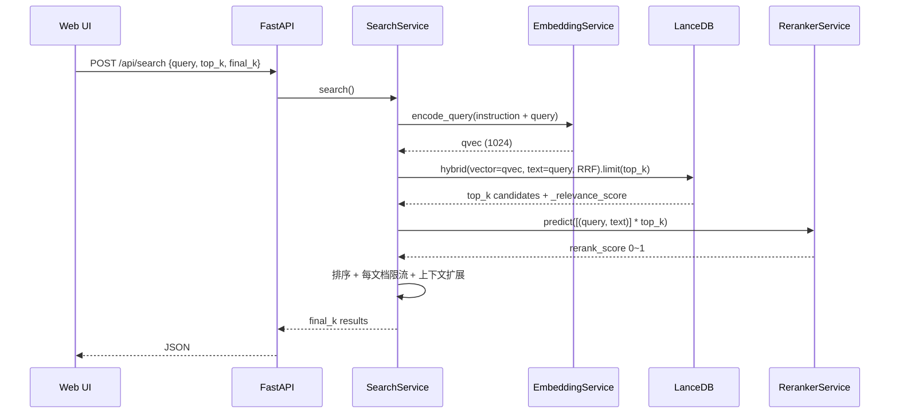
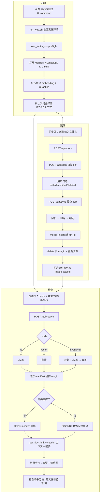

# 本地内容混合检索系统 · 总体方案

> 文档编号：DOC-00  
> 版本：1.2.0.dev0（稳定版 v1.1）  
> 日期：2026-10-24  
> 状态：v1.1 稳定；v1.2 OCR bbox 开发中（2026-10-24）  
> 目标机器：macOS 26.6.2 / Apple M5 Max / 64GB / arm64  
> 关联文档：[DOC-01 实施步骤总览](01-实施步骤总览.md) · [DOC-02 代码结构与追溯矩阵](02-代码结构与追溯矩阵.md) · [DOC-03 评测方案](03-评测方案.md) · [DOC-04 离线部署与运维](04-离线部署与运维.md)

---

## 1. 背景与目标

### 1.1 背景

在本地积累了大量 Markdown、TXT、PDF、DOCX、PPTX、截图等资料。系统自带的 Spotlight 主要依赖文件名和系统索引，无法做到：

- 按**正文内容**做语义检索（例如“那份讲混合检索延迟的文档”）；
- 同时兼顾**关键词精确命中**（例如错误码 `E1024`、人名、专有名词）；
- 对命中片段做**交叉注意力精排**，而不是只按向量距离排序；
- 完全离线、数据不出本机。

### 1.2 目标

构建一个 **macOS 本地、单人使用、浏览器访问**的内容检索系统：

1. 支持 MD / TXT / PDF / DOCX / PPTX / HTML / JSON / CSV / LOG / 图片（OCR）十类内容；
2. 单个 LanceDB 库同时提供 BGE 向量召回与中文 BM25 全文检索；
3. 双路召回用 RRF 融合，再用 `bge-reranker-large` 交叉编码器精排；
4. 支持“先选一部分文件，之后动态追加”；
5. 文件修改/删除后**只提醒、不自动同步**，由用户在 Web UI 勾选后手动执行；
6. 全流程本地推理，不请求任何云端 API；
7. 提供可复现的评测脚本，用 Downloads 样本与公开中文检索集验证效果。

### 1.3 非目标（v1 明确不做）

| 非目标 | 说明 |
|---|---|
| 音频/视频转写 | 预留 Parser 接口，v1 不实现；后续可用 whisper.cpp / mlx-whisper |
| 多用户/权限体系 | v1 仅本机单人，绑定 `127.0.0.1`，不做登录 |
| 云端同步/分享 | 不做，隐私优先 |
| 图片语义描述（VLM） | v1 只做 OCR 文本；图片内容理解留到 v2 |
| 语义切片模型 | v1 用结构感知 + 固定大小重叠；不引入额外切片模型 |
| 分布式/大规模 | 单机 10 万级 chunk 以内；ANN 索引按需再上 |
| 自动文件监听 | v1 用启动扫描 + 手动“检查更新”，不做 FSEvents 常驻监听 |

### 1.4 成功标准

| 编号 | 标准 | 验证方式 |
|---|---|---|
| SC-01 | 20 个混合格式文件可完整入库并检索 | 验收脚本 + 人工 |
| SC-02 | 中文关键词（错误码/专有名词）能被 FTS 命中 | 固定 query 集 |
| SC-03 | 混合检索 + 重排的 nDCG@10 不低于纯向量 | DOC-03 评测报告 |
| SC-04 | 热态查询 p95 ≤ 1.5s（top_k=20, final_k=5） | 基准测试 |
| SC-05 | 断网后系统仍可启动、入库、检索 | 关闭网络验收 |
| SC-06 | 文件新增/修改/删除能被扫描发现，且默认不自动写入 | UI 验收 |

---

## 2. 需求清单

### 2.1 功能需求

| 编号 | 需求 | 优先级 | 对应步骤 |
|---|---|---|---|
| FR-01 | 按正文内容检索，而非仅文件名 | P0 | STEP-04/07 |
| FR-02 | 支持 Markdown / TXT，自动识别 UTF-8/GB18030 等编码 | P0 | STEP-03 |
| FR-03 | 支持 PDF 文本层；扫描页自动 OCR | P0 | STEP-03 |
| FR-04 | 支持 DOCX 段落、标题、表格、内嵌图片 OCR | P0 | STEP-03 |
| FR-05 | 支持 PPTX 文本框、表格结构、图表、备注、图片 OCR/alt text | P0 | STEP-03 |
| FR-06 | 支持 PNG/JPG/JPEG/WebP/TIFF/BMP 图片 OCR | P0 | STEP-03 |
| FR-07 | 文件夹可动态添加/移除；扫描后可勾选部分文件入库 | P0 | STEP-05/06/09 |
| FR-08 | 文件变更提醒；用户手动选择是否同步；支持删除同步 | P0 | STEP-05/06/09 |
| FR-09 | 向量 + FTS 双路召回，RRF 融合 | P0 | STEP-01/07 |
| FR-10 | `bge-reranker-large` 对 top_k 精排，输出去重后的 final_k | P0 | STEP-02/07 |
| FR-11 | 结果展示文件名、路径、片段、页码/幻灯片、分数 | P0 | STEP-07/09 |
| FR-12 | 本地 Web UI，单人使用 | P0 | STEP-08/09 |
| FR-13 | 资料库列表、文档详情、索引统计 | P1 | STEP-08/09 |
| FR-14 | 打开文件 / 在 Finder 中显示 | P1 | STEP-08/09 |
| FR-15 | 评测脚本：Recall/MRR/nDCG + 延迟 | P1 | STEP-10 |
| FR-16 | 音频/视频转写 | P2 | 预留，不在 v1 |
| FR-17 | 图片内容理解（非 OCR） | P2 | 预留，不在 v1 |

### 2.2 非功能需求

| 编号 | 需求 | 目标 |
|---|---|---|
| NFR-01 | 全离线 | 模型本地路径；`HF_HUB_OFFLINE=1`；无遥测/云端调用 |
| NFR-02 | 性能 | 热态查询 p95 ≤ 1.5s；入库 ≥ 30 chunk/s |
| NFR-03 | 鲁棒性 | 损坏文件、加密 PDF、编码异常、模型缺失均不崩溃，给出可读错误 |
| NFR-04 | 隐私 | 仅监听 `127.0.0.1`；路径校验；日志不打印全文 |
| NFR-05 | 可维护 | 文档-代码追溯矩阵；每步有测试与验收命令 |
| NFR-06 | 可扩展 | Parser / Embedding / Reranker 均为可替换接口 |
| NFR-07 | 资源预算 | 模型 ~3.5GB；10 万 chunk 向量 ~400MB；峰值内存 < 10GB |
| NFR-08 | 可恢复 | 入库中断不丢旧数据；启动时清理 `indexing` 残留 |

---

## 3. 技术选型

### 3.1 版本锁定（本机实测通过）

| 组件 | 版本 | 用途 | 备注 |
|---|---|---|---|
| Python | 3.11.5 | 运行时 | 3.12 亦可；3.13 生态待验证 |
| LanceDB | **0.40.0** | 向量库 + 原生 FTS | 当前 PyPI 最新；API 变动快，必须锁版本 |
| pydantic | 2.14.1 | `LanceModel` | LanceDB 要求 `>=2.7.4,<3` |
| pyarrow | 26.0.0 | Arrow 数据 | LanceDB 依赖 |
| PyTorch | 2.14.1 | MPS 推理 | `torch.backends.mps.is_available() == True` |
| sentence-transformers | 6.1.0 | BGE 加载 / CrossEncoder | 查询与重排 |
| transformers | 5.20.2 | 底层 | 由 ST 拉取 |
| BAAI/bge-large-zh-v1.5 | 本地权重 1.3GB | 1024 维向量 | 中文语义召回 |
| BAAI/bge-reranker-large | 本地权重 2.24GB | 交叉编码器 | XLM-R large，560M 参数 |
| PyMuPDF | 2.0 | PDF 文本/渲染 | **AGPL**，个人使用无碍；对外分发需评估 |
| python-docx | 1.2.0 | DOCX | `iter_inner_content()` 保序 |
| python-pptx | 1.0.2 | PPTX | 文本框/表格/图表/备注/图片/占位符 |
| ocrmac | 1.0.1 | macOS Vision OCR | 系统内置，离线，中文效果好 |
| Pillow | 13.0.0 | 图片处理 | 旋转/缩略/格式 |
| charset-normalizer | 3.5.2 | 编码检测 | 替代 `errors="ignore"` |
| FastAPI | 0.156.4 | 本地 API | 单进程 |
| uvicorn | 0.54.0 | ASGI Server | `127.0.0.1:8765` |
| SQLite | 标准库 | 文件清单/任务状态 | WAL 模式 |

### 3.2 明确不使用的技术

| 技术 | 原因 |
|---|---|
| **Tantivy** | LanceDB 0.40 已移除 Tantivy FTS；`use_tantivy=True` 直接抛 `ValueError`。FTS 为 Lance 原生倒排索引 |
| `create_fts_index` | 自 0.25.0 起弃用；统一用 `create_index("text", config=FTS(...))` |
| 默认分词器 `simple` | 中文整句成 token，实测中文查询召回为 0；必须 `icu` |
| 云端 Embedding / Rerank API | 违反离线与隐私要求 |
| PaddleOCR | 依赖重；macOS 上 Vision 更快且无需额外模型 |
| 语义切片（embedding 找边界） | 成本翻倍、收益有限；结构感知切片足够 |
| 一开始就建 IVF/HNSW | 实测 10 万 × 1024 维暴力扫描 19.6ms，小规模 ANN 反而掉召回 |
| 浏览器端向量计算 | 无必要，且模型体积大 |

### 3.3 与初版方案的关键修正

| 初版写法 | 实际可行写法 |
|---|---|
| 底层 Tantivy 做 FTS | Lance 原生 FTS；`create_index(..., config=FTS(...))` |
| `table.create_fts_index` | 0.25 起弃用；保留兼容但会告警 |
| “原生支持中文 BM25” | 必须显式 `base_tokenizer="icu"`（或 jieba 词典） |
| `Vector(1024, source="text")` | `func.SourceField()` / `func.VectorField()` |
| `pip install tantivy` | 不需要；无需安装 |
| 模型自动离线 | 必须本地绝对路径 + `local_files_only` + offline 环境变量 |
| `CrossEncoderReranker` 直接放 hybrid | 会替换 RRF 为 vanilla merge；必须两段式手动重排 |

---

## 4. 总体架构

### 4.1 组件图



### 4.2 入库数据流



### 4.3 查询数据流



---

## 5. 数据模型

### 5.1 LanceDB 表 `chunks`

表只建一张，按 chunk 存储。字段如下：

| 字段 | 类型 | 说明 | 索引 |
|---|---|---|---|
| `id` | string | chunk 稳定 ID，`sha256(doc_id:chunk_index:content_hash)[:32]` | 主键（逻辑） |
| `doc_id` | string | 文档 ID，`sha256(realpath)[:20]` | 过滤 |
| `root_id` | int64 | 所属索引根 | 过滤 |
| `chunk_index` | int64 | 文档内序号，从 0 开始 | — |
| `text` | string | **检索/嵌入文本**：标题路径 + 正文 | **FTS** |
| `display_text` | string | 展示正文（不含标题前缀） | — |
| `vector` | fixed_size_list[1024] | BGE 向量，绑定 `text` | 向量 |
| `file_name` | string | 文件名 | — |
| `file_path` | string | 绝对路径 | 过滤 |
| `file_type` | string | `md/txt/pdf/docx/pptx/html/json/csv/image` | 过滤 |
| `title` | string | 文档标题 | — |
| `heading` | string | 标题路径，如 `架构 / 检索 / 重排` | — |
| `page` | int64 | PDF 页码，1 起；无则 0 | — |
| `slide` | int64 | PPT 幻灯片号，1 起；无则 0 | — |
| `char_start` | int64 | 在规范化全文中的起始偏移 | — |
| `char_end` | int64 | 结束偏移 | — |
| `content_hash` | string | `sha256(display_text)[:16]` | — |
| `doc_hash` | string | 文件内容哈希（变更检测） | — |
| `run_id` | string | 本次入库批次 ID，用于清理旧 chunk | 过滤 |
| `indexed_at` | float64 | Unix 时间戳 | — |
| `source_kind` | string | `text/ocr/table/note` | — |
| `meta_json` | string | 扩展元数据 JSON | — |

**设计说明：**

- `text` 作为 FTS 与 embedding 的唯一源字段，满足“vector 绑定 text”；标题前缀能提升召回，`display_text` 保证 UI 展示干净。
- `run_id` 是“先插入新数据、再删除旧数据”的关键：清理条件为 `doc_id = ? AND run_id != ?`，避免入库中断丢旧数据。
- 不存 base64 图片；只存 OCR 文本与元数据。

### 5.2 SQLite 清单 `data/manifest.sqlite`

```sql
PRAGMA journal_mode=WAL;

CREATE TABLE roots (
    id          INTEGER PRIMARY KEY AUTOINCREMENT,
    path        TEXT UNIQUE NOT NULL,   -- 绝对路径
    enabled     INTEGER NOT NULL DEFAULT 1,
    created_at  TEXT NOT NULL
);

CREATE TABLE files (
    path            TEXT PRIMARY KEY,   -- 绝对路径
    doc_id          TEXT NOT NULL,
    root_id         INTEGER NOT NULL,
    file_type       TEXT NOT NULL,
    size            INTEGER NOT NULL,
    mtime           REAL NOT NULL,
    doc_hash        TEXT,
    status          TEXT NOT NULL DEFAULT 'pending',
                    -- pending / indexing / indexed / error / deleted
    chunk_count     INTEGER NOT NULL DEFAULT 0,
    run_id          TEXT,
    last_indexed_at TEXT,
    last_error      TEXT
);
CREATE INDEX idx_files_status ON files(status);
CREATE INDEX idx_files_root   ON files(root_id);

CREATE TABLE sync_runs (
    id          TEXT PRIMARY KEY,       -- uuid
    kind        TEXT NOT NULL,          -- scan / sync
    started_at  TEXT NOT NULL,
    finished_at TEXT,
    added       INTEGER DEFAULT 0,
    updated     INTEGER DEFAULT 0,
    deleted     INTEGER DEFAULT 0,
    failed      INTEGER DEFAULT 0,
    status      TEXT NOT NULL           -- running / done / failed
);

CREATE TABLE settings (
    key   TEXT PRIMARY KEY,
    value TEXT NOT NULL
);

CREATE TABLE schema_meta (
    key   TEXT PRIMARY KEY,
    value TEXT NOT NULL
);
```

### 5.3 ID 与哈希规则

| 名称 | 规则 | 稳定性 |
|---|---|---|
| `doc_id` | `sha256(realpath)[:20]` | 文件移动会变（视为删除+新增） |
| `content_hash` | `sha256(display_text.encode("utf-8"))[:16]` | 内容不变则稳定 |
| `chunk_id` | `sha256(f"{doc_id}:{chunk_index}:{content_hash}")[:32]` | 内容/位置不变则稳定 |
| `doc_hash` | `sha256(文件字节流)`，流式计算 | 内容不变则稳定 |
| `run_id` | `uuid4().hex` | 每次入库任务唯一 |

### 5.4 文本组成与切片参数

```text
text          = f"{heading}\n{body}"   # heading 为空则只放 body
display_text  = body
```

| 参数 | 默认值 | 说明 |
|---|---|---|
| `CHUNK_SIZE` | 400 字 | 目标长度 |
| `CHUNK_OVERLAP` | 50 字 | 相邻切片重叠，按句子回退 |
| `CHUNK_MIN` | 80 字 | 过短则与相邻合并 |
| `CHUNK_MAX` | 600 字 | 硬上限；表格/代码块可到 800 |
| `HEADING_PREFIX_MAX` | 120 字 | 标题前缀上限 |

> 400 字是刻意与 BGE 的 512 token 上限对齐：中文约 300–400 token，不会截断；reranker 同样受益。

---

## 6. 解析与 OCR

### 6.1 Parser 矩阵

| 类型 | 扩展名 | 库 | 输出 | OCR 策略 |
|---|---|---|---|---|
| 纯文本 | `.txt` | 标准库 + charset-normalizer | 段落块 | 无 |
| Markdown | `.md` | 自研正则 | 标题/段落/代码/表格块 | 无 |
| PDF | `.pdf` | PyMuPDF 2.0 | 每页文本块 | 页面文本 < 40 字 → 200dpi 渲染整页 OCR |
| Word | `.docx` | python-docx 1.2 | 段落/标题/表格/图片 | 内嵌图片 ≥ 200px 且 ≥ 10KB → OCR |
| PowerPoint | `.pptx` | python-pptx 1.0 | 文本框/表格/图表/备注/图片/alt text | 同上，每页最多 20 张 |
| 图片 | `.png/.jpg/.jpeg/.webp/.tif/.tiff/.bmp` | Pillow + ocrmac | OCR 文本 | 始终 OCR（可关闭） |

**统一中间结构：**

```python
@dataclass
class ParsedBlock:
    text: str
    kind: str                 # heading / paragraph / table / code / ocr / note
    page: int = 0
    slide: int = 0
    heading_path: tuple[str, ...] = ()
    char_start: int = 0
    char_end: int = 0
    meta: dict = field(default_factory=dict)

@dataclass
class ParsedDocument:
    path: Path
    file_type: str
    title: str
    blocks: list[ParsedBlock]
    text: str                 # 规范化全文
    warnings: list[str]
```

### 6.2 OCR 策略（macOS Vision）

- 使用 `ocrmac` 调用系统 Vision，语言 `["zh-Hans", "en-US"]`；
- 实测 1500×480 中文截图 0.36s；A4 页面 200dpi 约 0.8–1.5s；
- 置信度 < 0.25 的行丢弃；连续短行合并；
- OCR 文本标记 `source_kind="ocr"`，UI 显示“OCR”徽标；
- 识别为空的图片跳过并记录 warning，不阻塞整个任务；
- 不做手写体承诺；截图/印刷体效果最好。

### 6.3 编码与异常

| 场景 | 处理 |
|---|---|
| UTF-8 / UTF-8-SIG | 直接解码 |
| GB18030 / GBK / Big5 | charset-normalizer 检测后解码 |
| 检测失败 | 依次尝试 utf-8、gb18030、big5；仍失败用 `errors="replace"` 并 warning |
| 加密 PDF | 尝试空密码；失败标记 `ENCRYPTED_PDF`，跳过 |
| 损坏 PDF/DOCX/PPTX | 捕获异常，记录文件级错误，不中断任务 |
| 超大文件 | > 200MB 跳过并提示；PDF > 500 页截断并提示 |
| 空文档 | 跳过，manifest 标记 `empty` |
| 符号链接 | 默认跳过，避免循环 |

---

## 7. 索引与检索

### 7.1 FTS 配置（必须照抄）

```python
from lancedb.index import FTS

table.create_index(
    "text",
    config=FTS(
        base_tokenizer="icu",
        lower_case=True,
        stem=False,
        remove_stop_words=False,
        ascii_folding=False,
    ),
)
```

**不要**使用默认 `simple`，否则中文关键词召回为 0（已实测）。  
**不要**传 `use_tantivy=True`，会直接抛异常。  
**注意** `create_index` 的 column 是第一个位置参数；写成 `create_index(config=...)` 会把 `"l2"` 当列名。

### 7.2 混合检索

```python
candidates = (
    table.search(query_type="hybrid")
    .vector(qvec)                 # 显式查询向量，便于加 instruction
    .text(query)
    .rerank(RRFReranker())        # 默认也是 RRF，显式更清晰
    .where(where_clause, prefilter=True)   # 可选
    .select([...])                # 不含 vector
    .limit(top_k)
    .to_list()
)
```

- 默认 `top_k=20`，可配置到 30/50；实测 20 条重排 400 字切片约 308ms；
- `_relevance_score` 是 RRF 分（约 `1/(60+rank)`），不是置信度；
- 查询向量加 BGE 指令前缀：`为这个句子生成表示以用于检索相关文章：`；
- 过滤条件用 `root_id` / `file_type` / `doc_id`，避免路径字符串注入。

### 7.3 重排

```python
scores = reranker.predict(
    [[query, c["text"]] for c in candidates],
    batch_size=32,
)
```

- 模型：`bge-reranker-large`（XLM-R large，560M）；
- 输入：`(query, text)`，`max_length=512`；
- 输出：sigmoid 后 0–1（sentence-transformers 已处理）；
- 重排失败：显式返回 `RERANK_FAILED`，不返回伪精排结果；
- 必须两段式：**不要**把 `CrossEncoderReranker` 直接传给 hybrid，它会用 vanilla merge 替换 RRF。

### 7.4 去重与上下文扩展

1. 按 `rerank_score` 降序；
2. 每 `doc_id` 最多 `PER_DOC_LIMIT=2` 条；
3. 可选 MMR（λ=0.7）进一步增加多样性；
4. 对每条命中，取同文档 `chunk_index ± 1` 的相邻块，拼接为上下文；
5. `display_text` 过长时截断到 600 字，保留命中词附近窗口。

### 7.5 分数语义（UI 必须区分）

| 字段 | 范围 | 含义 |
|---|---|---|
| `rrf_score` | 约 0–0.03 | RRF 融合分，仅用于排序 |
| `rerank_score` | 0–1 | 交叉编码器相关性，可展示为百分比 |
| `rank_before` | 1..top_k | 重排前名次 |
| `rank_after` | 1..final_k | 重排后名次 |
| `score_kind` | `rerank/rrf/bm25/distance` | 分数来源，UI 据此选择标签 |

### 7.6 性能实测与容量

| 场景 | 实测（M5 Max） |
|---|---|
| 查询向量化 | 13ms |
| 建索引吞吐 | 105 chunk/s（175 字/片，batch=32） |
| 10 万 × 1024 暴力向量检索 top20 | 19.6ms |
| hybrid top20 | 16–17ms（热态） |
| rerank 20 × 400 字 | 308ms |
| 端到端（top20 → final5） | 约 0.33s（热态） |
| 进程内首查 | 约 1.2s |
| 模型内存 | 1.3GB + 2.24GB，峰值约 6GB |

**结论：**

- 10 万 chunk 以内不建 ANN，暴力扫描足够；
- 20–30 万 chunk 再评估 `IVF_HNSW_SQ` / `IVF_PQ`；
- 100 万 chunk 约 4GB 向量 + 200ms 级扫描，必须 ANN。

---

## 8. 文件选择与增量同步

### 8.1 索引范围

- 以**文件夹**为索引根（`roots`），支持动态添加/移除；
- 扫描时按扩展名白名单过滤；
- 默认忽略：隐藏文件、`.git`、`node_modules`、`Library`、`Applications`、`~$*`、`.DS_Store`、符号链接；
- 用户可在“扫描结果”里只勾选部分文件入库，实现“先选一部分”。

### 8.2 扫描 Diff

```text
walk(root) -> 文件集合
for each file:
    stat size/mtime
    if path not in manifest:        added
    elif size/mtime changed:        modified
    else:                           unchanged
for each manifest path under root not seen: deleted
```

- 扫描阶段**不算哈希**，只做 `stat`，保证大目录也快；
- 用户点“同步”时再对选中文件算 `sha256`；
- 若 `doc_hash` 未变（仅 mtime 变化），标记 unchanged，不重嵌入；
- 结果写入 `sync_runs`，但**不自动写 LanceDB**。

### 8.3 提醒与手动同步

- 应用启动后后台执行一次轻量扫描（可配置关闭）；
- 有变更时，顶部显示“发现 N 个变更”徽标；
- 用户进入“同步”页，看到 added/modified/deleted 分组；
- 勾选后点“同步选中”，才真正入库；
- 默认**不删除**已消失文件的索引；需勾选“同时删除缺失文件”；
- 可配置“每 30 分钟自动扫描提醒”（仍然只提醒，不自动同步）。

### 8.4 更新与删除一致性

**更新策略（先插后删）：**

1. `run_id = uuid4().hex`；
2. 新 chunk 用 `merge_insert("id")` 写入（同一 ID 更新 `run_id`）；
3. `table.delete(f"doc_id = '{doc_id}' AND run_id != '{run_id}'")` 清理旧块；
4. 更新 manifest 为 indexed；
5. 若第 3 步失败，manifest 保持 `indexing`，下次同步重试清理。

**删除策略：**

```python
table.delete(f"doc_id = '{doc_id}'")
manifest.mark_deleted(path)
```

- `doc_id` 为十六进制，无引号注入风险；仍统一走 `escape_sql_literal()`；
- 删除后 LanceDB 以 tombstone 记录，定期 `optimize()`  compaction。

### 8.5 崩溃恢复

- manifest 中 `status='indexing'` 的记录在启动时进入恢复队列；
- 恢复动作：重新跑该文件的同步（幂等）；
- `run_id` 保证残留旧块可被识别并清理；
- 不要求 LanceDB 事务；单用户场景下允许短暂重复，查询端按 `id` 去重。

---

## 9. Web UI

### 9.1 页面结构

```text
┌──────────────────────────────────────────────────────────┐
│  本地内容检索        [搜索] [资料库] [同步] [设置]   ● 模型就绪 │
├──────────────────────────────────────────────────────────┤
│  搜索框 [................................................] │
│  过滤：类型 ▾   索引根 ▾   top_k 20   final_k 5           │
│                                                          │
│  ┌ 结果卡片 ───────────────────────────────────────────┐  │
│  │ 0.85  report.pdf  第 3 页   [PDF] [OCR]             │  │
│  │ /Users/.../report.pdf                               │  │
│  │ …命中片段，关键词高亮…                              │  │
│  │ [打开] [在 Finder 中显示]                            │  │
│  └─────────────────────────────────────────────────────┘  │
└──────────────────────────────────────────────────────────┘
```

### 9.2 页面职责

| 页面 | 功能 | 依赖 API |
|---|---|---|
| 搜索 | 查询、过滤、摘要、原文件预览、命中分块、打开文件 | `POST /api/search`, `/api/documents/{id}/preview`, `/api/open` |
| 资料库 | 文档列表、分页、按类型筛选、查看 chunks、重建单文档 | `GET /api/library`, `GET /api/documents/{doc_id}`, `POST /api/reindex` |
| 同步 | 索引根管理、检查更新、diff 勾选、同步进度、删除缺失 | `GET/POST/DELETE /api/roots`, `POST /api/scan`, `POST /api/sync`, `GET /api/jobs/{id}` |
| 设置 | 模型/数据库状态、切片参数、日志路径、健康检查、关闭服务 | `GET /api/health`, `GET /api/stats`, `POST /api/shutdown` |

### 9.3 交互细节

- 搜索框回车触发；请求期间显示骨架屏；
- 结果分数用两个徽标：`重排 85%`、`RRF 0.016`，避免误解；
- 命中词高亮：拉丁词按整词、中文按 2–4 字滑窗匹配，HTML 转义后再插入 `<mark>`；
- 同步任务用 1s 轮询；完成后刷新统计；
- 所有路径展示为可复制文本，不在前端拼接 HTML；
- 错误统一显示 `code + message + hint`，例如模型未就绪时提示检查 `.models`。

### 9.4 视觉

- 中文优先字体栈：`-apple-system, "PingFang SC", "Hiragino Sans GB", sans-serif`；
- 浅色为主，跟随系统深色（`prefers-color-scheme`）；
- 单页无需构建工具：原生 HTML/CSS/JS，FastAPI `StaticFiles` 托管；
- 不引入前端框架，降低离线安装复杂度。

---

## 10. API 设计

### 10.1 端点总表

| 方法 | 路径 | 说明 |
|---|---|---|
| GET | `/api/health` | 模型/DB/版本/离线状态 |
| GET | `/api/stats` | 文档数、chunk 数、库大小、最近同步 |
| POST | `/api/search` | 混合检索 + 重排 |
| GET | `/api/library` | 文档分页列表 |
| GET | `/api/documents/{doc_id}` | 文档元数据 + chunks |
| GET | `/api/documents/{doc_id}/file` | 原始文件 inline（预览/打开） |
| GET | `/api/documents/{doc_id}/preview?page=N` | PDF 页面 PNG 预览 |
| POST | `/api/reindex` | 重建单个文档 |
| GET | `/api/roots` | 索引根列表 |
| POST | `/api/roots` | 添加索引根 |
| DELETE | `/api/roots/{id}` | 移除索引根（可选删数据） |
| POST | `/api/scan` | 启动扫描任务，返回 job_id |
| POST | `/api/sync` | 启动同步任务，返回 job_id |
| GET | `/api/jobs/{id}` | 任务状态/进度/结果 |
| POST | `/api/jobs/{id}/cancel` | 取消任务 |
| POST | `/api/open` | 用默认应用打开或 Finder 显示 |
| POST | `/api/pick-folder` | macOS 原生目录选择 |
| POST | `/api/shutdown` | 关闭本地服务（需 X-Local-Action） |

### 10.2 通用约定

- 所有请求/响应 `application/json; charset=utf-8`；
- 时间统一 ISO 8601（本地时区展示，存储 UTC）；
- 错误结构：

```json
{
  "detail": {
    "code": "MODEL_NOT_READY",
    "message": "重排模型未加载",
    "hint": "检查 .models/bge-reranker-large 是否存在"
  }
}
```

- 常见错误码：`MODEL_NOT_READY`、`DB_NOT_READY`、`INVALID_PATH`、`FILE_TOO_LARGE`、`PARSE_FAILED`、`ENCRYPTED_PDF`、`JOB_NOT_FOUND`、`BUSY`。

### 10.3 异步任务

- 扫描/同步/重建均为后台任务；
- `JobManager` 单 worker 串行执行，避免 MPS 争用与写冲突；
- 任务状态：`queued / running / done / failed / cancelled`；
- 进度字段：`progress`（0–1）、`message`、`processed`、`total`；
- 内存保留最近 50 个任务；进程重启后丢失（可接受）。

### 10.4 核心请求/响应示例

**搜索请求：**

```json
{
  "query": "混合检索延迟怎么优化",
  "top_k": 20,
  "final_k": 5,
  "file_types": ["pdf", "docx"],
  "root_id": null
}
```

**搜索响应：**

```json
{
  "query": "混合检索延迟怎么优化",
  "took_ms": 330,
  "candidates": 20,
  "results": [
    {
      "chunk_id": "9f2c...",
      "doc_id": "a1b2...",
      "score": 0.8423,
      "rrf_score": 0.0164,
      "rank_before": 4,
      "rank_after": 1,
      "file_name": "检索优化.md",
      "file_path": "/Users/example/Documents/检索优化.md",
      "file_type": "md",
      "title": "检索优化",
      "heading": "性能 / 延迟",
      "snippet": "……混合检索的延迟主要来自重排阶段……",
      "page": 0,
      "slide": 0,
      "source_kind": "text"
    }
  ],
  "warnings": []
}
```

---

## 11. 隐私、安全与合规

| 项 | 措施 |
|---|---|
| 网络 | 仅监听 `127.0.0.1`；不调用任何云端 API；模型下载只在安装阶段 |
| 遥测 | 无；关闭 HF telemetry；不引入统计 SDK |
| 日志 | 默认不打印正文；只打印路径、耗时、错误类型；路径可脱敏 |
| 文件打开 | `/api/open` 只允许索引内路径或索引根下路径；`realpath` 校验，防目录穿越 |
| 前端 | 所有文本 `textContent`/转义后插入，防 XSS |
| 依赖 | PyMuPDF 为 AGPL；个人使用无碍，对外分发需替换或取得授权 |
| 数据 | 用户可随时删除 `data/`；不自动上传、不自动备份到云 |
| 权限 | 只申请用户主动添加的目录；不扫描整个磁盘 |

---

## 12. 容量与性能预算

| 规模 | chunk 数 | 向量占用 | 文本+索引 | 查询延迟（估算） |
|---|---|---|---|---|
| 小型 | 1 万 | 40MB | ~50MB | < 50ms |
| 中型 | 10 万 | 400MB | ~500MB | ~100ms |
| 大型 | 50 万 | 2GB | ~2.5GB | ~300–500ms |
| 超大型 | 100 万 | 4GB | ~5GB | 需 ANN |

- 平均 1 个 10 页 PDF ≈ 15–30 chunk；
- 1 万份文档 ≈ 20–30 万 chunk，仍在可接受范围，但建议上 ANN；
- 磁盘预算：模型 3.5GB + 数据（向量 + 原文 + 索引）≈ 1.5× 原文体积。

---

## 13. 风险与对策

| 风险 | 影响 | 对策 |
|---|---|---|
| LanceDB API 快速变动 | 升级后代码失效 | 锁 `0.40.0`；STEP-01 冒烟测试；升级前跑回归 |
| 默认分词器导致中文 0 召回 | 搜索不可用且不报错 | 强制 `icu`；启动自检：插入测试词并查询 |
| 模型路径失效触发 7 次重试 | 查询卡死数分钟 | 绝对路径；`max_retries=1`；启动 preflight；`HF_HUB_OFFLINE=1` |
| OCR 质量不稳定 | 图片内容漏检 | 置信度过滤；保留原图路径；UI 标注 OCR |
| 大文件/大 PDF 卡住 | 任务长时间无响应 | 200MB / 500 页上限；任务可取消；进度上报 |
| 入库中断导致数据不一致 | 重复或缺失 | 先插后删 + `run_id`；启动恢复 `indexing` |
| 重排延迟随切片变长 | 交互变慢 | 400 字上限；top_k 20；必要时换 base 版 |
| PyMuPDF AGPL | 分发合规风险 | 个人使用；对外发布前替换 |
| 隐私泄露 | 用户数据外流 | 全本地；无遥测；localhost 绑定 |
| 评测集缺失 | 无法证明效果 | DOC-03 双层评测：Downloads 样本 + 公开集 |

---

## 14. 验收标准

### 14.1 功能验收

- [ ] 十类文件各至少 3 个样本可入库；
- [ ] 中文关键词、语义查询、混合查询均能返回相关结果；
- [ ] 扫描能发现新增/修改/删除，且不自动写库；
- [ ] 勾选部分文件同步成功，进度可见；
- [ ] 结果包含文件名、路径、片段、页码/幻灯片、重排分；
- [ ] 打开文件 / Finder 定位可用；
- [ ] 断网后全流程可用。

### 14.2 性能验收

- [ ] 热态搜索 p95 ≤ 1.5s（top_k=20，final_k=5）；
- [ ] 入库吞吐 ≥ 30 chunk/s；
- [ ] 冷启动（模型懒加载）首查 ≤ 3s；
- [ ] 峰值内存 < 10GB。

### 14.3 质量验收

- [ ] Downloads 样本评测集 Recall@10 ≥ 0.8；
- [ ] hybrid + rerank 的 nDCG@10 ≥ hybrid（允许 ±2% 波动，目标 +10%）；
- [ ] 失败案例分析文档完成。

### 14.4 鲁棒性验收

- [ ] 损坏 PDF/DOCX 不导致进程崩溃；
- [ ] GB18030 TXT 正确解码；
- [ ] 加密 PDF 给出明确错误；
- [ ] 模型缺失时给出可操作提示；
- [ ] 入库中断后可恢复。

---

## 15. 里程碑与文档索引

| 里程碑 | 内容 | 对应步骤 |
|---|---|---|
| M0 可跑通 | 环境、DB、模型、解析、切片 | STEP-00 ~ STEP-04 |
| M1 可入库 | 扫描、同步、增量、CLI 检索 | STEP-05 ~ STEP-07 |
| M2 可用 | API + Web UI | STEP-08 ~ STEP-09 |
| M3 可证明 | 评测报告、性能报告 | STEP-10 |
| M4 可交付 | 安装脚本、运维文档、验收 | STEP-11 |

| 文档 | 内容 |
|---|---|
| [DOC-01 实施步骤总览](01-实施步骤总览.md) | 步骤、依赖、工期、DoD |
| [DOC-02 代码结构与追溯矩阵](02-代码结构与追溯矩阵.md) | 目录、模块、需求-代码-测试映射 |
| [DOC-03 评测方案](03-评测方案.md) | 数据集、指标、协议、报告 |
| [DOC-04 离线部署与运维](04-离线部署与运维.md) | 安装、模型、运行、备份、排障 |
| [STEP-00 ~ STEP-11](steps/) | 每步实现细节与验收 |

---

## 16. 附录

### 16.1 术语

| 术语 | 含义 |
|---|---|
| Chunk | 文档切片，检索的最小单位 |
| RRF | Reciprocal Rank Fusion，倒数排名融合 |
| FTS | Full-Text Search，全文检索 |
| ICU | International Components for Unicode，词典分词器 |
| MPS | Metal Performance Shaders，Apple GPU 推理后端 |
| Manifest | 文件清单，记录已索引文件状态 |

### 16.2 关键参考

- LanceDB 0.40 FTS：`lancedb.index.FTS`、`Table.create_index`
- BGE 模型卡：`BAAI/bge-large-zh-v1.5`、`BAAI/bge-reranker-large`
- macOS Vision OCR：`ocrmac`
- LanceDB 混合检索：`query_type="hybrid"` + `RRFReranker`

### 16.3 变更记录

| 版本 | 日期 | 变更 |
|---|---|---|
| v1.0 | 2026-10-21 | 首版；按 LanceDB 0.40 实测修正 Tantivy/ICU/Vector API |
| v1.1 | 2026-10-23 | 动态 scope、auto rerank、文档级结果、HTML/JSON/CSV/LOG/PDF 表格 |
| v1.2 | 开发中 | OCR 行级 bbox；尚未接入阅读顺序 |

---

## 主流程图


