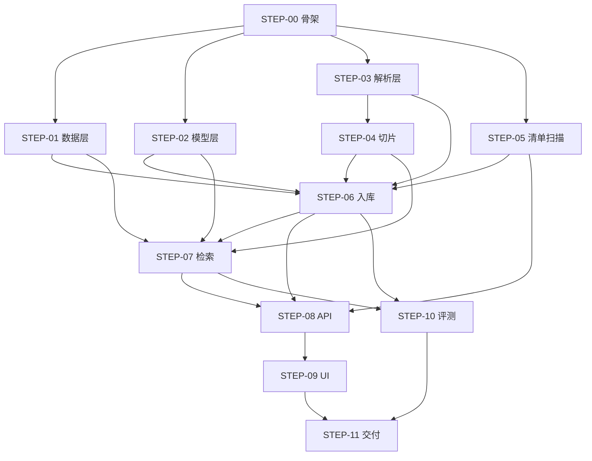
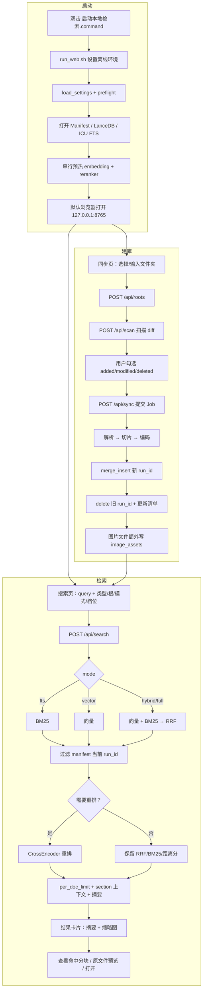

# 实施步骤总览

> 文档编号：DOC-01  
> 版本：1.2.0.dev0（稳定版 v1.1）  
> 日期：2026-10-24  
> 上游：[DOC-00 总体方案](00-总体方案.md)  
> 下游：`docs/steps/STEP-00 ~ STEP-11`  
> 用途：定义实施顺序、依赖、交付物、验收门槛；每一步的详细实现见对应 STEP 文档。

---

## 1. 实施原则

1. **先打通再优化**：先让“解析 → 切片 → 入库 → 检索”端到端跑通，再补 UI、评测、性能。
2. **每步可独立验收**：每步都有明确的命令/测试/页面，不把风险堆到最后。
3. **文档与代码同源**：每个模块 docstring 标注 STEP 编号；每步文档的“代码映射”表必须与真实文件/符号一致。
4. **API 先冻结再并行**：STEP-08 之前先冻结 `app/models.py` 的 DTO 与 API 契约，UI 可据此先行开发。
5. **不做隐性降级**：中文分词、离线、模型路径等关键配置必须在启动自检中显式校验，不允许“能跑但召回为 0”。

---

## 2. 步骤总表

| 步骤 | 名称 | 核心目标 | 主要交付物 | 依赖 | 预估 |
|---|---|---|---|---|---|
| [STEP-00](steps/STEP-00-项目骨架与环境校验.md) | 项目骨架与环境校验 | 可安装、可启动、可自检 | `pyproject.toml`、`app/config.py`、`app/preflight.py`、脚本 | — | 0.5d |
| [STEP-01](steps/STEP-01-数据层与索引.md) | 数据层与索引 | LanceDB 表、FTS(ICU)、健康检查 | `app/schema.py`、`app/db.py`、DB 测试 | STEP-00 | 0.5d |
| [STEP-02](steps/STEP-02-模型层.md) | 模型层 | BGE 向量 + 重排 + 预热/降级 | `app/embeddings.py`、`app/reranker.py` | STEP-00 | 0.5d |
| [STEP-03](steps/STEP-03-解析层.md) | 解析层 | 十类内容 → `ParsedDocument` | `app/parsing/*`、样本测试 | STEP-00 | 2.0d |
| [STEP-04](steps/STEP-04-切片层.md) | 切片层 | 结构感知 400/50 切片 + 偏移 | `app/chunking.py`、切片测试 | STEP-03 | 1.0d |
| [STEP-05](steps/STEP-05-清单与增量扫描.md) | 清单与增量扫描 | SQLite 清单、diff、根管理 | `app/manifest.py`、扫描测试 | STEP-00 | 1.0d |
| [STEP-06](steps/STEP-06-入库流水线.md) | 入库流水线 | 解析→切片→嵌入→写入→恢复 | `app/ingest.py`、`app/jobs.py`、CLI | STEP-01/02/03/04/05 | 1.5d |
| [STEP-07](steps/STEP-07-检索与重排.md) | 检索与重排 | hybrid + RRF + rerank + 去重 | `app/search.py`、检索测试 | STEP-01/02/04/06 | 1.5d |
| [STEP-08](steps/STEP-08-API层.md) | API 层 | 搜索/资料库/同步/系统 API | `app/api/*`、`app/models.py` | STEP-05/06/07 | 1.0d |
| [STEP-09](steps/STEP-09-Web-UI.md) | Web UI | 搜索/资料库/同步/设置四页 | `web/*` | STEP-08 | 1.5d |
| [STEP-10](steps/STEP-10-评测与基准.md) | 评测与基准 | 数据集、四组对比、报告 | `app/evaluation.py`、`scripts/benchmark.py` | STEP-06/07 | 1.0d |
| [STEP-11](steps/STEP-11-打包与验收.md) | 打包与验收 | 安装脚本、备份、验收清单 | `scripts/*`、`README.md` | 全部 | 0.5d |

> 预估为单人、熟悉 Python/检索栈的前提；不含模型下载等待时间。总计约 12.5 人日，建议按 3 周排期。

---

## 3. 依赖关系

**可并行窗口：**

- STEP-01 / STEP-02 / STEP-03 / STEP-05 在 STEP-00 完成后可并行；
- STEP-08 的 DTO 与路由可在 STEP-06/07 完成前先按契约写骨架；
- STEP-09 可在 STEP-08 契约冻结后、接口完成前用 mock 数据开发。

---

## 4. 里程碑

| 里程碑 | 完成条件 | 包含步骤 |
|---|---|---|
| M0 可跑通 | 十类文件可解析；DB 可建表；模型可编码/重排；切片有测试 | 00–04 |
| M1 可入库 | 扫描→勾选→同步→CLI 检索端到端；中断可恢复 | 05–07 |
| M2 可用 | 浏览器可搜索、看资料库、手动同步 | 08–09 |
| M3 可证明 | 评测报告 + 性能报告 + 失败案例 | 10 |
| M4 可交付 | 一键安装、模型校验、备份/恢复、验收清单 | 11 |

---

## 5. 每步完成定义（DoD）

所有步骤统一满足：

- [ ] 代码通过 `ruff check` 与 `mypy`（或至少无新增类型错误）；
- [ ] 新增模块有 docstring，首行标注 `Step: STEP-XX`；
- [ ] 新增行为有单元测试；测试可在无网络环境运行；
- [ ] 对应 STEP 文档的“实现状态/代码映射/验收记录”已更新；
- [ ] 提供一条可复制的验收入口命令；
- [ ] 不破坏前序步骤的验收项。

---

## 6. 风险检查点（Gate）

| Gate | 时点 | 检查内容 | 不通过的处理 |
|---|---|---|---|
| G1 | STEP-01 完成 | 中文 FTS：插入“混合检索”，查询必须命中；默认 `simple` 必须失败 | 检查 `base_tokenizer="icu"` 与 `create_index` 调用 |
| G2 | STEP-02 完成 | 查询向量 1024 维；20 条 400 字重排 < 600ms；模型缺失时快速失败 | 检查 `device="mps"`、绝对路径、`max_retries=1` |
| G3 | STEP-03 完成 | 十类样本全部能产出非空 `ParsedDocument`；扫描 PDF 有 OCR 文本 | 降级该类型为 warning，不阻塞其他类型 |
| G4 | STEP-07 完成 | 10 条人工 query 的 Top5 有人工判定相关结果 | 调整切片/检索参数，不进入 UI |
| G5 | STEP-10 完成 | Recall@10 与 nDCG 达标；延迟达标 | 记录差距，决定是否换 base reranker 或调 top_k |

---

## 7. 实施顺序建议

### 第 1 周：打通底层

| 天 | 工作 |
|---|---|
| D1 | STEP-00 + STEP-01；跑通建表、插入、中文 FTS 查询 |
| D2 | STEP-02；跑通查询编码、重排耗时、缺失模型快速失败 |
| D3–D4 | STEP-03；十类解析 + OCR，生成样本 fixtures |
| D5 | STEP-04；切片单测；用真实文档检查切片边界 |

### 第 2 周：入库与检索

| 天 | 工作 |
|---|---|
| D6 | STEP-05；扫描 diff、根管理、清单状态 |
| D7–D8 | STEP-06；批量入库、进度、失败恢复、CLI |
| D9–D10 | STEP-07；hybrid + rerank + 去重 + 上下文；10 条 query 人工验收 |

### 第 3 周：UI、评测、交付

| 天 | 工作 |
|---|---|
| D11–D12 | STEP-08；API + 任务轮询 + 错误码 |
| D13–D14 | STEP-09；四页 UI + 进度 + 高亮 |
| D15 | STEP-10；Downloads 样本评测 + 公开集冒烟 |
| D16 | STEP-11；安装脚本、备份、验收、README |

> 如果只能投入半天/天，优先顺序：STEP-00 → 01 → 02 → 03 → 04 → 06 → 07，先得到 CLI 可用版本；UI 与评测后置。

---

## 8. 状态跟踪

| 步骤 | 状态 | 完成日期 | 验收人 | 备注 |
|---|---|---|---|---|
| STEP-00 | 已完成 | 2026-10-21 | 实现 | 测试通过 |
| STEP-01 | 已完成 | 2026-10-21 | 实现 | 测试通过 |
| STEP-02 | 已完成 | 2026-10-21 | 实现 | 测试通过 |
| STEP-03 | 已完成 | 2026-10-21 | 实现 | 测试通过 |
| STEP-04 | 已完成 | 2026-10-21 | 实现 | 测试通过 |
| STEP-05 | 已完成 | 2026-10-21 | 实现 | 测试通过 |
| STEP-06 | 已完成 | 2026-10-21 | 实现 | 测试通过 |
| STEP-07 | 已完成 | 2026-10-21 | 实现 | 测试通过 |
| STEP-08 | 已完成 | 2026-10-21 | 实现 | 测试通过 |
| STEP-09 | 已完成 | 2026-10-21 | 实现 | 测试通过 |
| STEP-10 | 冒烟完成 | 2026-10-21 | 实现 | 5 条 query；正式评测待语料 |
| STEP-11 | 已完成 | 2026-10-21 | 实现 | 脚本/文档就绪 |

---

## 9. 文档更新规则

1. 每完成一步，更新该 STEP 文档顶部的“状态”和“验收记录”；
2. 若实现与设计不一致，先改文档再改代码，或在文档中记录“偏差说明”；
3. 代码文件新增/改名时，同步更新 [DOC-02](02-代码结构与追溯矩阵.md) 的模块表；
4. 任何影响 API/数据模型的变更，必须同步 DOC-00 的 §5/§10；
5. 步骤文档中的代码路径必须使用相对仓库根的真实路径，禁止写“待定”。

---

## 主流程图

