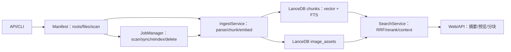

# 工程实现与代码映射

> 文档编号：DOC-06  
> 版本：1.2.0.dev0（稳定版 v1.1）  
> 日期：2026-10-24  
> 用途：把“需求 / 步骤文档 / 实际代码 / 测试”四层对应起来，作为维护和验收的索引。  
> 上游：[DOC-02 代码结构与追溯矩阵](02-代码结构与追溯矩阵.md)  
> 说明：本文以**当前真实代码**为准；DOC-02 保留设计级结构，本文提供实现级索引。

---

## 1. 实现状态总览

| 项 | 状态 |
|---|---|
| 核心检索链路 | ✅ 已实现 |
| 十类解析 + OCR | ✅ 已实现 |
| 增量扫描与手动同步 | ✅ 已实现 |
| 本地 Web UI | ✅ 已实现 |
| 自动化测试 | ✅ 176 个用例通过（2026-10-24 本机运行，记录见 `reports/evidence/test-run-v12.txt`） |
| 评测 | ✅ v1.1 基线 + v1.2 重建后 38 条 scoped；见 `reports/v1.2-acceptance.md` |
| 音视频 | ⬜ 未实现（预留 Parser 接口） |

---

## 2. 模块 → 代码符号 → 测试

### 2.1 基础设施

| 模块 | 文件 | 关键符号 | 步骤 | 测试 |
|---|---|---|---|---|
| 版本 | `app/__init__.py` | `__version__` | 00 | — |
| 入口 | `app/__main__.py` | `main` | 00/11 | 手工 |
| 配置 | `app/config.py` | `Settings`, `load_settings`, `_validate` | 00 | `test_config.py`（16） |
| 日志 | `app/logging_setup.py` | `setup_logging`, `redact_path` | 00 | `test_config.py::test_log_file_created` |
| 自检 | `app/preflight.py` | `run_preflight`, `PreflightReport`, `CheckItem` | 00 | `test_config.py::test_preflight_*` |
| ID/哈希 | `app/ids.py` | `make_doc_id`, `make_chunk_id`, `make_content_hash`, `sha256_file`, `escape_sql_literal` | 00/05 | `test_config.py::test_ids_stable`, `test_manifest.py::test_oversize_known_file_not_deleted` |

### 2.2 数据层

| 模块 | 文件 | 关键符号 | 步骤 | 测试 |
|---|---|---|---|---|
| Schema | `app/schema.py` | `build_chunk_model`, `EMBED_DIM` | 01 | `test_db.py::test_schema_fields` |
| DB | `app/db.py` | `connect_db`, `open_table`, `ensure_fts`, `health_check`, `db_stats`, `optimize` | 01 | `test_db.py`（11） |
| 异常 | `app/db.py` | `DBError`, `DBSchemaMismatch` | 01 | `test_db.py::test_dimension_mismatch` |

### 2.3 模型层

| 模块 | 文件 | 关键符号 | 步骤 | 测试 |
|---|---|---|---|---|
| 向量 | `app/embeddings.py` | `EmbeddingService`, `query_prompt`, `document_text`, `_load_model`, `ModelNotReady` | 02/P0 | `test_embeddings.py`（6） |
| 重排 | `app/reranker.py` | `RerankerService`, `RerankerUnavailable` | 02 | `test_reranker.py`（4） |

### 2.4 解析层

| 模块 | 文件 | 关键符号 | 步骤 | 测试 |
|---|---|---|---|---|
| 中间结构 | `app/parsing/base.py` | `ParsedBlock`, `ParsedDocument`, `ParseError`, `finalize_document` | 03 | 各解析测试 |
| 注册表 | `app/parsing/registry.py` | `get_parser`, `file_type_for`, `SUPPORTED_EXTENSIONS` | 03 | `test_parsing_text.py::test_unsupported_extension` |
| TXT/MD | `app/parsing/text_md.py` | `TextMarkdownParser`, `decode_bytes` | 03 | `test_parsing_text.py`（4） |
| PDF | `app/parsing/pdf.py` | `PdfParser` | 03 | `test_parsing_pdf.py`（8） |
| DOCX | `app/parsing/docx.py` | `DocxParser`, `_heading_level` | 03 | `test_parsing_office.py::test_docx` |
| PPTX | `app/parsing/pptx.py` | `PptxParser`, `_iter_shapes`, `_table_content`, `_chart_text` | 03 | `test_parsing_office.py`（11 个） |
| 图片 | `app/parsing/image_ocr.py` | `ImageParser`, `ocr_blob`, `image_to_png_bytes` | 03 | `test_ocr.py`（5） |
| OCR | `app/parsing/ocr.py` | `ocr_available`, `ocr_image`, `ocr_image_lines`, `ocr_image_bytes_lines` | 03 | `test_ocr.py`（5） |
| PDF 隔离 | `app/parsing/isolated.py` | `parse_pdf_isolated` | 03 | 手工崩溃隔离；`PARSER_CRASH` |
| 倾斜校正 | `app/parsing/deskew.py` | `estimate_skew`, `deskew_image` | 03 | `test_deskew.py`（1） |
| OCR 版面 | `app/parsing/ocr_layout.py` | `strip_repeated_margins`, `group_rows`, `table_candidates`, `order_lines_columns` | 03 | `test_ocr_layout.py`（2） |
| 表格结构 | `app/table_structure.py` | `TableStructureService`, `TableResult`, `TableCell` | 03 | `test_table_structure.py`（2） |

### 2.5 切片与清单

| 模块 | 文件 | 关键符号 | 步骤 | 测试 |
|---|---|---|---|---|
| 切片 | `app/chunking.py` | `ChunkDraft`, `chunk_document`, `_pack_spans`, `_split_table`, `_merge_short` | 04 | `test_chunking.py`（18） |
| 清单 | `app/manifest.py` | `Manifest`, `ScanDiff`, `RootRecord`, `FileRecord`, `ScanError` | 05 | `test_manifest.py`（11） |

### 2.6 入库与检索

| 模块 | 文件 | 关键符号 | 步骤 | 测试 |
|---|---|---|---|---|
| 入库 | `app/ingest.py` | `IngestService`, `IngestResult`, `IngestError` | 06 | `test_ingest.py`（17） |
| 任务 | `app/jobs.py` | `JobManager`, `Job`, `JobCancelled`, `is_active`, `submit_if_idle` | 06 | `test_jobs.py`（3）、`test_ingest.py::test_progress_and_cancel` |
| 写锁 | `app/locks.py` | `write_lock` | 06 | `test_ingest.py`（隐式） |
| 图片索引 | `app/image_index.py` | `build_asset_model`, `open_asset_table`, `ImageEmbeddingService` | P1 | `test_image_index.py`（3） |
| 检索 | `app/search.py` | `SearchService`, `SearchHit`, `SearchResult`, `SearchError` | 07 | `test_search.py`（17） |
| CLI | `app/cli.py` | `main`, `cmd_scan`, `cmd_index`, `cmd_search`, `cmd_status` | 06/07 | 手工 |

### 2.7 API / UI

| 模块 | 文件 | 关键符号 | 步骤 | 测试 |
|---|---|---|---|---|
| DTO | `app/models.py` | `SearchRequest`, `SearchResponse`, `SyncRequest`, `JobDTO` 等 | 08 | `test_api.py::test_search_validation` |
| 应用 | `app/api/app.py` | `create_app` | 08 | `test_api.py`（22） |
| 错误 | `app/api/errors.py` | `AppError`, `app_error_handler` | 08 | `test_api.py::test_open_outside_roots` |
| 搜索路由 | `app/api/routes_search.py` | `search` | 08 | `test_api.py::test_search` |
| 资料库路由 | `app/api/routes_library.py` | `library`, `document`, `document_preview`, `document_file`, `open_path`, `reindex` | 08 | `test_api.py::test_preview_pdf_page` |
| 同步路由 | `app/api/routes_sync.py` | `pick_folder`, `list_roots`, `add_root`, `remove_root`, `scan`, `sync` | 08 | `test_api.py::test_pick_folder_endpoint`、`test_remove_root_deletes_index` |
| 系统路由 | `app/api/routes_system.py` | `health`, `stats`, `shutdown` | 08 | `test_api.py::test_shutdown_*` |
| UI | `web/index.html`、`web/app.js`、`web/styles.css` | 搜索/资料库/同步/设置 | 09 | Playwright 手工冒烟 |

### 2.8 评测与脚本

| 模块 | 文件 | 关键符号 | 步骤 | 测试 |
|---|---|---|---|---|
| 指标 | `app/evaluation.py` | `recall_at_k`, `mrr_at_k`, `ndcg_at_k`, `evaluate`, `write_report` | 10 | `test_evaluation.py`（6） |
| 评测 CLI | `scripts/benchmark.py` | `main` | 10 | 手工 |
| P0 A/B | `scripts/ab_embedding.py` | `main` | P0 | 手工 |
| 编码基准 | `scripts/embed_bench.py` | `main` | P0 | 手工 |
| P1 档位基准 | `scripts/profile_bench.py` | `main` | P1 | 手工 |
| P2 规模化 | `scripts/scale_bench.py` | `main` | P2 | 手工 |
| 安装 | `scripts/setup_env.sh` | — | 11 | 手工 |
| 模型 | `scripts/download_models.sh` | — | 11 | 手工 |
| 启动 | `scripts/run_web.sh` | — | 11 | 手工 |
| Fixtures | `scripts/make_fixtures.py` | `main` | 03 | 测试间接使用 |

---

## 3. API 路由实现对照

| 方法 | 路径 | 实现函数 | DTO |
|---|---|---|---|
| GET | `/api/health` | `routes_system.health` | `HealthResponse` |
| GET | `/api/stats` | `routes_system.stats` | `StatsResponse` |
| POST | `/api/search` | `routes_search.search` | `SearchRequest/Response` |
| GET | `/api/library` | `routes_library.library` | `LibraryResponse` |
| GET | `/api/documents/{doc_id}` | `routes_library.document` | `DocumentDetail` |
| POST | `/api/open` | `routes_library.open_path` | `OpenRequest` |
| POST | `/api/pick-folder` | `routes_sync.pick_folder` | — |
| GET | `/api/documents/{doc_id}/preview` | `routes_library.document_preview` | — |
| GET | `/api/documents/{doc_id}/file` | `routes_library.document_file` | — |
| POST | `/api/reindex` | `routes_library.reindex` | `ReindexRequest` |
| GET | `/api/roots` | `routes_sync.list_roots` | `list[RootDTO]` |
| POST | `/api/roots` | `routes_sync.add_root` | `RootCreate/RootDTO` |
| DELETE | `/api/roots/{root_id}` | `routes_sync.remove_root` | — |
| POST | `/api/scan` | `routes_sync.scan` | `ScanRequest` |
| POST | `/api/sync` | `routes_sync.sync` | `SyncRequest` |
| GET | `/api/jobs/{job_id}` | `routes_sync.get_job` | `JobDTO` |
| POST | `/api/jobs/{job_id}/cancel` | `routes_sync.cancel_job` | — |
| POST | `/api/shutdown` | `routes_system.shutdown` | — |

---

## 4. 数据流图

## 5. 步骤文档 → 代码

| 步骤文档 | 主要代码 | 测试 |
|---|---|---|
| [STEP-00](steps/STEP-00-项目骨架与环境校验.md) | `config.py`、`ids.py`、`logging_setup.py`、`preflight.py`、`__main__.py` | `test_config.py` |
| [STEP-01](steps/STEP-01-数据层与索引.md) | `schema.py`、`db.py` | `test_db.py` |
| [STEP-02](steps/STEP-02-模型层.md) | `embeddings.py`、`reranker.py` | `test_embeddings.py`、`test_reranker.py` |
| [STEP-03](steps/STEP-03-解析层.md) | `parsing/*`、`scripts/make_fixtures.py` | `test_parsing_*`、`test_ocr.py` |
| [STEP-04](steps/STEP-04-切片层.md) | `chunking.py` | `test_chunking.py` |
| [STEP-05](steps/STEP-05-清单与增量扫描.md) | `manifest.py`、`ids.py` | `test_manifest.py` |
| [STEP-06](steps/STEP-06-入库流水线.md) | `ingest.py`、`jobs.py`、`cli.py` | `test_ingest.py` |
| [STEP-07](steps/STEP-07-检索与重排.md) | `search.py`、`cli.py` | `test_search.py` |
| [STEP-08](steps/STEP-08-API层.md) | `models.py`、`api/*` | `test_api.py` |
| [STEP-09](steps/STEP-09-Web-UI.md) | `web/*` | Playwright 手工 |
| [STEP-10](steps/STEP-10-评测与基准.md) | `evaluation.py`、`scripts/benchmark.py` | `test_evaluation.py` |
| [STEP-11](steps/STEP-11-打包与验收.md) | `scripts/*`、`README.md` | 手工 |

---

## 6. 测试清单（176）

| 测试文件 | 用例数 | 覆盖 |
|---|---|---|
| `test_config.py` | 16 | 配置、路径、ID、日志、自检 |
| `test_db.py` | 11 | 建表、ICU FTS、中文回归、维度 |
| `test_embeddings.py` | 6 | 查询指令、维度、缺失模型 |
| `test_reranker.py` | 4 | 分数、缺失模型、空输入 |
| `test_parsing_text.py` | 4 | Markdown、GB18030、损坏编码 |
| `test_parsing_pdf.py` | 8 | 文本 PDF、扫描 PDF、表格、损坏、加密 |
| `test_parsing_office.py` | 11 | DOCX/PPTX 结构 + 图片 OCR |
| `test_parsing_html.py` | 4 | HTML 标题/表格/代码/alt/正文容器 |
| `test_parsing_structured.py` | 3 | JSON/CSV/LOG |
| `test_ocr.py` | 5 | 中文 OCR、bbox、扫描版面、图片解析、小图跳过 |
| `test_table_structure.py` | 2 | Table Transformer 检测/结构/合并单元格 HTML |
| `test_ocr_layout.py` | 2 | 多栏阅读顺序/跨页页眉 |
| `test_deskew.py` | 1 | 倾斜页 deskew |
| `test_chunking.py` | 18 | 长度、重叠、页边界、表格、长行、上下文开关、确定性 |
| `test_manifest.py` | 11 | 增删改、恢复、超大文件不误删、嵌套根修复 |
| `test_ingest.py` | 17 | 幂等、更新、删除、失败隔离、取消、编码/merge 失败、类型落库、错误路径 |
| `test_jobs.py` | 3 | 任务状态、取消、active |
| `test_search.py` | 17 | 关键词、去重、上下文、scope、parent rerank、doc limit、doc level、metadata boost、显式失败 |
| `test_image_index.py` | 3 | 图片 asset 表、入库、删除、图片检索 |
| `test_api.py` | 22 | 健康、搜索、资料库、扫描同步、越界、auto scope |
| `test_evaluation.py` | 6 | 指标/加载/Chunk 标签/Anchors |
| `test_spotlight_candidates.py` | 2 | Spotlight 候选解析/状态分类 |

---

## 7. 运行期产物

| 路径 | 内容 | 是否提交 |
|---|---|---|
| `data/lancedb/` | LanceDB 数据 | 否 |
| `data/manifest.sqlite` | 文件清单 | 否 |
| `data/schema.json` | 模型/维度元数据 | 否 |
| `data/logs/app.log` | 日志 | 否 |
| `.models/` | 模型权重（~3.3GB） | 否 |
| `reports/` | 评测/验收报告与证据 | 否 |
| `tests/fixtures/` | 生成的测试样本 | 否 |
| `examples/eval-smoke.jsonl` | 冒烟评测集 | 是 |

---

## 8. 维护规则

1. 新增/改名代码文件时，同步更新本文 §2；
2. 新增 API 时，同步更新 §3 与 [DOC-00 §10](00-总体方案.md)；
3. 新增测试时，同步更新 §5 的计数与覆盖；
4. 代码模块 docstring 保留 `Step: STEP-xx` 与 `Doc: docs/steps/...`；
5. 以 `pytest --collect-only` 的实际数量为准，文档不写死未经核对的数字。
