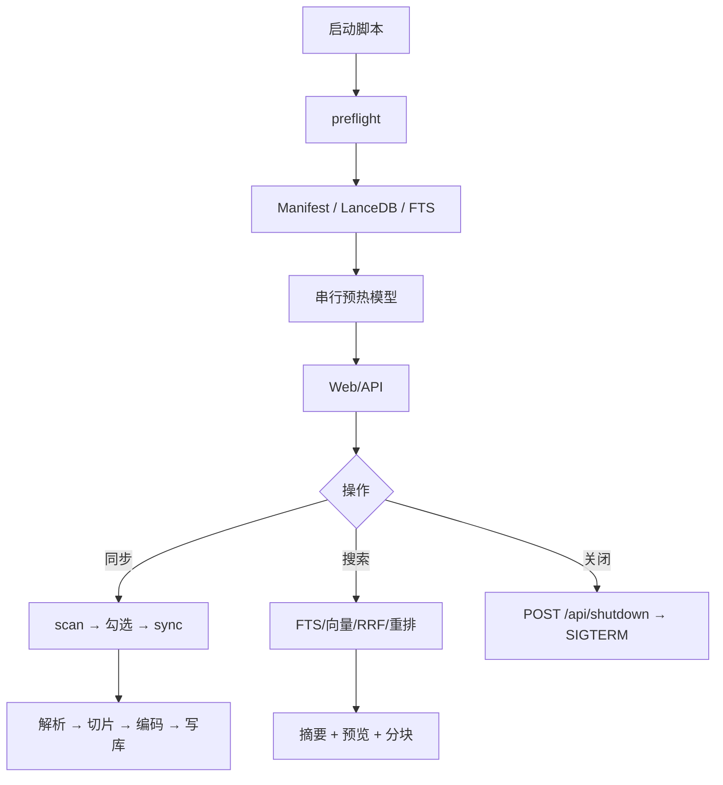

# 代码注释、日志与流程图规范

> 文档编号：DOC-13  
> 版本：1.2.0.dev0（稳定版 v1.1）  
> 日期：2026-10-24  
> 适用范围：`app/`、`scripts/`、`tests/`  
> 关联：[DOC-02 代码结构](02-代码结构与追溯矩阵.md) · [DOC-06 实现映射](06-工程实现与代码映射.md)

---

## 1. 文件头

每个 Python 文件开头必须说明：

```python
"""模块一句话职责。

Step: STEP-xx / P0-P2
Doc: docs/steps/STEP-xx-....md
输入：...
输出：...
"""
```

要求：

- 说明“这个文件负责什么、不负责什么”；
- 标注对应 STEP/优化阶段；
- 指向设计文档；
- 不写无意义的历史注释。

---

## 2. 类与字段

类 docstring 至少包含：

```python
class IngestService:
    """单文件入库流水线。

    负责：路径校验 → 解析 → 切片 → 编码 → 写 LanceDB → 更新清单。
    不负责：目录扫描（Manifest）、HTTP 路由（api/）、前端交互。

    Attributes:
        settings: 运行期配置。
        table: chunks LanceDB 表。
        manifest: SQLite 清单。
        embedder: 查询/文档编码服务。
        asset_table: 可选图片向量表。
    """
```

字段：

- Pydantic `Settings` 每个分组加行注释；
- dataclass 字段用行尾注释说明单位/含义；
- 枚举/状态值列出可选值；
- 不把实现细节写成字段注释。

---

## 3. 方法

每个公开方法必须有：

```python
def ingest_paths(
    self,
    paths: list[Path | str],
    *,
    progress: ProgressCB | None = None,
    cancel=None,
    force: bool = False,
) -> IngestResult:
    """入库一批文件（串行、带跨进程写锁）。

    Args:
        paths: 待入库文件路径；内部会去重、拒绝符号链接。
        progress: 可选进度回调 `(done, total, message)`。
        cancel: 可选取消事件，设置后抛 JobCancelled。
        force: 为 True 时忽略同 hash 跳过优化，强制重解析/重嵌入。

    Returns:
        IngestResult：total/indexed/failed/skipped/chunks/images/errors。

    Raises:
        JobCancelled: 用户取消。
        OSError: 写锁或文件系统不可用。
    """
```

私有方法：

- 至少一句话说明“做什么”；
- 参数多/有副作用时补 Args/Returns；
- 生成器说明 yield 什么。

---

## 4. 方法体关键代码

以下位置必须有行内注释：

| 位置 | 注释内容 |
|---|---|
| 路径 resolve / symlink 检查 | 为什么不能直接 resolve |
| 跨进程锁 | 锁文件位置、保护范围 |
| hash before/after | 防止解析期间文件变化 |
| merge/delete run_id | 为什么先插后删 |
| FTS ICU | 默认 simple 中文召回为 0 |
| RRF / 重排 | 两段式原因 |
| per_doc_limit | 多样性与回填上限 |
| 图片 asset | 为什么独立表、768 维 |
| 摘要 | 抽取式、去 Markdown、非生成 |
| 关闭服务 | 先响应再 SIGTERM |

不注释“显而易见的赋值”，只解释**为什么**和**边界条件**。

---

## 5. 日志规范

使用 `logging.getLogger(__name__)`，禁止 `print`（CLI 用户输出除外）。

级别：

| 级别 | 用途 |
|---|---|
| DEBUG | 查询文本、候选数、单文件细节 |
| INFO | 启动、模型加载、入库完成、扫描汇总、任务完成 |
| WARNING | 可恢复：OCR 失败、图片向量失败、重排不可用、空根 |
| ERROR | 请求失败、DB/写锁/删除失败 |

格式：

```python
logger.info("入库完成 path=%s chunks=%d images=%d duration_ms=%d", ...)
```

要求：

- 记录数量、耗时、路径、job_id；
- 不记录正文、密码、密钥；
- 异常用 `logger.exception` 保留堆栈；
- 同一错误只在一个层记录，避免刷屏。

---

## 6. 主流程图



各 STEP 的详细流程图见 `docs/steps/STEP-00 ~ STEP-11` 的“流程图”章节。

---

## 7. 检查清单

- [ ] 文件头有职责/Step/Doc；
- [ ] 类有职责与 Attributes；
- [ ] 公开方法有 Args/Returns/Raises；
- [ ] 关键分支有“为什么”注释；
- [ ] 关键路径有 INFO 日志与耗时；
- [ ] 文档中的符号/API/测试数已同步；
- [ ] `pytest` + `ruff` 通过。
