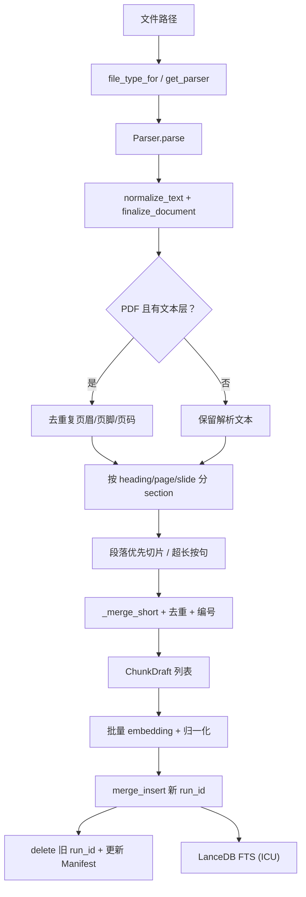

# 数据清洗、分块与向量化

> 文档编号：DOC-16  
> 版本：1.2.0.dev0（稳定版 v1.1）  
> 日期：2026-10-24  
> 范围：文件解析 → 清洗 → 分块 → 向量化 → 入库 → 检索  
> 关联：[DOC-00 总体方案](00-总体方案.md) · [DOC-06 实现映射](06-工程实现与代码映射.md) · DOC-14 历史记录

---

## 1. 总览

本系统是**确定性数据流水线**，不使用大模型改写正文：

```text
文件
  → Parser（PDF/DOCX/PPTX/TXT/MD/HTML/JSON/CSV/LOG/图片）
  → normalize_text / finalize_document
  → PDF 去页眉页脚
  → section 分组
  → 段落优先 / 句子回退 / 表格代码按行
  → ChunkDraft
  → BGE / Gemma 向量化
  → LanceDB chunks（vector + FTS）
  → Manifest 记录 run_id / 状态
```




## 1.1 术语与缩写

| 术语/缩写 | 全称或中文 | 在本项目中的含义 |
|---|---|---|
| **RAG** | Retrieval-Augmented Generation，检索增强生成 | 先检索证据，再交给 LLM 回答；当前项目只做检索层 |
| **Parser** | 解析器 | 把 PDF/DOCX/PPTX/TXT/MD/HTML/JSON/CSV/LOG/图片转成 `ParsedDocument` |
| **OCR** | Optical Character Recognition，光学字符识别 | 对扫描页、图片做文字识别；本机用 macOS Vision |
| **Chunk** | 文本块/切片 | 送去 embedding 和 FTS 的最小检索单元 |
| **Token** | 模型 token | 模型内部切分单位；中文 1 字约 1–2 token，不等同于字符 |
| **Embedding** | 向量化/嵌入 | 把文本映射成固定维度浮点向量 |
| **Vector** | 向量 | 例如 BGE 1024 维、Gemma 768 维 |
| **Dimension** | 维度 | 向量长度；维度越高不一定越好 |
| **Normalize** | 归一化 | 把向量缩放为单位长度，便于余弦/内积比较 |
| **Cosine / L2** | 余弦相似度 / 欧氏距离 | 向量相似度度量；本项目主要用归一化向量的距离/相似度 |
| **FTS** | Full-Text Search，全文检索 | 关键词倒排索引；本项目用 LanceDB 原生 FTS |
| **BM25** | Best Matching 25 | 经典关键词相关性打分，考虑词频、文档频率、长度 |
| **ICU** | International Components for Unicode | 中文分词器；LanceDB 默认 `simple` 对中文召回为 0 |
| **RRF** | Reciprocal Rank Fusion，倒数排名融合 | 把 FTS 和向量两路排名融合成一个排名 |
| **Bi-encoder** | 双塔编码器 | 查询和文档分别编码，速度快；BGE embedding 属于此类 |
| **Cross-encoder** | 交叉编码器 | query+passage 一起输入，精度高但慢；reranker 属于此类 |
| **Reranker** | 重排器 | 对初筛候选重新打分；本项目用 bge-reranker-large |
| **top_k** | 初筛数量 | 先取多少候选，默认 20 |
| **final_k** | 最终返回数 | 默认 5；不能大于 top_k |
| **Candidate** | 候选 | 初筛得到、尚未重排/截断的 chunk |
| **Context** | 上下文 | 命中 chunk 前后的同 section 内容，用于预览/摘要 |
| **Summary** | 摘要 | 本项目是从命中 chunk 抽取句子，不是 LLM 生成 |
| **Manifest** | 清单 | SQLite 记录根、文件状态、run_id、同步历史 |
| **run_id** | 运行 ID | 每次入库生成的 UUID，用于删除旧版本 |
| **Schema** | 表结构 | LanceDB 字段/维度/模型元数据；不一致会拒绝启动 |
| **LanceDB** | 向量数据库 | 本项目同时存 vector 和 FTS 的本地库 |
| **ANN** | Approximate Nearest Neighbor，近似最近邻 | HNSW/IVF 等加速索引；当前 10 万级仍用暴力扫描 |
| **HNSW / IVF** | 图索引 / 倒排聚类索引 | 大规模向量检索的 ANN 方案，当前未启用 |
| **MRL** | Matryoshka Representation Learning | 可截断的向量表示，Gemma 支持 128/256/512/768 |
| **bf16 / fp16** | Brain Float 16 / Float 16 | 半精度格式；Gemma 要求 bf16，禁止 fp16 |
| **MPS** | Metal Performance Shaders | Apple GPU 后端；本项目 macOS 上使用 |
| **qrels** | Query Relevance Judgments | 人工标注的 query→相关文档/段落 |
| **Bad case** | 失败案例 | 未召回、排序错、切片错、解析错等 |
| **Spotlight** | macOS 系统搜索 | 用 `mdfind` 做候选召回/查漏，不作为金标准 |
| **p50 / p95** | 50/95 分位延迟 | 一半/95% 请求的耗时上限；不是准确率指标 |

---

## 1.2 指标详解：Recall、MRR、nDCG

### 1.2.1 先定义评测对象

对一条 query：

- **相关集合** `R`：人工标注为相关的文档/段落，例如：
  ```text
  R = {A, B, C}
  ```
- **系统返回列表** `L`：按排名从 1 开始：
  ```text
  L = [A, D, E, B, F]
  ```
- **k**：只看前 k 个，例如 `k=5`。

本项目的 `app/evaluation.py` 会把相关文件路径转成 `doc_id`，再按 `doc_id` 计算文件级指标。

---

### 1.2.2 Recall@k（召回率）

**问题：相关的内容，系统找回来了多少？**

公式：

```text
Recall@k = |R ∩ L[:k]| / |R|
```

算例：

```text
R = {A, B, C}
L[:5] = [A, D, E, B, F]
召回 = {A, B} = 2 个
Recall@5 = 2 / 3 = 0.667
```

特点：

- 分母是“所有相关文档数”；
- 更关心“有没有漏”；
- 相关文档越多，单条 query 的 Recall 越难满分；
- 本项目报告里的 `Recall@5`、`Recall@10` 就是 k=5/10。

> 注意：Recall 高不代表排得好。把 3 个相关文档全塞进第 10 名，Recall@10 仍然是 1.0。

---

### 1.2.3 Precision@k（精确率）

**问题：返回的前 k 个里，有多少是相关的？**

公式：

```text
Precision@k = |R ∩ L[:k]| / k
```

算例：

```text
L[:5] = [A, D, E, B, F]
相关命中 = A、B
Precision@5 = 2 / 5 = 0.4
```

特点：

- 分母固定是 k；
- 更关心“返回结果干不干净”；
- 本项目报告目前以 Recall/MRR/nDCG 为主，Precision 未作为主表指标，但排障时很有用。

---

### 1.2.4 MRR@k（Mean Reciprocal Rank）

**问题：第一个相关结果排在第几名？**

单条 query：

```text
RR@k = 1 / rank_first_relevant
```

如果前 k 个里没有相关结果，`RR=0`。

算例：

```text
L = [A, D, E, B, F]
第一个相关是 A，rank=1
RR@5 = 1/1 = 1.0

L = [D, E, A, B]
第一个相关是 A，rank=3
RR@5 = 1/3 = 0.333
```

多条 query 取平均：

```text
MRR@k = mean(RR@k)
```

特点：

- 只看**第一个**相关结果；
- 对“第一条是否相关”非常敏感；
- 适合问答、导航型搜索；
- 不关心第二个、第三个相关结果排得怎样。

---

### 1.2.5 nDCG@k（Normalized Discounted Cumulative Gain）

**问题：相关结果是否排在前面？而且是否考虑了多个相关结果？**

nDCG 比 MRR 更细：

1. 每个位置有折扣（越靠后越不值钱）；
2. 多个相关结果都计入；
3. 支持分级相关性（0/1/2/3），不只 0/1。

公式：

```text
DCG@k = Σ (2^rel_i - 1) / log2(i + 1)
IDCG@k = 理想排序下的 DCG
nDCG@k = DCG@k / IDCG@k
```

其中：

- `i` 是排名，从 1 开始；
- `rel_i` 是第 i 个结果的相关等级；
- 本项目当前评测标签是二值相关（相关=1，不相关=0），所以：
  ```text
  DCG@k = Σ 1 / log2(i + 1)   （只对相关结果累加）
  ```

算例（二值）：

```text
相关：A、B
系统排序：A, X, B
DCG@3 = 1/log2(2) + 1/log2(4)
      = 1 + 0.5
      = 1.5

理想排序：A, B
IDCG@3 = 1/log2(2) + 1/log2(3)
       = 1 + 0.6309
       = 1.6309

nDCG@3 = 1.5 / 1.6309 ≈ 0.92
```

如果是分级标签：

```text
A=2（高度相关），B=1（部分相关）
DCG = (2^2-1)/log2(2) + (2^1-1)/log2(4)
    = 3 + 0.5 = 3.5
```

特点：

- 越相关的结果排得越前，分数越高；
- 多个相关结果都会被奖励；
- 对“第 1 名相关但第 2 名不相关”比 MRR 更敏感；
- 需要 qrels 里有相关性等级；当前项目按 0/1 计算。

---

### 1.2.6 三者怎么选

| 指标 | 关心什么 | 适合回答 |
|---|---|---|
| Recall@k | 有没有漏 | “相关文件找全了吗？” |
| Precision@k | 结果干不干净 | “前 k 条有多少噪声？” |
| MRR@k | 第一个相关排多前 | “用户第一条能不能用？” |
| nDCG@k | 整体排序质量 | “相关结果整体排得好不好？” |

推荐组合：

```text
Recall@10：先保证不漏
MRR@10：看首条体验
nDCG@10：看整体排序
p50/p95：看速度
```

---

### 1.2.7 本项目的指标读法

例如 38 条 query 的对比（早期 top_k=10/final_k=10 口径；最新 UI 口径见 STEP-10）：

| 配置 | Recall@5 | MRR@10 | nDCG@10 | p50 |
|---|---|---|---|---|
| baseline hybrid | 0.6636 | 0.5382 | 0.6016 | 26ms |
| new hybrid | **0.6943** | **0.6873** | **0.6877** | 26ms |

可以解读为：

- Recall@5 提升约 3.1 个点：前 5 条覆盖的相关文件更多；
- MRR@10 提升约 14.9 个点：第一个相关结果整体更靠前；
- nDCG@10 提升约 8.6 个点：整体排序更好；
- p50 基本不变：收益不是靠增加延迟换来的。

再如：

```text
baseline rerank  MRR=0.6481  nDCG=0.6451
new rerank       MRR=0.6202  nDCG=0.6526
```

这说明：

- nDCG 略升：整体排序略有改善；
- MRR 下降：第一条相关结果变差；
- 不能只看一个指标，要结合 Recall/MRR/nDCG 和业务场景。

---

### 1.2.8 指标使用的注意事项

1. **文件级 vs chunk 级**
   - 本项目当前主要按 `doc_id` 算文件级；
   - 同一个文件多个 chunk 只算一个文档命中；
   - 若要评估“命中段落”，需要 chunk 级 qrels。

2. **多相关文档**
   - 一个 query 有 3 个相关文档时，Recall 分母是 3；
   - 系统返回 1 个也可能 nDCG 不低，但 Recall 只有 1/3。

3. **重复文件/历史版本**
   - 历史版本和当前版本可能都算相关；
   - 也可能只应算一个；必须在 qrels 里明确。

4. **负样本/无答案 query**
   - 当前 `recall_at_k` 对空 relevant 返回 0；
   - 无答案 query 应单独统计“误报率”，不要混进 Recall 平均。

5. **样本量**
   - 6 条 query 只能做方向性验证；
   - 38 条仍是草稿，最好 50+ 且两人独立标注；
   - 指标差异小于 2–3 个点时，不要轻易下结论。

6. **延迟指标**
   - p50/p95 是耗时，不是准确率；
   - 冷启动、模型加载、首次查询要单独排除或标注。

---

---

## 2. 数据接入范围

| 类型 | 解析方式 | 说明 |
|---|---|---|
| `.md` / `.txt` | 文本解码 + Markdown 结构解析 | 标题/段落/表格/代码块 |
| `.pdf` | PyMuPDF 文本层；短文本页 OCR | 扫描 PDF 走 Vision OCR |
| `.docx` | python-docx | 段落、表格、内嵌图片 OCR |
| `.html/.htm` | lxml.html | 标题、段落、表格、代码、alt text |
| `.json` | json | 递归 key/value |
| `.csv` | csv | 表头 + 行 |
| `.log` | text | 按行日志 |
| `.pptx` | python-pptx | 标题、正文、表格、备注、组合形状 |
| 图片 | macOS Vision OCR | 独立图片；无文本则 `EMPTY_DOCUMENT` |

不在 v1：

- 音频/视频；
- HTML；
- ZIP/压缩包；
- DOCX/PPTX/PDF 内嵌图片的**图片向量**（仅 OCR 文本）。

---

## 3. 数据清洗

### 3.1 公共清洗

`app/parsing/base.py::normalize_text`：

1. `\r\n`、`\r` → `\n`；
2. 删除 `\x00`；
3. 每行 `rstrip`；
4. 整个块 `strip`。

`finalize_document`：

- 丢弃清洗后为空的 block；
- 重新计算 `char_start/char_end`；
- 用 `\n\n` 拼接全文；
- 没有标题时用文件名兜底。

### 3.2 PDF 去页眉页脚

代码：`app/parsing/pdf.py`

开关：`PDF_STRIP_HEADER_FOOTER=true`（默认）。

规则：

1. 用 `page.get_text("dict")` 读取每行文本 + bbox；
2. 顶部/底部各取页面高度 **8%**；
3. 同一行（数字归一化成 `#`）在至少 **30% 页面、至少 2 页**重复出现 → 页眉/页脚；
4. 页边纯页码直接删除：
   - `12`
   - `第 3 页`
   - `Page 3 of 10`
5. 只清理有文本层的页面；
6. 删除行数写入 `meta["header_footer_removed"]` 和 warning。

保守策略：

- 单页 PDF 不删除页眉，避免误删标题；
- 只在页边区域判断；
- 失败时回退原始文本。

> 扫描 PDF 的页眉页脚由 OCR 产生，本轮不清理。

### 3.3 OCR 清洗

- 低置信度行过滤：`OCR_MIN_CONFIDENCE`；
- 扫描 PDF：200dpi 渲染后 OCR；
- 文本层很短时 OCR；OCR 失败保留原文本层；
- 无文本的图片记为 `EMPTY_DOCUMENT`，不影响其他文件；
- DOCX 内嵌图片按段落/run 顺序 OCR，OCR block 插入当前位置并使用当前 `heading_path`；
- DOCX 表格单元格图片追加在 table block 之后；
- DOCX 同一 `rId` 只 OCR 一次；VML/浮动图片/文本框仍是限制；
- PPTX 按 slide → shapes（top/left 几何排序）→ notes 输出；文本框按 paragraph 拆；
- PPTX 表格输出 `表头/行` 结构，图表输出 `类别/系列` 文本；
- 表格超长行切分时每片保留表头和行键，续片加“（续）”，不产生表头单独 chunk；
- PPTX 图片 OCR 在形状位置，组合形状按 bbox 排序后深度优先展开；
- PPTX 图片占位符/背景图/备注图/alt text 也进入文本。

### 3.4 清洗阶段不做的事

- 不删除页眉页脚之外的重复段落；
- 不做停用词/词干化；
- 不做 OCR 模型纠错；
- 不做跨文件去重；
- 不让 LLM 改写/总结正文。

因此：

- 历史版本、副本、同名内容会各自入库；
- 扫描件 OCR 错字会原样进入索引；
- 页眉页脚只做保守清理。

---

## 4. 分块

代码：`app/chunking.py`

### 4.1 参数

| 配置 | 默认 | 含义 |
|---|---|---|
| `CHUNK_SIZE` | 400 | 目标块长（字符） |
| `CHUNK_OVERLAP` | 50 | 相邻块重叠 |
| `CHUNK_MIN` | 80 | 低于此值尝试合并 |
| `CHUNK_MAX` | 600 | 硬上限 |
| `CHUNK_ADAPTIVE` | true | 段落优先，段落 ≤ 上限不拆 |
| `MAX_CHUNKS_PER_DOC` | 5000 | 单文档截断 |

单位是**字符**，不是 token。

### 4.2 section 分组

```python
key = (heading_path, page, slide)
```

只合并**连续**且 key 相同的 block：

- 不同页不合并；
- 不同幻灯片不合并；
- 同一页不同标题不合并；
- `A → B → A` 不会被合成一个 A。

### 4.3 文本块

`CHUNK_ADAPTIVE=true`：

- 段落长度 ≤ `CHUNK_MAX`：整段作为一个 span；
- 段落 > `CHUNK_MAX`：按句切分；单句仍超长再硬切；
- 句子边界：`。！？!?；;`、换行、英文句号后空白。

`CHUNK_ADAPTIVE=false`：

- 旧行为：所有文本块先按句切，再按 400 字打包。

### 4.4 打包与 overlap

`_pack_spans`：

1. 按顺序把 span 放入 buffer；
2. 超过 `CHUNK_SIZE` 就 emit；
3. 从上一块末尾取最多 `CHUNK_OVERLAP` 字符作为下一块开头；
4. 如果 overlap + 新 span 超过 `CHUNK_MAX`，放弃 overlap；
5. 单句超过 `CHUNK_MAX` 时硬切。

关键点：

> overlap 只取上一块末尾最多 50 字，不能把整段长句全量重复带入。

### 4.5 表格和代码

- 表格按行切，每片重复首行表头；
- 代码按行切；
- 单行超过 `CHUNK_MAX` 时硬切；
- 所有块都必须 ≤ `CHUNK_MAX`。

### 4.6 短块合并

`_merge_short` 只在以下条件全部满足时合并：

- 上一块长度 < `CHUNK_MIN`；
- 合并后 ≤ `CHUNK_MAX`；
- 页码、幻灯片、标题、`source_kind` 相同。

### 4.7 去重与编号

去重键：

```text
(content_hash, heading, page, slide)
```

- 正文相同但标题/页码不同的块不会误删；
- 去重后按顺序重新赋 `chunk_index`；
- 超过 `MAX_CHUNKS_PER_DOC` 截断并写 warning。

### 4.8 Chunk 字段

```python
text          # heading + "\n" + body，供 FTS/向量
display_text  # body，供 UI/摘要
heading       # 标题路径，最多 120 字
page/slide    # 页码/幻灯片
char_start    # 在解析全文中的偏移
char_end
source_kind   # text/ocr/table/code
content_hash  # 正文哈希
chunk_index   # 文档内顺序
```

标题前缀只用于检索，不进入 `display_text`，避免预览重复。

---

## 5. 向量化

代码：`app/embeddings.py`

### 5.1 默认模型

| 项 | 默认 |
|---|---|
| 模型 | BGE-large-zh-v1.5 |
| 维度 | 1024 |
| provider | `bge` |
| dtype | `float32` |
| 设备 | `mps` |
| batch | 32 |
| 查询指令 | `为这个句子生成表示以用于检索相关文章：` |

### 5.2 EmbeddingGemma 2 可选

```bash
EMBED_PROVIDER=gemma
EMBED_MODEL=embeddinggemma-2
EMBED_DIM=768
EMBED_DTYPE=bfloat16
```

- 支持 MRL 128/256/512/768；
- 文本塔按需加载，不加载视觉/音频塔；
- bf16 可用，禁止 fp16；
- 查询前缀：

  ```text
  task: search result | query:
  ```

- 文档模板：

  ```text
  title: {title} | text: {content}
  ```

- 256 维适合纯文本、更小索引；图片语义必须 768。

### 5.3 编码

`encode_documents(texts, titles)`：

- 按 `EMBED_BATCH_SIZE` 分批；
- `normalize_embeddings=True`；
- 再在 numpy 层归一化一次；
- 返回 `float32` 向量。

`encode_query(query)`：

- 加 provider 查询前缀；
- 归一化；
- FTS-only 模式跳过编码，节省延迟。

### 5.4 图片向量

代码：`app/image_index.py`

启用条件：

```text
EMBED_PROVIDER=gemma
IMAGE_EMBED_ENABLED=1
EMBED_DIM=768
```

- 独立 `image_assets` 表；
- 768 维；
- 文本查询复用文本塔，视觉塔只建库；
- 结果 `score_kind=image`；
- 只支持独立图片文件。

---

## 6. 入库：向量与清单

代码：`app/ingest.py`

### 6.1 单文件流程

```text
拒绝 symlink
  → resolve
  → 校验根/大小
  → hash_before
  → parse
  → chunk
  → hash_after
  → hash 不一致 → FILE_CHANGED
  → mark_indexing
  → batch encode
  → merge_insert 新 run_id
  → delete 旧 run_id
  → mark_indexed
```

### 6.2 为什么先插后删

LanceDB 没有跨表事务。先写新 `run_id`，再删旧 `run_id`：

- 失败时最多有短暂多版本；
- 不会出现“旧数据已删、新数据没写入”的空档；
- 搜索按 Manifest 当前 `run_id` 过滤，避免读到混合版本。

### 6.3 Manifest

SQLite 记录：

- roots：索引根；
- files：路径、doc_id、size/mtime、doc_hash、status、chunk_count、run_id；
- sync_runs：每次同步历史。

扫描时：

- `pending/indexing/error` 视为需要重试；
- 根不存在、空根、遍历失败时保守跳过删除；
- 超限/无权限单文件记 error，不中止整个根。

---

## 7. 向量库与 FTS

代码：`app/db.py`、`app/schema.py`

### 7.1 chunks 表

- `vector`：固定维度；
- `text`：FTS + 向量输入；
- `run_id`：版本清理；
- `file_type/page/slide/heading`：过滤与上下文；
- `display_text`：UI；
- `meta_json`：解析 warning。

### 7.2 FTS

```python
create_index("text", config=FTS(base_tokenizer="icu"))
```

- LanceDB 0.40 已移除 Tantivy；
- 默认 `simple` 分词中文召回为 0；
- 必须 ICU；
- 检测到非 ICU 索引会自动 `replace=True` 重建。

### 7.3 schema 校验

`data/schema.json` 记录：

- embed_model；
- embed_provider；
- embed_dim；
- embed_query_prompt；
- embed_doc_template。

不一致时拒绝启动，避免“用 768 维查询 1024 维库”。

---

## 8. 检索阶段如何使用这些数据

代码：`app/search.py`

1. `fts`：BM25，不编码查询；
2. `vector`：向量检索；
3. `hybrid`：向量 + BM25 + RRF；
4. `full`：hybrid + CrossEncoder 重排；
5. `fast`：强制 hybrid，top_k ≤10，关闭重排。

结果：

- 按 Manifest 当前 `run_id` 过滤旧版本；
- `per_doc_limit` 控制单文档刷屏；
- 同 section 上下文扩展；
- 抽取式摘要；
- 图片命中追加；
- `score_kind` 区分 rrf/bm25/distance/rerank/image。

---

## 9. 当前验证结果

### 9.1 清洗与自适应切片

简历语料：

- chunks：174 → 167；
- 13 个 PDF 中 2 个触发页眉页脚清理，共删除 5 行；
- 38 条 query：

| 配置 | Recall@5 | MRR@10 | nDCG@10 |
|---|---|---|---|
| baseline hybrid | 0.6636 | 0.5382 | 0.6016 |
| new hybrid | **0.6943** | **0.6873** | **0.6877** |
| baseline rerank | 0.6702 | 0.6481 | 0.6451 |
| new rerank | **0.6789** | 0.6202 | **0.6526** |

> 上表是早期对比口径；2026-10-23 后默认改为 scope-aware auto（全局 full / 有 scope hybrid），详见 STEP-10。

- hybrid 提升明显；
- rerank 后 Recall/nDCG 略升，MRR 下降；
- 样本仍不是正式统计。

### 9.2 编码基准

| 项 | BGE | Gemma 文本塔 |
|---|---|---|
| 维度 | 1024 | 768 |
| 查询 p50 | 14.9ms | 18.9ms |
| 编码吞吐 | 165/s | 48/s |
| MPS 内存 | 1.3GB | 0.54GB |

### 9.3 10 万向量

| 维度 | top20 p50 | 索引大小 |
|---|---|---|
| 256 | 7.2ms | 98.3MB |
| 768 | 17.6ms | 293.6MB |

---

## 10. 已知限制

1. 扫描 PDF 的 OCR 页眉页脚不清理；
2. 多栏/旋转 PDF 的页眉页脚检测可能不准；
3. OCR 错字不做模型纠错；
4. HTML/ZIP 不支持；
5. 内嵌图片暂无图片向量；
6. 历史版本/副本会各自入库；
7. 自适应块变长，rerank 延迟上升；
8. 38 条 query 仍是草稿标签，需人工复核；
9. 现有索引不会自动应用新规则，需 `--force-all` 重建。

---

## 11. 代码索引

| 模块 | 文件 |
|---|---|
| 配置 | [app/config.py](../app/config.py) |
| 公共清洗 | [app/parsing/base.py](../app/parsing/base.py) |
| PDF | [app/parsing/pdf.py](../app/parsing/pdf.py) |
| DOCX/PPTX | [app/parsing/docx.py](../app/parsing/docx.py)、[app/parsing/pptx.py](../app/parsing/pptx.py) |
| 切片 | [app/chunking.py](../app/chunking.py) |
| 文本向量 | [app/embeddings.py](../app/embeddings.py) |
| 图片向量 | [app/image_index.py](../app/image_index.py) |
| 入库 | [app/ingest.py](../app/ingest.py) |
| 清单 | [app/manifest.py](../app/manifest.py) |
| LanceDB/FTS | [app/db.py](../app/db.py)、[app/schema.py](../app/schema.py) |
| 检索 | [app/search.py](../app/search.py) |

---

## 12. 复现与检查

```bash
# 检查配置
python -m app --check

# 重建某个根（应用新清洗/切片）
python -m app.cli index --root "/path/to/docs" --force-all

# 单条检索对比
python -m app.cli search "查询" --mode fts
python -m app.cli search "查询" --mode vector
python -m app.cli search "查询" --mode hybrid
python -m app.cli search "查询" --mode full

# 查看 chunk
curl "http://127.0.0.1:8765/api/documents/{doc_id}"

# 评测
python scripts/benchmark.py --dataset examples/eval-resume-38.jsonl \
  --configs hybrid,hybrid_rerank --top-k 10 --final-k 10
```
