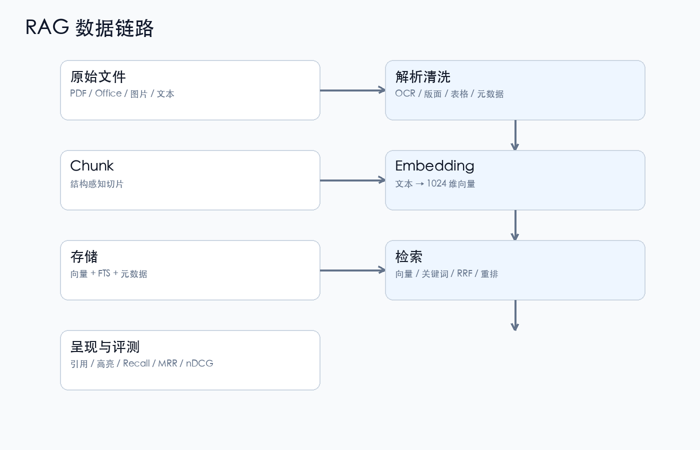

# 第 1 章 RAG 全局链路

## 一句话结论

RAG 的核心不是“让模型记住更多”，而是：

```text
在生成答案之前，先把相关证据找出来。
```

## 1.1 RAG 是什么

RAG = Retrieval-Augmented Generation，检索增强生成。

它由两个阶段组成：

```text
检索阶段：Query → 找证据
生成阶段：Query + 证据 → 答案
```

| 术语 | 解释 |
|---|---|
| Retriever | 检索器，负责找候选 |
| Generator | 生成器，通常是大语言模型 |
| Corpus | 语料库，全部被索引的文档 |
| Query | 用户查询 |
| Document | 原始文档 |
| Chunk | 文档切片，检索的基本单位 |
| Context | 交给生成模型的证据片段 |
| Grounding | 答案基于检索证据，而不是模型记忆 |
| Citation | 引用，标明答案来自哪份资料 |

> 初学者先记住：RAG 的第一目标是“找对”，第二目标才是“说好”。

## 1.2 完整链路



```text
原始文件
  ↓
解析 / OCR / 清洗
  ↓
结构化 block
  ↓
Chunk 切片
  ↓
Embedding 向量化
  ↓
向量库 + 全文索引 + 元数据
  ↓
Query 处理
  ↓
向量召回 + 关键词召回
  ↓
融合（RRF）
  ↓
重排（Rerank）
  ↓
过滤 / 去重 / 截断
  ↓
结果卡片 / 引用 / 表格预览
  ↓
（可选）LLM 生成答案
```

这条链路里，任何一层出问题，后面都很难补：

- 解析丢了表格，检索就找不到单元格；
- chunk 切断了句子，向量语义就不完整；
- 索引没有版本，新旧结果会混在一起；
- 只做向量召回，专有名词和编号容易漏；
- 不做评测，调参只能靠感觉。

## 1.3 召回和重排

### 召回阶段

目标：**不漏**。

常用方式：

- 向量检索：语义相似；
- 关键词检索：字面匹配；
- 混合检索：两路都取，再融合。

```text
Query
├── 向量检索 → Top 50
└── 关键词检索 → Top 50
        ↓
      RRF 融合
        ↓
     候选 Top 50
```

术语：

| 术语 | 解释 |
|---|---|
| Top-K | 取前 K 个候选 |
| Candidate | 候选结果 |
| Recall | 召回率，相关结果被找回来的比例 |
| RRF | Reciprocal Rank Fusion，倒数排名融合 |
| BM25 | 经典关键词相关性算法 |

### 重排阶段

目标：**排得准**。

CrossEncoder 把 `query + chunk` 一起输入模型，输出相关性分数。

```text
Top 50 候选
  → CrossEncoder 逐条打分
  → 取 Top 5
```

术语：

| 术语 | 解释 |
|---|---|
| Bi-Encoder | 查询和文档分别编码，速度快，适合召回 |
| Cross-Encoder | 查询和文档联合编码，精度高，适合重排 |
| Rerank | 对候选二次排序 |
| Latency | 延迟 |

> 进阶：rerank 不是永远正收益。候选很少、结果同质化时，重排可能把正确结果排后。必须用评测集验证。

## 1.4 RAG 不是什么

### 不是“把文档塞进 prompt”

上下文窗口有限，成本高，而且模型仍然可能忽略中间内容。

### 不是“接了向量库就完事”

向量库只解决候选生成。后面还有：

```text
过滤 → 融合 → 重排 → 去重 → 截断 → 呈现
```

### 不是“答案像就算对”

RAG 需要：

- 检索到正确证据；
- 答案忠于证据；
- 引用可追溯；
- 证据不足时能拒答。

## 1.5 用一个例子串起来

用户问：

```text
“这份简历里税前金额和发放日期是多少？”
```

系统做的事：

1. 解析 PDF/DOCX，保留表格结构；
2. 把薪酬表切成独立 chunk；
3. 用 embedding 和关键词同时召回；
4. 融合候选；
5. 重排，把薪酬表排到前面；
6. 返回表格 HTML、页码、置信度；
7. 如果接 LLM，把表格作为证据生成答案，并附引用。

如果第 1 步把表格当普通段落，第 2 步就会切碎；  
如果第 3 步只做向量，“税前金额”这种精确词可能不如关键词稳；  
如果第 5 步重排把错误文档排前，答案就会基于错误证据。

## 1.6 本项目的映射

当前工程采用：

```text
LanceDB：向量 + 标量 + FTS
BGE：embedding
BGE reranker：可选重排
Manifest：文件清单/版本
FastAPI + Web UI：本地交互
```

检索模式：

| 模式 | 含义 |
|---|---|
| `fts` | 纯关键词 |
| `vector` | 纯向量 |
| `hybrid` | 向量 + 关键词，RRF 融合 |
| `hybrid_rerank` | hybrid + 重排 |
| `full` | 完整候选 + 重排，偏精度 |

`auto` 策略：

```text
无 scope → full
有 scope → hybrid
```

这不是“拍脑袋”：项目评测里，scoped 场景下 full 的 rerank 曾造成排序下降，所以 scoped 默认用 hybrid。

## 1.7 检查清单

- [ ] 能否说清召回和重排的区别？
- [ ] 是否同时有向量和关键词两条路？
- [ ] 是否有版本/过滤机制？
- [ ] 是否能追溯答案来源？
- [ ] 是否有固定评测集？
- [ ] 是否记录了失败案例？

下一章进入数据清洗：检索质量的第一道门槛。
