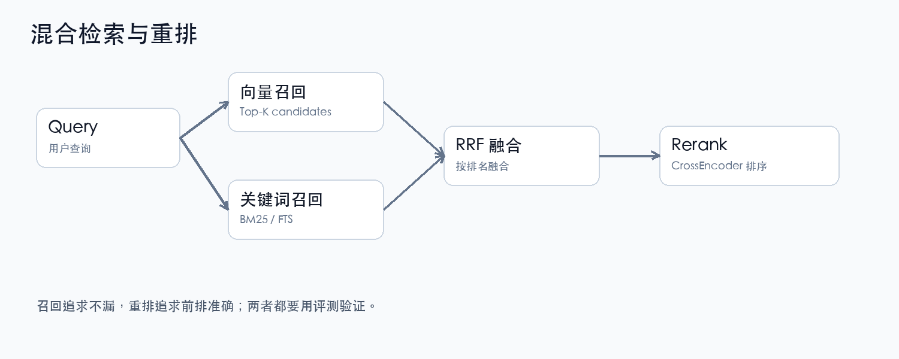

# 第 6 章 检索

## 一句话结论

检索不是“调一个 top_k”，而是：

```text
候选生成 → 融合 → 重排 → 过滤 → 去重 → 截断
```

每一层都影响最终结果。

## 6.1 检索模式

| 模式 | 含义 | 适合 |
|---|---|---|
| `fts` | 纯关键词 | 精确词、编号 |
| `vector` | 纯向量 | 语义相似 |
| `hybrid` | 向量 + 关键词融合 | 通用 |
| `hybrid_rerank` | hybrid + 重排 | 精度优先 |
| `full` | 完整候选 + 重排 | 离线/高精度 |

本项目 `auto`：

```text
无 scope → full
有 scope → hybrid
```

术语：

| 术语 | 解释 |
|---|---|
| Top-K | 取前 K 个候选 |
| Final-K | 最终返回数量 |
| Scope | 检索范围 |
| Candidate | 候选结果 |
| Auto | 自动选择模式 |

## 6.2 查询处理



常见：

- 归一化：大小写、空白、全半角；
- 同义词扩展；
- 多 query；
- 查询分解；
- HyDE：先生成假设答案。

术语：

| 术语 | 解释 |
|---|---|
| Query Rewriting | 查询改写 |
| Multi-Query | 多查询召回 |
| Query Decomposition | 查询分解 |
| HyDE | Hypothetical Document Embeddings |

不要一上来就上复杂改写。  
先保证基础召回和评测稳定。

## 6.3 RRF 融合

RRF = Reciprocal Rank Fusion。

```text
RRF(d) = Σ 1 / (k + rank_i(d))
```

- `rank_i(d)`：文档在第 i 路检索中的排名；
- `k`：平滑常数，常用 60。

优点：

- 不需要把 BM25 分数和向量距离强行归一化；
- 只看排名，稳健；
- 适合混合检索。

术语：

| 术语 | 解释 |
|---|---|
| RRF | Reciprocal Rank Fusion |
| Fusion | 多路融合 |
| Score Normalization | 分数归一化 |

## 6.4 重排

```text
召回 Top 50
→ CrossEncoder 对 query+chunk 打分
→ 取 Top 5
```

术语：

| 术语 | 解释 |
|---|---|
| Recall Stage | 召回阶段 |
| Rerank Stage | 重排阶段 |
| Cross-Encoder | 联合编码器 |
| Latency | 延迟 |

### 重要经验

```text
rerank 不是永远正收益。
```

本项目在 38 条 scoped 简历评测中观察到：

```text
固定候选/context：
no-rerank MRR 0.6509
rerank    MRR 0.5349
```

这不是说 rerank 没用，而是：

- scoped 候选同质化；
- rerank 可能把正确文件排后；
- 必须用业务评测验证。

## 6.5 去重与限额

### 去重

- 同文档相邻 chunk；
- 重复内容；
- 图片/文本重复。

### 每文档限额

```text
per_doc_limit
```

防止一个文档占满结果。

### doc-level

```text
一条结果 = 一个文档
```

适合“找文件”；chunk-level 适合“找段落”。

## 6.6 查询改写

常见策略：

- 同义词/缩写扩展；
- 多 query 召回后融合；
- 复杂问题拆子问题；
- 先检索再改写。

风险：

- 改写偏离原意；
- 延迟增加；
- 结果不可解释。

改写必须有评测，不然容易“看起来聪明，实际更差”。

## 6.7 失败分析

常见失败：

| 现象 | 可能原因 |
|---|---|
| 找不到 | 解析丢内容/chunk 切断/embedding 不匹配 |
| 找到了但排后 | rerank 负收益/融合权重 |
| 结果重复 | 去重不足/overlap 过大 |
| 结果太多 | top_k 过大/缺 scope |
| 结果为空 | 过滤过严/索引未更新 |
| 延迟高 | 候选过多/重排过多/冷启动 |

## 6.8 检查清单

- [ ] 是否有向量 + 关键词两路？
- [ ] 是否有融合策略？
- [ ] 是否评测过 rerank？
- [ ] 是否有 scope/过滤？
- [ ] 是否去重/限额？
- [ ] 是否记录延迟和失败？

下一章：结果呈现。
