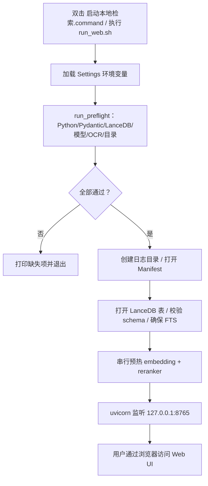

# STEP-00 项目骨架与环境校验

> 状态：已完成（2026-10-21）  
> 依赖：无  
> 预估：0.5 人日  
> 对应总方案：[DOC-00](../00-总体方案.md) §3、§11、§13  
> 对应代码：`pyproject.toml`、`app/config.py`、`app/logging_setup.py`、`app/preflight.py`、`app/__main__.py`  
> 验收命令：见 §7

---

## 1. 目标

建立一个**可安装、可配置、可自检**的最小工程骨架：

- 固定 Python 3.11 与依赖版本；
- 所有路径解析为绝对路径；
- 启动前能检查：模型是否存在、LanceDB 是否可导入、MPS 是否可用、OCR 是否可用、数据目录是否可写；
- 日志同时输出到控制台与 `data/logs/app.log`；
- 为后续 STEP 提供统一的 `Settings` 对象。

本步不实现业务逻辑，不建表、不加载模型。

---

## 2. 前置条件

- 已创建 `.venv`（Python 3.11）；
- 依赖已安装（或本步同时完成 `pyproject.toml`）；
- `.models/` 下模型已下载（可在本步只检查存在性）。

---

## 3. 交付物

### 3.1 代码文件

| 文件 | 内容 |
|---|---|
| `pyproject.toml` | 项目元数据、依赖、ruff/pytest 配置 |
| `.env.example` | 环境变量样例 |
| `.gitignore` | 排除 `.venv/.models/data/reports` |
| `app/__init__.py` | 版本号 `__version__` |
| `app/__main__.py` | `python -m app` 入口；`--check` 只跑自检 |
| `app/config.py` | `Settings`、`load_settings()` |
| `app/ids.py` | `sha256_text/file`、`make_doc_id`、`make_chunk_id`、`make_content_hash` |
| `app/logging_setup.py` | `setup_logging()` |
| `app/preflight.py` | `run_preflight()`、`PreflightReport` |
| `tests/test_config.py` | 配置/自检单测 |
| `tests/conftest.py` | 临时目录、设置 fixture |

### 3.2 文档/配置

- 更新 [DOC-02](../02-代码结构与追溯矩阵.md) §4 配置键（如新增）；
- 更新本文档 §8 验收记录。

---

## 4. 设计与实现要点

### 4.1 `pyproject.toml`

```toml
[project]
name = "local-content-search"
version = "1.2.0.dev0"
description = "macOS 本地内容混合检索系统"
requires-python = ">=3.11,<3.13"
dependencies = [
  "lancedb==0.40.0",
  "pydantic>=2.7.4,<3",
  "sentence-transformers==6.1.0",
  "torch==2.14.1",
  "transformers==5.20.2",
  "sentencepiece==0.2.2",
  "pymupdf==2.0",
  "python-docx==1.2.0",
  "python-pptx==1.0.2",
  "ocrmac==1.0.1",
  "pillow==13.0.0",
  "charset-normalizer==3.5.2",
  "fastapi==0.156.4",
  "uvicorn[standard]==0.54.0",
  "python-multipart",
]

[project.optional-dependencies]
dev = ["pytest>=8", "pytest-cov", "httpx", "ruff", "mypy"]

[project.scripts]
content-search = "app.cli:main"

[tool.ruff]
line-length = 100
target-version = "py311"

[tool.pytest.ini_options]
testpaths = ["tests"]
addopts = "-q"
```

> 不要把 `tantivy` 写进依赖。LanceDB 0.40 已移除 Tantivy FTS。

### 4.2 `Settings`（dataclass 或 pydantic BaseModel）

字段见 [DOC-02 §4](../02-代码结构与追溯矩阵.md#4-配置键)。实现要求：

- 所有路径 `Path(...).expanduser().resolve()`；
- `data_dir` 不存在时自动 `mkdir(parents=True, exist_ok=True)`；
- `models_dir` 不存在时**不自动创建**（避免掩盖模型缺失）；
- 环境变量覆盖默认值；非法值给出明确错误；
- 提供派生属性：`db_dir`、`manifest_path`、`log_dir`、`embed_model_path`、`rerank_model_path`、`web_dir`。

```python
@dataclass(frozen=True)
class Settings:
    host: str = "127.0.0.1"
    port: int = 8765
    data_dir: Path = Path("./data")
    models_dir: Path = Path("./.models")
    embed_model: str = "bge-large-zh-v1.5"
    rerank_model: str = "bge-reranker-large"
    device: str = "mps"
    chunk_size: int = 400
    chunk_overlap: int = 50
    top_k: int = 20
    final_k: int = 5
    # ... 其余见 DOC-02
```

### 4.3 日志

- 控制台：`INFO`；文件：`DEBUG`；
- `RotatingFileHandler`，单文件 10MB，保留 7 个；
- 格式：`时间 | 级别 | 模块 | 消息`；
- 提供 `redact_path(path)`，日志中长路径截断中间；
- 不记录正文内容。

### 4.4 自检 `run_preflight()`

| 检查 | 失败级别 | 说明 |
|---|---|---|
| Python ≥ 3.11 | error | 版本不符直接退出 |
| `pydantic.VERSION` 主版本 == 2 | error | 1.x 会 import 失败 |
| `import lancedb` 且版本 == 0.40.0 | error（版本 warn） | 版本不符警告但继续 |
| `.models/READY.json` 存在 | error | 提示运行下载脚本 |
| 向量模型 `pytorch_model.bin` > 1GB | error | 防止半截文件 |
| 重排模型 `pytorch_model.bin` > 1.5GB | error | XLM-R large 约 2.24GB |
| `data_dir` 可写 | error | 写入临时文件测试 |
| `torch.backends.mps.is_available()` | warn | 不可用则回退 CPU |
| `ocrmac` 可导入 | warn | 图片/扫描件能力降级 |
| `sentencepiece` 可导入 | error | XLM-R tokenizer 需要 |

返回值：

```python
@dataclass
class CheckItem:
    name: str
    ok: bool
    level: Literal["error", "warn"]
    message: str
    hint: str = ""

@dataclass
class PreflightReport:
    ok: bool
    items: list[CheckItem]
```

`python -m app --check` 打印表格并以非零码退出（有 error 时）。

### 4.5 启动入口

```bash
python -m app --check     # 只自检
python -m app             # STEP-08 后启动 Web；此前提示未实现
```

STEP-00 阶段 `python -m app` 可只打印自检结果并退出，避免提前引入 FastAPI 依赖。

---

## 5. 接口/契约

| 符号 | 签名 | 说明 |
|---|---|---|
| `load_settings` | `(env: Mapping[str,str] \| None = None) -> Settings` | 便于测试注入 |
| `setup_logging` | `(settings: Settings) -> None` | 幂等 |
| `run_preflight` | `(settings: Settings) -> PreflightReport` | 不抛异常，返回报告 |

---

## 6. 代码映射

| 文件 | 符号 | 说明 | 测试 |
|---|---|---|---|
| `app/config.py` | `Settings`, `load_settings` | 配置加载 | `tests/test_config.py::test_paths_are_absolute` |
| `app/ids.py` | `sha256_file`, `make_doc_id`, `make_chunk_id` | 稳定 ID | `tests/test_config.py::test_ids_stable` |
| `app/logging_setup.py` | `setup_logging` | 日志 | `tests/test_config.py::test_log_file_created` |
| `app/preflight.py` | `run_preflight`, `PreflightReport` | 自检 | `tests/test_config.py::test_missing_model_fails` |
| `app/__main__.py` | `main` | CLI 入口 | 手工 |

---

## 7. 测试与验收

### 7.1 单元测试

```bash
.venv/bin/python -m pytest tests/test_config.py -q
```

覆盖：

- 相对路径被解析为绝对路径；
- `DATA_DIR` 环境变量生效；
- 非法端口抛 `ValueError`；
- 模型缺失时 `run_preflight().ok is False`；
- 日志文件创建成功。

### 7.2 手工验收

```bash
.venv/bin/python -m app --check
```

期望输出包含：

```text
[OK]    python            3.11.x
[OK]    pydantic          2.x
[OK]    lancedb           0.40.0
[OK]    embed_model       .models/bge-large-zh-v1.5 (1.3GB)
[OK]    rerank_model      .models/bge-reranker-large (2.24GB)
[OK]    data_dir          writable
[OK]    mps               available
[OK]    ocr               available
```

### 7.3 验收记录

| 日期 | 执行人 | 结果 | 备注 |
|---|---|---|---|
| 2026-10-21 | 实现 | 通过 | 自动化测试通过 |

---

## 8. 风险与备注

| 风险 | 处理 |
|---|---|
| 用户系统默认 pydantic 1.x | 强制 venv；自检报错并提示 |
| 模型半截文件 | 检查文件大小 + `READY.json` |
| MPS 不可用 | 警告并回退 CPU，不阻塞启动 |
| OCR 依赖缺失 | 警告；图片/扫描 PDF 标记为不可用，其他类型正常 |

---

## 9. 完成定义（DoD）

- [ ] `pip install -e ".[dev]"` 成功；
- [ ] `python -m app --check` 全绿；
- [ ] `pytest tests/test_config.py` 通过；
- [ ] 本文档 §7.3 已填写；
- [ ] 未引入业务逻辑与模型加载。


---

## 流程图


