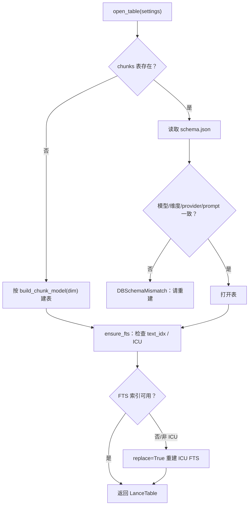

# STEP-01 数据层与索引

> 状态：已完成（2026-10-21）  
> 依赖：[STEP-00](STEP-00-项目骨架与环境校验.md)  
> 预估：0.5 人日  
> 对应总方案：[DOC-00](../00-总体方案.md) §5、§7.1、§7.6  
> 对应代码：`app/schema.py`、`app/db.py`、`tests/test_db.py`  
> 验收命令：见 §7

---

## 1. 目标

建立 LanceDB 数据层，确保：

- `chunks` 表结构稳定，`vector` 与 `text` 绑定；
- FTS 使用 **ICU 分词**，中文关键词可命中；
- 表/索引不存在时可自动创建；
- 维度/模型变化时能检测并拒绝启动；
- 提供统计与 optimize 能力。

本步不实现入库与检索业务，只提供可测试的 DB 能力。

---

## 2. 前置条件

- STEP-00 完成；
- 已安装 `lancedb==0.40.0`、`pydantic>=2.7`；
- 测试环境不需要真实 BGE 模型（用 Fake Embedding Function）。

---

## 3. 交付物

| 文件 | 内容 |
|---|---|
| `app/schema.py` | `EMBED_DIM=1024`、`build_chunk_model(func)`、字段常量 |
| `app/db.py` | 连接、建表、FTS、健康检查、统计、optimize |
| `tests/conftest.py` | `fake_embedding_function`、`temp_db` fixtures |
| `tests/test_db.py` | 建表/FTS/中文召回/维度校验测试 |
| `data/schema.json` | 运行期生成：`{"chunks":1,"embed_dim":1024,"embed_model":"..."}` |

---

## 4. 设计与实现要点

### 4.1 Schema

```python
EMBED_DIM = 1024

def build_chunk_model(func):
    class Chunk(LanceModel):
        id: str
        doc_id: str
        root_id: int
        chunk_index: int
        text: str = func.SourceField()
        vector: Vector(EMBED_DIM) = func.VectorField()
        display_text: str
        file_name: str
        file_path: str
        file_type: str
        title: str
        heading: str
        page: int
        slide: int
        char_start: int
        char_end: int
        content_hash: str
        doc_hash: str
        run_id: str
        indexed_at: float
        source_kind: str
        meta_json: str
    return Chunk
```

要求：

- `func` 为 `SentenceTransformerEmbeddings` 实例；
- `text` 必须用 `func.SourceField()`，`vector` 必须用 `func.VectorField()`；
- **不要**写 `Vector(1024, source="text")`（0.40 无此参数）；
- 类在函数内动态创建，避免 import 时加载模型；
- 所有字符串字段默认非空；`heading/page/slide` 允许空串/0。

### 4.2 连接

```python
def connect_db(settings) -> lancedb.DBConnection:
    settings.db_dir.mkdir(parents=True, exist_ok=True)
    return lancedb.connect(str(settings.db_dir))
```

异常处理：

- 目录不可写 → `DB_NOT_READY`，提示路径与权限；
- LanceDB 版本不匹配 → 日志警告；
- 不在此处加载模型。

### 4.3 建表/开表

```python
def open_table(db, settings, func) -> LanceTable:
    Chunk = build_chunk_model(func)
    if settings.table_name in set(db.list_tables().tables):
        table = db.open_table(settings.table_name)
        _check_schema(table, settings)
    else:
        table = db.create_table(settings.table_name, schema=Chunk)
        _write_schema_meta(settings)
    ensure_fts(table)
    return table
```

`_check_schema` 校验：

- `vector` 字段存在且 `fixed_size_list` 长度为 `EMBED_DIM`；
- 必要字段齐全；
- `data/schema.json` 中的 `embed_model` 与当前配置一致；
- 不一致时抛 `DB_SCHEMA_MISMATCH`，提示“换模型需重建库”。

### 4.4 FTS（必须照抄）

```python
from lancedb.index import FTS

def ensure_fts(table) -> None:
    for idx in table.list_indices():
        if idx.index_type == "FTS":
            return
    table.create_index(
        "text",
        config=FTS(
            base_tokenizer="icu",
            lower_case=True,
            stem=False,
            remove_stop_words=False,
            ascii_folding=False,
        ),
    )
```

**注意：**

- `create_index` 的列名是第一个位置参数；
- 写成 `table.create_index(config=FTS(...))` 会把默认 `metric="l2"` 当成列名，报 `Field path 'l2' not found`；
- 不要传 `use_tantivy=True`，会抛 `ValueError: Tantivy-based FTS has been removed`；
- 0.40 的 `create_fts_index` 已弃用，保留只为兼容，不要使用。

### 4.5 健康检查

```python
def health_check(table) -> dict:
    return {
        "chunks": table.count_rows(),
        "fts_index": any(i.index_type == "FTS" for i in table.list_indices()),
        "vector_dim": _vector_dim(table.schema),
        "table": table.name,
    }
```

启动时若 FTS 缺失：

- 空表：直接创建；
- 有数据：`replace=True` 重建，记录耗时；
- 失败：`FTS_NOT_READY`，阻止进入搜索页。

### 4.6 统计与优化

```python
def db_stats(settings, table) -> dict:
    return {
        "chunks": table.count_rows(),
        "docs": table.count_rows("doc_id IS NOT NULL"),  # 近似
        "db_size_mb": du(settings.db_dir) / 1024 / 1024,
        "indices": [{"name": i.name, "type": i.index_type} for i in table.list_indices()],
    }

def optimize(table) -> None:
    table.optimize()   # compaction；可在批量同步后调用
```

> `count_rows("doc_id IS NOT NULL")` 不是去重计数；精确文档数由 manifest 提供（STEP-05）。此处只做近似。

### 4.7 启动自检（中文 FTS）

在 `tests/test_db.py` 中固化一个**回归测试**：

1. 插入 3 条中文；
2. 建 ICU FTS；
3. 查询“混合检索”，断言命中；
4. （可选）用 `simple` 建索引，断言查询为空，证明必须用 ICU。

生产启动不插入测试数据；只检查索引存在。

---

## 5. 接口/契约

| 符号 | 签名 | 说明 |
|---|---|---|
| `EMBED_DIM` | `1024` | 向量维度 |
| `build_chunk_model` | `(func) -> type[LanceModel]` | 动态 schema |
| `connect_db` | `(settings) -> DBConnection` | 建目录/连接 |
| `open_table` | `(db, settings, func) -> LanceTable` | 开/建表 + FTS |
| `ensure_fts` | `(table) -> None` | 幂等创建 |
| `health_check` | `(table) -> dict` | 健康信息 |
| `optimize` | `(table) -> None` | compaction |

---

## 6. 代码映射

| 文件 | 符号 | 说明 | 测试 |
|---|---|---|---|
| `app/schema.py` | `EMBED_DIM`, `build_chunk_model` | 表结构 | `tests/test_db.py::test_schema_fields` |
| `app/db.py` | `connect_db` | 连接 | `test_db.py::test_connect_creates_dir` |
| `app/db.py` | `open_table` | 建表/开表 | `test_db.py::test_open_table_idempotent` |
| `app/db.py` | `ensure_fts` | FTS | `test_db.py::test_chinese_fts_icu` |
| `app/db.py` | `health_check` | 健康 | `test_db.py::test_health_check` |
| `app/db.py` | `optimize` | 压缩 | `test_db.py::test_optimize_smoke` |

---

## 7. 测试与验收

### 7.1 单元测试

```bash
.venv/bin/python -m pytest tests/test_db.py -q
```

覆盖：

- 建表字段与类型正确；
- 重复 `open_table` 不报错；
- ICU FTS 中文查询命中；
- 查询 `LanceDB` 等拉丁词命中；
- `health_check` 返回 `fts_index=True`；
- 维度不匹配时抛 `DB_SCHEMA_MISMATCH`。

### 7.2 冒烟脚本

```bash
.venv/bin/python - <<'PY'
from app.config import load_settings
from app.db import connect_db, open_table, health_check
from tests.conftest import make_fake_func

s = load_settings()
db = connect_db(s)
t = open_table(db, s, make_fake_func())
print(health_check(t))
PY
```

期望：

```text
{'chunks': 0, 'fts_index': True, 'vector_dim': 1024, 'table': 'chunks'}
```

### 7.3 验收记录

| 日期 | 执行人 | 结果 | 备注 |
|---|---|---|---|
| 2026-10-21 | 实现 | 通过 | 自动化测试通过 |

---

## 8. 风险与备注

| 风险 | 处理 |
|---|---|
| `create_index` 双签名坑 | 固定 `create_index("text", config=FTS(...))` |
| 默认分词器中文 0 召回 | 强制 ICU；测试固化 |
| 已有表缺 FTS | 启动时 `replace=True` 重建 |
| 换模型维度不符 | `schema.json` 校验，提示重建 |
| `optimize()` 期间查询变慢 | 放在同步任务末尾，非高峰期执行 |

---

## 9. 完成定义（DoD）

- [ ] 空库可自动建表 + FTS；
- [ ] 中文/英文 FTS 冒烟通过；
- [ ] `test_db.py` 全绿；
- [ ] `health_check` 可被 STEP-08 直接复用；
- [ ] 本文档 §7.3 已填写。


---

## 流程图


