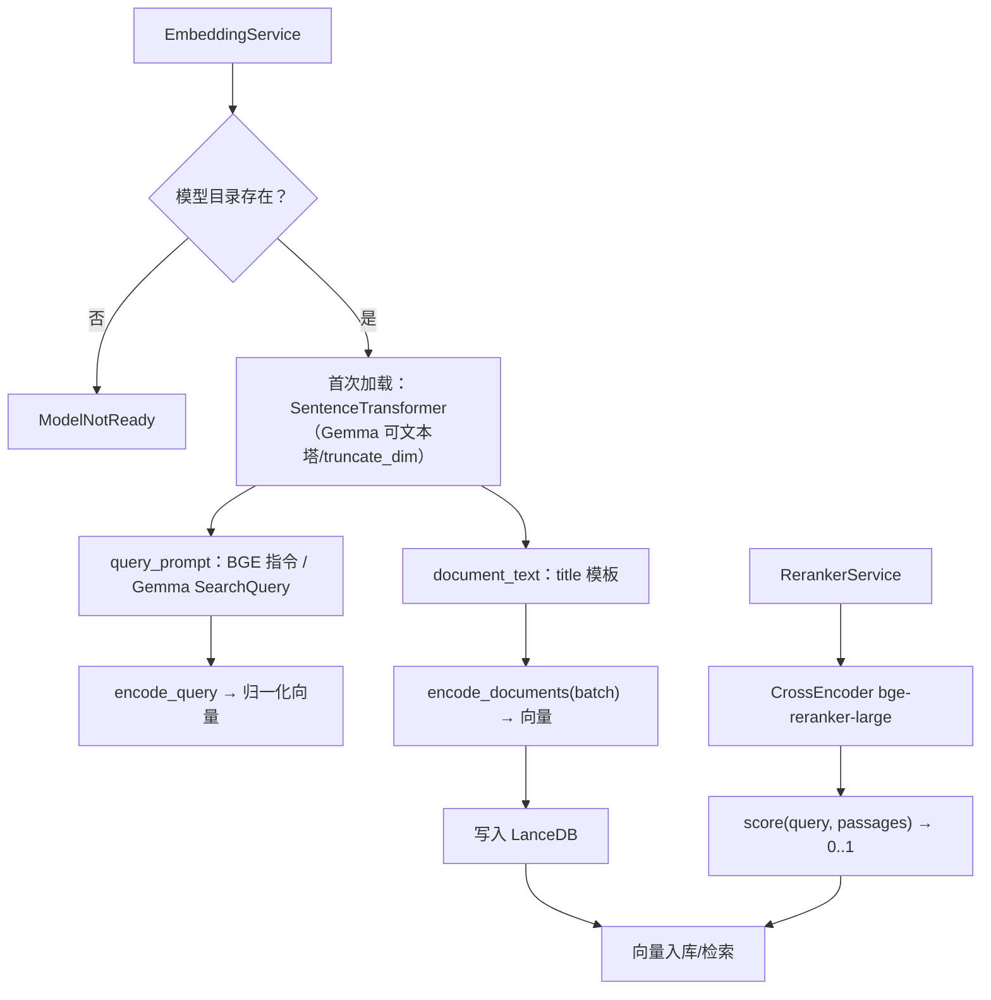

# STEP-02 模型层

> 状态：已完成（2026-10-21）  
> 依赖：[STEP-00](STEP-00-项目骨架与环境校验.md)  
> 预估：0.5 人日  
> 对应总方案：[DOC-00](../00-总体方案.md) §3、§7.2、§7.3、§7.6  
> 对应代码：`app/embeddings.py`、`app/reranker.py`、`tests/test_embeddings.py`  
> 验收命令：见 §7

---

## 1. 目标

封装两个本地模型，提供稳定、可测、失败显式的服务接口：

- `bge-large-zh-v1.5`：1024 维，查询侧加 BGE 指令，文档侧不加；
- `bge-reranker-large`：对 `(query, passage)` 打分，输出 0–1；
- 懒加载 + 预热 + 线程锁；
- 模型缺失/加载失败时**快速失败**，不触发 HuggingFace 长退避；
- 不依赖 LanceDB 的查询路径也能独立测试。

---

## 2. 前置条件

- `.models/bge-large-zh-v1.5` 与 `.models/bge-reranker-large` 已下载；
- 已安装 `torch`、`sentence-transformers`、`sentencepiece`；
- 本机 MPS 可用（不可用回退 CPU）。

---

## 3. 交付物

| 文件 | 内容 |
|---|---|
| `app/embeddings.py` | `EmbeddingService`、`QUERY_INSTRUCTION`、`ModelNotReady` |
| `app/reranker.py` | `RerankerService`、`RerankerUnavailable` |
| `tests/test_embeddings.py` | 维度/归一化/指令/缺失路径测试 |
| `tests/test_reranker.py` | 分数范围/失败测试 |

---

## 4. 设计与实现要点

### 4.1 Embedding 函数创建（关键 API）

```python
from lancedb.embeddings import get_registry

func = get_registry().get("sentence-transformers").create(
    name=str(settings.embed_model_path),   # 绝对路径
    device=settings.device,                # "mps"
    normalize=True,
    trust_remote_code=False,
    max_retries=1,                         # 路径错时立即失败
)
```

**不要**：

- 用相对路径（换工作目录后会触发 HF 7 次重试，3s→110s）；
- 省略 `device`（默认 `cpu`，慢 5–10 倍）；
- 在模块 import 时调用 `func.ndims()`（会立即加载模型）。

### 4.2 查询指令

BGE 官方建议短查询加：

```python
QUERY_INSTRUCTION = "为这个句子生成表示以用于检索相关文章："
```

- **只加在 query 侧**；文档侧不加；
- 是否加指令应通过评测对比决定，默认开启；
- 自定义 `compute_query_embeddings` 或直接对 query 字符串拼接。

### 4.3 `EmbeddingService`

```python
class EmbeddingService:
    def __init__(self, settings: Settings):
        self.settings = settings
        self._func = None
        self._lock = threading.Lock()

    @property
    def func(self):
        with self._lock:
            if self._func is None:
                self._func = create_func(self.settings)
            return self._func

    @property
    def model(self):
        return self.func.embedding_model      # 底层 SentenceTransformer

    def warmup(self) -> None:
        self.encode_documents(["预热文本"])

    def encode_query(self, query: str) -> np.ndarray:
        text = QUERY_INSTRUCTION + query
        vec = self.model.encode(
            [text],
            batch_size=1,
            normalize_embeddings=True,
            convert_to_numpy=True,
            show_progress_bar=False,
        )[0]
        return vec.astype(np.float32)

    def encode_documents(self, texts: list[str]) -> list[list[float]]:
        if not texts:
            return []
        arr = self.model.encode(
            texts,
            batch_size=self.settings.embed_batch_size,
            normalize_embeddings=True,
            convert_to_numpy=True,
            show_progress_bar=False,
        )
        return arr.astype(np.float32).tolist()

    def health(self) -> dict:
        return {"ready": self._func is not None,
                "path": str(self.settings.embed_model_path),
                "device": self.settings.device,
                "dim": 1024}
```

要求：

- `encode_documents` 内部按 `embed_batch_size` 分批；异常包装为 `ModelNotReady`；
- 返回 `float32`，避免 pyarrow 推断成 float64；
- 线程锁只保护加载，不保护 encode（单 worker 调用）；
- 预热在 lifespan 中同步执行；避免 auto 全局首查与 MPS 初始化竞态。

### 4.4 `RerankerService`

```python
class RerankerService:
    def __init__(self, settings):
        self.settings = settings
        self._model = None
        self._lock = threading.Lock()

    @property
    def model(self):
        with self._lock:
            if self._model is None:
                from sentence_transformers import CrossEncoder
                self._model = CrossEncoder(
                    str(self.settings.rerank_model_path),
                    device=self.settings.device,
                    max_length=512,
                    local_files_only=True,
                    trust_remote_code=False,
                )
            return self._model

    def score(self, query: str, passages: list[str]) -> np.ndarray:
        if not passages:
            return np.array([], dtype=np.float32)
        try:
            out = self.model.predict(
                [[query, p] for p in passages],
                batch_size=self.settings.rerank_batch_size,
                show_progress_bar=False,
            )
        except Exception as e:
            raise RerankerUnavailable(str(e)) from e
        return np.clip(np.asarray(out, dtype=np.float32), 0.0, 1.0)
```

说明：

- `bge-reranker-large` 是 XLM-R large（560M），权重 2.24GB；
- `sentence-transformers` 对单标签 CrossEncoder 默认已做 sigmoid，实测输出 0–1；仍做 clip 兜底；
- 不在此层做排序/去重，只返回分数；
- 失败抛 `RerankerUnavailable`，SearchService 转换为 `RERANK_FAILED`。

### 4.5 预热策略

| 时机 | 动作 | 说明 |
|---|---|---|
| 应用启动 | 后台线程 `embedder.warmup()` | 避免首查 1s+ |
| 首次搜索 | 若未预热，同步加载 | 可能 1–3s |
| 重排首次 | 懒加载 | 约 1.1s（热缓存） |
| 同步任务开始前 | 确保 embedder ready | 失败则任务直接失败 |

### 4.6 性能基线（本机实测）

| 项 | 数值 |
|---|---|
| 向量模型加载 | 0.32s（热缓存） |
| 重排模型加载 | 1.11s（热缓存） |
| 查询编码 | 13ms |
| 文档编码吞吐 | 105 chunk/s（175 字，batch=32） |
| 重排 20×200 字 | 165ms |
| 重排 20×400 字 | 308ms |
| 重排 20×600 字 | 454ms |
| 向量模型内存 | 1.3GB |
| 重排模型内存 | 2.24GB |

> 这些数字写入测试报告，作为回归基线；超过 1.5 倍需排查。

---

## 5. 接口/契约

| 符号 | 签名 | 说明 |
|---|---|---|
| `QUERY_INSTRUCTION` | `str` | 查询前缀 |
| `EmbeddingService.encode_query` | `(str) -> np.ndarray[1024]` | 归一化 |
| `EmbeddingService.encode_documents` | `(list[str]) -> list[list[float]]` | 批量 |
| `EmbeddingService.health` | `() -> dict` | 状态 |
| `RerankerService.score` | `(str, list[str]) -> np.ndarray` | 0–1 |
| `RerankerService.health` | `() -> dict` | 状态 |

异常：

- `ModelNotReady(code="MODEL_NOT_READY")`
- `RerankerUnavailable(code="RERANK_UNAVAILABLE")`，SearchService 对外报 `RERANK_FAILED`

---

## 6. 代码映射

| 文件 | 符号 | 说明 | 测试 |
|---|---|---|---|
| `app/embeddings.py` | `QUERY_INSTRUCTION` | 指令前缀 | `test_embeddings.py::test_query_gets_instruction` |
| `app/embeddings.py` | `EmbeddingService.encode_query` | 查询编码 | `test_embeddings.py::test_query_dim_and_norm` |
| `app/embeddings.py` | `EmbeddingService.encode_documents` | 批量编码 | `test_embeddings.py::test_batch_shapes` |
| `app/reranker.py` | `RerankerService.score` | 重排打分 | `test_reranker.py::test_score_range` |
| `app/reranker.py` | `RerankerUnavailable` | 显式失败 | `test_reranker.py::test_missing_model_raises` |

---

## 7. 测试与验收

### 7.1 单元测试（不加载真模型）

```bash
.venv/bin/python -m pytest tests/test_embeddings.py -q -m "not slow"
```

覆盖：

- 查询文本被加上 `QUERY_INSTRUCTION`（mock `model.encode` 捕获入参）；
- 空文档列表返回 `[]`；
- 输出 dtype 为 `float32`；
- 模型路径不存在时抛 `ModelNotReady`。

### 7.2 集成测试（真模型，标记 slow）

```bash
.venv/bin/python -m pytest tests/test_embeddings.py -q -m slow
```

覆盖：

- 维度 1024；
- L2 范数 ≈ 1（±1e-3）；
- 重排分数均在 `[0,1]`；
- 20 条 400 字重排 < 1.5s。

### 7.3 手工验收

```bash
.venv/bin/python - <<'PY'
import numpy as np
from app.config import load_settings
from app.embeddings import EmbeddingService
from app.reranker import RerankerService

s = load_settings()
e = EmbeddingService(s)
v = e.encode_query("混合检索怎么做？")
print("dim:", v.shape, "norm:", float(np.linalg.norm(v)))

r = RerankerService(s)
scores = r.score("混合检索怎么做？", ["向量召回与关键词匹配", "今天天气很好"])
print("scores:", scores)
PY
```

期望：

```text
dim: (1024,) norm: 1.0
scores: [0.8x 0.0x]
```

### 7.4 验收记录

| 日期 | 执行人 | 结果 | 备注 |
|---|---|---|---|
| 2026-10-21 | 实现 | 通过 | 自动化测试通过 |

---

## 8. 风险与备注

| 风险 | 处理 |
|---|---|
| 相对路径导致 HF 重试数分钟 | 绝对路径 + `max_retries=1` + `HF_HUB_OFFLINE=1` |
| MPS 内存不足 | 降 batch；或 `DEVICE=cpu` |
| 首次加载慢 | 启动同步预热；健康检查通过前完成 |
| 重排分数不是 0–1 | 已观测为 sigmoid 输出；仍 clip 兜底 |
| 模型升级导致维度变化 | `schema.json` 校验；重建库 |
| 线程安全问题 | 加载加锁；encode 由单 worker 串行调用 |

---

## 9. 完成定义（DoD）

- [ ] 查询编码 1024 维、归一化；
- [ ] 重排分数 0–1，20×400 字 < 600ms；
- [ ] 模型缺失时 1s 内失败并给出 `MODEL_NOT_READY`；
- [ ] 预热完成后才对外提供健康检查；
- [ ] 测试与本文档验收记录完成。


---

## 流程图


