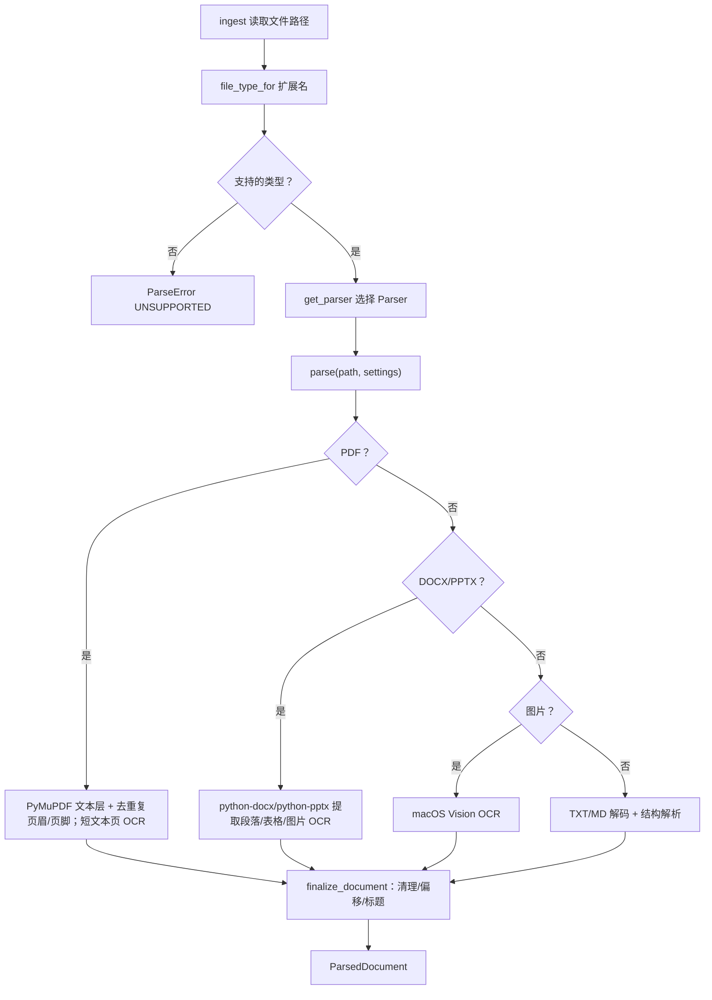

# STEP-03 解析层

> 状态：已完成（2026-10-21）  
> 依赖：[STEP-00](STEP-00-项目骨架与环境校验.md)  
> 预估：2.0 人日  
> 对应总方案：[DOC-00](../00-总体方案.md) §6  
> 对应代码：`app/parsing/*`、`scripts/make_fixtures.py`、`tests/test_parsing_*.py`  
> 验收命令：见 §8

---

## 1. 目标

把十类文件统一解析为 `ParsedDocument`，为切片层提供**有序、带结构、带页码/幻灯片号**的文本块：

- TXT / Markdown（编码自适应）
- PDF（文本层 + 扫描页 OCR）
- DOCX（段落/标题/表格/图片）
- PPTX（文本框/表格/备注/图片）
- HTML（标题/段落/列表/表格/代码/alt text）
- JSON / CSV / LOG（结构化轻量解析）
- 图片（OCR）
- 统一异常与限制，单文件失败不影响整批任务

本步不做切片、不写库。

---

## 2. 前置条件

- 已安装 `pymupdf==2.0`、`python-docx==1.2.0`、`python-pptx==1.0.2`、`ocrmac==1.0.1`、`pillow`、`charset-normalizer`；
- macOS 允许 Vision OCR（无需额外授权，系统框架）；
- 有可用的中文字体用于生成测试图片（Hiragino Sans GB / Songti）。

---

## 3. 交付物

| 文件 | 内容 |
|---|---|
| `app/parsing/base.py` | `ParsedBlock`、`ParsedDocument`、`Parser` 协议、`ParseError`、`finalize_document()` |
| `app/parsing/registry.py` | 扩展名路由、`SUPPORTED_EXTENSIONS` |
| `app/parsing/text_md.py` | `TextMarkdownParser` |
| `app/parsing/pdf.py` | `PdfParser` |
| `app/parsing/docx.py` | `DocxParser` |
| `app/parsing/pptx.py` | `PptxParser` |
| `app/parsing/image_ocr.py` | `ImageParser` |
| `app/parsing/ocr.py` | `ocr_image()`、`ocr_available()` |
| `scripts/make_fixtures.py` | 生成测试用 PDF/DOCX/PPTX/图片 |
| `tests/test_parsing_text.py` | 文本/Markdown |
| `tests/test_parsing_pdf.py` | PDF/扫描页 |
| `tests/test_parsing_office.py` | DOCX/PPTX |
| `tests/test_ocr.py` | OCR |

---

## 4. 统一数据结构

### 4.1 `ParsedBlock`

```python
@dataclass
class ParsedBlock:
    text: str
    kind: str = "paragraph"          # heading/paragraph/table/code/ocr/note
    page: int = 0                    # PDF 1-based
    slide: int = 0                   # PPTX 1-based
    heading_path: tuple[str, ...] = ()
    char_start: int = 0
    char_end: int = 0
    meta: dict = field(default_factory=dict)
```

### 4.2 `ParsedDocument`

```python
@dataclass
class ParsedDocument:
    path: Path
    file_type: str                   # md/txt/pdf/docx/pptx/html/image
    title: str
    blocks: list[ParsedBlock]
    text: str                        # 规范化全文，块之间 "\n\n"
    warnings: list[str] = field(default_factory=list)
    meta: dict = field(default_factory=dict)
```

### 4.3 `finalize_document()`

职责：

1. 丢弃纯空白块；
2. 合并相邻同 `kind` 的短段落（可选，交给切片层）；
3. 计算每块 `char_start/char_end`；
4. 生成 `text`；
5. 若 `title` 为空，用文件名 stem。

### 4.4 `ParseError`

```python
class ParseError(Exception):
    def __init__(self, code: str, message: str, hint: str = ""): ...
```

错误码：`UNSUPPORTED_TYPE`、`FILE_TOO_LARGE`、`ENCRYPTED_PDF`、`BROKEN_FILE`、`OCR_UNAVAILABLE`、`EMPTY_DOCUMENT`。

### 4.5 Parser 协议

```python
class Parser(Protocol):
    extensions: tuple[str, ...]
    def parse(self, path: Path, settings: Settings) -> ParsedDocument: ...
```

`registry.get_parser(path)` 按后缀返回单例；未知后缀抛 `UNSUPPORTED_TYPE`。

---

## 5. 各解析器实现

### 5.1 TXT / Markdown（`text_md.py`）

**编码检测顺序：**

1. 读取前 256KB 字节；
2. `charset_normalizer.from_bytes(raw).best()`；
3. 失败则依次试 `utf-8`、`utf-8-sig`、`gb18030`、`big5`；
4. 仍失败用 `errors="replace"` 并写 warning（**不要用 `ignore`**，会静默丢字）。

**Markdown 解析：**

| 结构 | 规则 | kind |
|---|---|---|
| ATX 标题 | `^(#{1,6})\s+(.+)$` | `heading` |
| 围栏代码 | ` ``` ` / `~~~`，保留语言标记 | `code` |
| 表格 | 连续以 `|` 开头的行 | `table` |
| 列表 | `^\s*([-*+]|\d+\.)\s+` | `paragraph`（保留缩进） |
| 引用 | `^>\s?` | `paragraph` |
| 空行 | 分块边界 | — |

- 维护 `heading_stack`，生成 `heading_path`；
- 第一个 H1 作为 `title`；
- 代码块整块保留，不切句；
- 表格行保留 `|`，便于切片层按行拆分。

**TXT：**

- 按空行分块；
- 每块 `kind="paragraph"`；
- 标题检测不做（避免误判），`title` 用文件名。

### 5.2 PDF（`pdf.py`）

**打开：**

```python
doc = pymupdf.open(path)
if doc.is_encrypted and not doc.authenticate(""):
    raise ParseError("ENCRYPTED_PDF", ...)
```

**逐页：**

```python
# 先收集带 bbox 的行，识别重复页眉/页脚；raw_text 用于判断是否需要 OCR
raw_text = page.get_text("text").strip()
text, removed = _strip_margin_lines(lines_by_page[page_no], repeated)
if len(raw_text) < settings.pdf_ocr_text_threshold:
        pix = page.get_pixmap(dpi=200)
        text = ocr_image_bytes(pix.tobytes("png"), lang=("zh-Hans","en-US"))
        kind = "ocr"
    else:
        kind = "paragraph"
    blocks.append(ParsedBlock(text=text, kind=kind, page=page_no))
```

**限制与异常：**

- 页数 > `MAX_PDF_PAGES`（默认 500）：截断并 warning；
- 单页 OCR 失败：记录 warning，保留空页；
- 文本层存在但含大量乱码（如 CID 字体）：v1 不自动检测，记录 warning；
- 内嵌图片：v1 默认只对“整页扫描”OCR，不对文本页里的图片逐个 OCR（可用配置开启，P2）；
- `title` 取 `doc.metadata["title"]`，为空用文件名。

### 5.2.1 去页眉页脚（P2）

开关：`PDF_STRIP_HEADER_FOOTER=true`（默认）。

1. `page.get_text("dict")` 收集每行文本 + bbox；
2. 顶部/底部各取页面高度 8%；
3. 同一行（数字归一化为 `#`）在 ≥30% 页面重复出现，判为页眉/页脚；
4. 页边纯页码（`12`、`第 3 页`、`Page 3 of 10`）直接删除；
5. 只清理文本层页面，扫描页 OCR 不清理；
6. 删除行数写入 `meta["header_footer_removed"]` 和 warning。

风险：多栏/旋转页面按行顺序可能异常；单页 PDF 不删除页眉，避免误删标题。

**性能：**

- 200dpi A4 渲染 + OCR 约 0.8–1.5s/页；
- 500 页扫描件可能 10 分钟，必须有进度与取消。

### 5.3 DOCX（`docx.py`）

**保序遍历：**

```python
doc = Document(path)
for item in doc.iter_inner_content():   # python-docx 1.2 支持
    if isinstance(item, Paragraph): ...
    elif isinstance(item, Table): ...
```

**段落：**

- `p.style.name` 形如 `Heading 1` / `标题 1`；
- 用正则提取级别，维护 `heading_stack`；
- 空段落跳过；
- 标题块 `kind="heading"`。

**表格：**

```python
rows = [" | ".join(cell.text.strip() for cell in row.cells) for row in table.rows]
blocks.append(ParsedBlock(text="\n".join(rows), kind="table", heading_path=...))
```

**图片（按文档顺序）：**

- 段落内按 `run` 顺序扫描 DrawingML 图片：
  ```python
  run._element.xpath(".//a:blip")
  r_id = blip.get("{...relationships}embed")
  part = doc.part.related_parts[r_id]
  ```
- 文本与图片交错时，先 flush 当前文本段，再插入 OCR block；
- OCR 使用图片出现时的 `heading_stack`，不再使用文末标题；
- 表格单元格图片通过 `cell.paragraphs` 递归处理，追加在 table block 之后；
- 同一 `rId` 只 OCR 一次，避免重复 logo 产生重复 chunk；
- 每文档最多 50 张唯一图片，超出 warning；
- 尺寸 ≥ `OCR_MIN_IMAGE_PX` 且字节 ≥ 10KB 才 OCR；
- `OCR_ENABLED=false` 时只 warning，不生成 OCR block；
- 限制：只处理 DrawingML `a:blip`；VML/浮动图片/文本框/页眉页脚未处理；
- 同一 run 内“文本+图片+文本”的精确顺序是近似的。

**标题：**

- 第一个 Heading 1 作为 `title`；
- 无标题则文件名。

### 5.4 PPTX（`pptx.py`）

**逐页：**

```python
prs = Presentation(path)
for slide_no, slide in enumerate(prs.slides, start=1):
    title = slide.shapes.title.text if slide.shapes.title else ""
    for shape in _iter_shapes(slide.shapes):  # 按 top/left 几何排序
        if shape.has_text_frame:
            ...                 # P1: 按 paragraph 拆
        elif shape.has_table:
            ...                 # P4: headers/rows
        elif shape.has_chart:
            ...                 # P3: categories/series
        elif getattr(shape, "image", None):
            ...                 # P5: PICTURE/占位符图片/alt text
        else:
            ...                 # P3: SmartArt diagram XML 兜底
    if slide.has_notes_slide:
        notes = slide.notes_slide.notes_text_frame.text
```

规则：

- 标题占位符作为 `heading`，后续块继承；
- 文本框按 paragraph 拆，每段一个 block，保留 `paragraph.level`；
- **P4 表格**：提取 `headers/rows`，输出：
  ```text
  表头：模块 | 说明
  行 1：解析 | PDF/DOCX
  ```
  `meta` 里同时保存 `table_headers/table_rows`；
- **P3 图表**：提取标题/类别/系列/数值，转为 `kind="table"` 文本；
- **P3 SmartArt**：从 diagram XML 的 `a:t` 兜底提取文本；
- 备注 `kind="note"`，附在幻灯片末尾；
- **P5 图片**：`PICTURE`、图片占位符、slide 背景图、备注页图片都尝试 OCR；
- **P5 alt text**：`cNvPr@descr` 非空时先输出一个 paragraph block；
- 图片 OCR，`page=0, slide=slide_no`；
- 组合形状按组合 bbox 参与排序，内部再按 top/left 深度优先展开；
- 形状按 `(top, left)` 几何排序，模拟视觉阅读顺序；相同坐标保持 XML 顺序；
- 备注固定追加到本页最后；
- 图片 OCR block 插入形状出现的位置，使用本页标题作为 `heading_path`；
- 每页最多 20 张图片（含背景图/备注图）；
- 已知限制：只处理可访问的图片关系；slide layout/master 背景不处理；图表只能读 python-pptx 暴露的数据；SmartArt 复杂布局可能不完整；同一图片重复出现会重复 OCR；
- `title` 取第一页标题或文件名。

### 5.4.1 HTML（`html.py`）

**规则：**

- `lxml.html` 解析，保留文档顺序；
- `h1`–`h6` 更新 `heading_path`；
- `p/li/blockquote/dt/dd/figcaption` → paragraph；
- `table` → `a | b` 行；
- `pre` → code，保留 `language-*`；
- `img[alt]` → paragraph（`meta.source=html_alt`）；
- 跳过 `script/style/noscript/template/svg/nav/head`；
- 标题优先 `<title>`，其次首个 `<h1>`，否则文件名；
- 优先从 `main/article/role=main/#content/.content` 抽取正文，内容过短则回退 body；
- 文件名类型为 `html`。

**限制：**

- 不执行 JavaScript；
- 复杂 CSS 布局/正文抽取不做；
- 页面噪声（导航/页脚）可能进入正文；
- 不下载远程图片。

测试：`tests/test_parsing_html.py`（4 个）。

### 5.4.2 JSON / CSV / LOG（`structured.py`）

- JSON 递归展开 `key: value`；
- CSV 每行转 `a | b`，作为 table block；
- LOG 按文本处理，`file_type=txt`；
- 不负责字段类型推断/数据库导入。

测试：`tests/test_parsing_structured.py`（3 个）。

### 5.5 图片（`image_ocr.py`）

支持：`.png .jpg .jpeg .webp .tif .tiff .bmp`。

流程：

1. `Image.open`；
2. `ImageOps.exif_transpose` 纠正方向；
3. 若最长边 < `OCR_MIN_IMAGE_PX`，放大 2 倍再 OCR（可选）；
4. 转 RGB，保存临时 PNG（或直接传路径）；
5. `ocr_image()`；
6. 文本为空 → `EMPTY_DOCUMENT` warning，不抛致命错误；
7. `title` 用文件名（去扩展名）。

HEIC：Pillow 默认不支持；v1 记为 `UNSUPPORTED_TYPE`，文档注明可用 `sips` 转换后再入库（P2）。

### 5.6 OCR 封装（`ocr.py`）

v1.2 起新增：

```python
OcrLine(text, confidence, bbox)
ocr_image_lines(...)
ocr_image_bytes_lines(...)
```

现有 `ocr_image` 保持返回整页文本；PDF 扫描页和顶层图片 OCR 已按 bbox
做从上到下、从左到右排序，并把行文本/bbox 写入 chunk 的 `meta_json`。

v1.2 已增加：

- deskew 可选（`OCR_DESKEW=true`；默认关闭，避免表格页投影误判）；
- 多栏阅读顺序（x 大间距分栏；短页面保持 y/x 排序）；
- 合并单元格 HTML 单元测试（模型 spanning cell + 合成 fixture）；
- OCR 跨页页眉/页脚/页码统计；
- OCR 行列分组；
- 连续多行多列文本的表格候选；
- 扫描 fixture 回归（页眉/页脚/表格/正文）。

离线表格模型（可选）：

- `TABLE_STRUCTURE_ENABLED=true`
- `.models/table-transformer-detection`
- `.models/table-transformer-structure`
- 检测表格、识别行/列/单元格、逐格 OCR、HTML；
- 模型加载失败显式 `TABLE_MODEL_UNAVAILABLE`；
- 低置信度写 warning，不伪装结构正确；
- Kaggle `table-detection` 65 图/100 表，IoU≥0.5 全图 Recall 0.71；分块补检 0.81（额外框增加，见活动报告）。

```python
def ocr_available() -> bool:
    try:
        import ocrmac  # noqa
        return sys.platform == "darwin"
    except Exception:
        return False

def ocr_image(path_or_bytes, languages=("zh-Hans", "en-US")) -> tuple[str, list[str]]:
    from ocrmac import ocrmac
    ...
    results = ocrmac.OCR(
        str(path),
        language_preference=list(languages),
    ).recognize()
    lines = [text for text, conf, _ in results if conf >= 0.25]
    return "\n".join(lines), warnings
```

要求：

- 置信度阈值 0.25（可配置）；
- 连续短行合并为段落；
- 输入 bytes 时写 `tempfile.NamedTemporaryFile(suffix=".png")`，用完删除；
- 异常包装为 `ParseError("OCR_UNAVAILABLE", ...)`；
- 单张图片 OCR 失败不让整个文档失败，返回空串 + warning。

---

## 6. 公共限制与异常

| 项 | 默认 | 行为 |
|---|---|---|
| `MAX_FILE_MB` | 200 | 超限抛 `FILE_TOO_LARGE` |
| `MAX_PDF_PAGES` | 500 | 截断 + warning |
| `PDF_STRIP_HEADER_FOOTER` | true | 去重复页眉/页脚/页码 |
| `PDF_TABLE_EXTRACT` | true | 提取带线表格（PyMuPDF find_tables） |
| `.json/.csv/.log` | 内置 | JSON 展开 / CSV 表格 / LOG 文本 |
| 每文档图片数 | 50 | 超出 warning |
| 每页 PPT 图片 | 20 | 超出 warning |
| 单页 OCR 超时 | 60s | 跳过该页 + warning |
| 空文档 | — | 返回空 blocks，ingest 标记 `empty` |

**原则：**

- 文件级失败 → `ParseError`，由 ingest 记录到 manifest；
- 页/图级失败 → warning，继续；
- 不允许 `except Exception: pass` 静默吞掉。

---

## 7. 代码映射

| 文件 | 符号 | 说明 | 测试 |
|---|---|---|---|
| `app/parsing/base.py` | `ParsedBlock`, `ParsedDocument`, `finalize_document` | 中间结构 | `test_parsing_text.py::test_finalize_offsets` |
| `app/parsing/registry.py` | `get_parser`, `SUPPORTED_EXTENSIONS` | 路由 | `test_parsing_text.py::test_unsupported` |
| `app/parsing/text_md.py` | `TextMarkdownParser.parse` | 编码/Markdown | `test_parsing_text.py::test_gb18030` |
| `app/parsing/pdf.py` | `PdfParser.parse` | 文本层/OCR/表格 | `test_parsing_pdf.py`（8） |
| `app/parsing/isolated.py` | `parse_pdf_isolated` | PDF segfault 子进程隔离 | 手工：`PARSER_CRASH` |
| `app/parsing/deskew.py` | `estimate_skew`, `deskew_image` | 倾斜页估计/校正 | `test_deskew.py`（1） |
| `app/parsing/ocr_layout.py` | `order_lines_columns`, `strip_repeated_margins`, `group_rows` | 多栏/页眉/表格候选 | `test_ocr_layout.py`（2） |
| `app/parsing/docx.py` | `DocxParser.parse` | 保序解析 | `test_parsing_office.py::test_docx_order` |
| `app/parsing/pptx.py` | `PptxParser.parse` | 幻灯片/备注 | `test_parsing_office.py::test_pptx_notes` |
| `app/parsing/image_ocr.py` | `ImageParser.parse` | 图片 OCR | `test_ocr.py::test_chinese_image` |
| `app/parsing/ocr.py` | `ocr_image`, `ocr_available` | Vision 封装 | `test_ocr.py::test_confidence_filter` |
| `app/table_structure.py` | `TableStructureService.recognize` | 表格检测/结构/单元格 OCR/HTML | `test_table_structure.py`（2） |

---

## 8. 测试与验收

### 8.1 生成 fixtures

```bash
.venv/bin/python scripts/make_fixtures.py --out tests/fixtures
```

生成：

- `tiny.md`、`gb18030.txt`
- `sample.pdf`（中文文本层）
- `scanned.pdf`（图片页）
- `sample.docx`（标题/段落/表格/图片）
- `sample.pptx`（标题/正文/备注/图片）
- `sample.png`（中文截图）
- `broken.pdf`（截断）

### 8.2 单元测试

```bash
.venv/bin/python -m pytest tests/test_parsing_text.py tests/test_parsing_pdf.py \
  tests/test_parsing_office.py tests/test_ocr.py -q
```

覆盖：

- GB18030 文本正确解码；
- Markdown 标题路径正确；
- 文本 PDF 页码正确；
- 扫描 PDF 有 OCR 文本；
- 损坏 PDF 抛 `ParseError` 而非崩溃；
- DOCX 段落/表格顺序正确；
- PPTX 备注被读入；
- 图片 OCR 包含“混合检索”；
- 空图片返回空 blocks + warning。

### 8.3 手工验收

```bash
.venv/bin/python - <<'PY'
from pathlib import Path
from app.config import load_settings
from app.parsing.registry import get_parser

s = load_settings()
for p in ["tests/fixtures/sample.pdf", "tests/fixtures/sample.docx",
          "tests/fixtures/sample.pptx", "tests/fixtures/sample.png"]:
    doc = get_parser(Path(p)).parse(Path(p), s)
    print(p, doc.file_type, len(doc.blocks), doc.title, doc.warnings[:2])
    print("  first:", doc.blocks[0].text[:60] if doc.blocks else "<empty>")
PY
```

期望：四类均 `len(blocks) > 0`，标题合理，warnings 为空或可解释。

### 8.4 验收记录

| 日期 | 执行人 | 结果 | 备注 |
|---|---|---|---|
| 2026-10-21 | 实现 | 通过 | 自动化测试通过 |

---

## 9. 风险与备注

| 风险 | 处理 |
|---|---|
| PyMuPDF AGPL | 个人使用；对外分发前替换为 pypdf/pdfplumber |
| 扫描件 OCR 慢 | 200dpi + 页数上限 + 进度；必要时降 150dpi |
| OCR 错字 | 置信度过滤；UI 标注 OCR；评测单独分桶 |
| DOCX 图片位置不准 | v1 追加到当前 section 末尾；文档注明 |
| PPTX 组合/图表 | 组合已递归；图表读 python-pptx 可访问数据；SmartArt 为 diagram XML 兜底 |
| HEIC | 暂不支持；用 `sips -s format png` 转换 |
| 编码误判 | 多级 fallback + warning；允许用户手动指定 |

---

## 10. 完成定义（DoD）

- [ ] 十类样本均可解析出非空 `ParsedDocument`；
- [ ] 中文 OCR 命中“混合检索”；
- [ ] 损坏/加密文件不崩溃；
- [ ] 单文件失败不影响批量任务；
- [ ] `tests/test_parsing_*` 与 `test_ocr.py` 通过；
- [ ] 本文档 §8.4 已填写。


---

## 流程图


