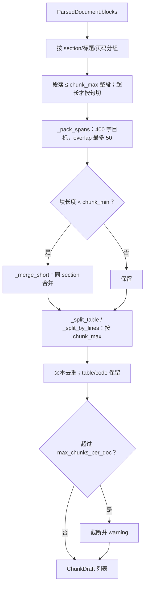

# STEP-04 切片层

> 状态：已完成（2026-10-21）  
> 依赖：[STEP-03](STEP-03-解析层.md)  
> 预估：1.0 人日  
> 对应总方案：[DOC-00](../00-总体方案.md) §5.4  
> 对应代码：`app/chunking.py`、`tests/test_chunking.py`  
> 验收命令：见 §7

---

## 1. 目标

把 `ParsedDocument` 切成适合 BGE 与 reranker 的 chunk：

- 目标 400 字、重叠 50 字；自适应模式下优先保持完整段落；
- 不跨页/跨幻灯片混切；
- 保留标题路径、页码、幻灯片号、字符偏移；
- 表格/代码块尽量整块保留；
- 输出确定性结果，同一文档重复切片一致。

---

## 2. 前置条件

- STEP-03 可产出 `ParsedDocument`；
- 已确定 `text` 与 `display_text` 的组成规则（DOC-00 §5.4）。

---

## 3. 交付物

| 文件 | 内容 |
|---|---|
| `app/chunking.py` | `ChunkDraft`、`chunk_document()`、句边界工具 |
| `tests/test_chunking.py` | 长度/重叠/偏移/标题/边界测试 |

---

## 4. 数据结构

```python
@dataclass
class ChunkDraft:
    chunk_index: int
    text: str            # heading + "\n" + body，用于 embedding + FTS
    display_text: str    # body，用于 UI
    heading: str         # "架构 / 检索 / 重排"
    page: int
    slide: int
    char_start: int
    char_end: int
    source_kind: str     # text / ocr / table / note
    content_hash: str    # sha256(display_text)[:16]
```

> `chunk_id` 不在本层生成；由 STEP-06 用 `doc_id + chunk_index + content_hash` 计算。

---

## 5. 算法

### 5.1 总体流程

```text
ParsedDocument
  → 按 (heading_path, page, slide) 分组为 section
  → 段落 ≤ chunk_max 时整段作为 span；超长段落才按句切
  → 按目标 400 打包，overlap 最多 50 字
  → 生成 body，拼 heading 前缀
  → 去重、修正过短块、编号
  → list[ChunkDraft]
```

### 5.2 Section 分组

分组键：

```python
key = (block.heading_path, block.page, block.slide)
```

- 不同 PDF 页不合并；
- 不同 PPT 幻灯片不合并；
- 同一页内不同标题不合并；
- 这样保证 `page/slide` 元数据准确，避免“跨页 chunk 无法定位”。

### 5.3 句子切分

实际实现是逐字符扫描，不是正则 split：

```python
boundary = char in "。！？!?；;\n"
if char == "." and (index + 1 == len(text) or text[index + 1].isspace()):
    boundary = True
```

规则：

- 句末标点保留在前一句；
- 换行也是句边界；
- 英文句号只在末尾或后接空白时切；
- 返回 `(句子, local_start, local_end)`，偏移相对 block；
- 只有“段落超过 `chunk_max`”或关闭自适应时才按句切；
- 单句超过 `chunk_max` 才 `_hard_split`。

### 5.4 窗口打包

```python
target = settings.chunk_size       # 400
overlap = settings.chunk_overlap   # 50
min_len = settings.chunk_min       # 80
max_len = settings.chunk_max       # 600

buf, buf_start, buf_end = [], None, None
for sent, s_start, s_end in sentences:
    if buf and (buf_end - buf_start) + len(sent) > target:
        emit(buf, buf_start, buf_end)
        # 保留尾部句子作为重叠
        buf, buf_start, buf_end = tail_for_overlap(buf, overlap)
    buf.append(sent)
    ...
emit_remaining()
```

**实际重叠规则：**

- 从上一块末尾的 span 反向取，累计最多 `overlap` 个字符；
- 短 span 整段带入；长 span 只取末尾 `overlap` 字；
- 如果 overlap 加上新 span 超过 `chunk_max`，放弃 overlap；
- 没有 `target / 2` 的硬限制；目标是软目标，`chunk_max` 才是硬上限；
- `_pack_spans` 直接 `"".join` span，跨 paragraph 的空行不会保留。

**自适应段落（`CHUNK_ADAPTIVE=true`，默认）：**

- 段落长度 ≤ `chunk_max` 时，整段作为一个 span，不从段落中间拆；
- 段落 > `chunk_max` 才按句切/硬切；
- overlap 只取上一块末尾最多 50 字，不能把整段长句全量带入；
- 关闭该开关可回到旧行为，用于 A/B。

**长度修正：**

- 只尝试把当前块合并到**紧邻的上一块**；
- 上一块长度 < `chunk_min`；
- 合并后（加一个换行）≤ `chunk_max`；
- `page/slide/heading/source_kind` 必须相同；
- 合并后重算 `content_hash` 和 `char_end`；
- 最后一块过短时不会反向找下一块，只保留。

**表格/代码：**

- `kind="table"`：按 `chunk_max` 行切，每片重复表头（首行）；
- `kind="code"`：按 `chunk_max` 行切，不做空行优先；
- 单行超过 `chunk_max` 时硬切；
- 表格/代码也必须 ≤ `chunk_max`；
- 表格不产生“只有表头”的 chunk；
- 某行本身超过可用空间时，按内容切多片；每片重复表头和行键，续片加“（续）”；
- overlap 只作用于文本 span；table/code 不共享 overlap，表格用重复表头；
- 重复表头时 `char_start` 是近似值，因为表头来自上一块偏移。

### 5.4.1 表格/代码短上下文

`CHUNK_SPECIAL_CONTEXT=false`（默认）：不拼上下文。  
`true`：表格/代码 chunk 的 `text` 拼入同 section 前一段正文最后 160 字；`display_text` 仍只展示表格/代码本身。

A/B：

```text
docs MD Chunk R@5：
  off 0.5733
  on  0.3533
```

因此默认关闭，保留为可选实验开关。

### 5.5 标题前缀

```python
heading = " / ".join(block.heading_path)[:120]
body = "".join(buf).strip()
text = f"{heading}\n{body}" if heading else body
```

- `display_text = body`；
- 标题前缀只用于检索/嵌入，UI 展示 `display_text`；
- 前缀不参与 `char_start/char_end`（偏移只针对 body）。

### 5.6 偏移

- `char_start/char_end` 指向 `ParsedDocument.text` 中的 body 区间；
- 由句子偏移累计得到；
- 用于“查看原文上下文”和高亮定位（v1 先存，UI 可后置）。

### 5.7 去重与编号

- 文本去重 key：
  ```python
  (content_hash, heading, page, slide)
  ```
- 同一 section 内正文相同 → 丢弃后来的；
- table/code **不做正文去重**：长表格行的续片可能正文相同，但它们是同一行的不同片段，去重会丢数据；
- 不同 heading/page/slide 的相同正文保留；
- `content_hash` 由 `app/ids.py::make_content_hash(display_text)` 计算；
- 去重后从 0 编号；
- 单文档 chunk 上限 `MAX_CHUNKS_PER_DOC=5000`，超出截断并 warning（由 ingest 记录）；
- 截断后重新编号。

### 5.8 日志

`chunk_document` 现在有分层日志：

| 级别 | 内容 |
|---|---|
| INFO | 开始切片：path/blocks/adaptive/target/overlap/max |
| INFO | 切片完成：path/chunks/avg_chars/max_chars |
| WARNING | chunk 数超过上限并截断 |
| DEBUG | section 数、每个 section 的 page/slide/heading/blocks |
| DEBUG | 文本缓冲：blocks/spans/packed 数 |
| DEBUG | 表格/代码：kind/chars/pieces 数 |
| DEBUG | 短块合并前后数量 |
| DEBUG | 去重前后数量 |
| DEBUG | 每个 chunk：index/kind/chars/page/slide/offsets |

日志只记录路径、数量和偏移，不打印正文，避免隐私和日志膨胀。

### 5.9 确定性

- 不依赖随机数、时间、字典遍历顺序；
- 同一 `ParsedDocument` + 同一配置 → 完全相同的 `ChunkDraft` 列表；
- 测试中用两次调用比对。

---

### 5.10 已知限制

- 跨 paragraph 的空行在 `_pack_spans` 中会丢失；
- 表格重复表头的字符偏移是近似值；
- 表格/代码与前后说明段不共享 chunk；
- 无 heading 的 PDF 只能靠 page 分 section；
- 文本去重只针对同 section 的完全同正文；table/code 不去重；
- 截断发生在去重之后。

## 6. 边界情况

| 场景 | 期望 |
|---|---|
| 空文档 | 返回 `[]` |
| 只有标题 | 返回 `[]`；heading 不占 chunk |
| 单段 5000 字 | 按 400/50 切，允许句中断开，保证覆盖 |
| 表格 2000 字 | 按行拆，每片带表头；超长行带表头 + 行键 + 续标记 |
| 代码块 1000 字 | 按行拆，不做空行优先 |
| OCR 文本无标点 | 按 `chunk_max` 硬切 + 重叠 |
| 页边界 | 不跨页 |
| 幻灯片边界 | 不跨页 |
| 重复段落 | 文本块去重；table/code 保留 |
| 全角/半角空格 | 规范化但保留中文标点 |

---

## 7. 测试与验收

### 7.1 单元测试

```bash
.venv/bin/python -m pytest tests/test_chunking.py -q
```

覆盖：

- 5000 字文档：所有 chunk ≤ `chunk_max`；表格/代码也受上限约束；
- 文本窗口溢出时才产生 overlap；不是每个相邻 chunk 都必然重叠；
- `text` 以 heading 开头，`display_text` 不含 heading；
- `doc.text[start:end]` 与 `display_text` 有高重合；
- 不同页不混合；
- 表格按行拆分且每片含表头；超长行续片还含行键和“（续）”标记；
- 不产生“只有表头”的 table chunk；
- 300 字单元格可完整重建，不因 table/code 去重丢内容；
- 空文档返回 `[]`；
- 同一输入两次结果一致。

### 7.2 表格长行与 38 条评测

本次修复后：

- 300 字单元格单测通过；
- 证据：`tests/test_chunking.py::test_long_table_row_repeats_header_and_row_key`；
- 38 条 query 全量重跑：
  ```text
  hybrid       Recall@5=0.6855  MRR@10=0.6939  nDCG@10=0.6938
  rerank       Recall@5=0.6702  MRR@10=0.6246  nDCG@10=0.6585
  ```
- 旧表格式切分与新手写 table 切分的 38 条聚合指标完全一致；
- 38 条中只有 `r34 个人薪酬说明表` 与表格文档相关，它是**文档名查询**，不是表格内容查询；该 query 命中第 1 名；
- 因此“表格内容 query”的变化不能从这 38 条中统计，需要另建表格 query 集；
- 报告：
  - eval-resume-38-tablefix.md
  - eval-resume-38-tableold.md

### 7.3 手工验收

```bash
.venv/bin/python - <<'PY'
from pathlib import Path
from app.config import load_settings
from app.parsing.registry import get_parser
from app.chunking import chunk_document

s = load_settings()
p = Path("tests/fixtures/sample.pdf")
doc = get_parser(p).parse(p, s)
chunks = chunk_document(doc, s)
print("chunks:", len(chunks))
for c in chunks[:3]:
    print(c.chunk_index, len(c.display_text), c.page, c.heading, c.display_text[:40])
PY
```

期望：`len(chunks) > 0`，长度大多在 300–450，页码递增。

### 7.4 验收记录

| 日期 | 执行人 | 结果 | 备注 |
|---|---|---|---|
| 2026-10-21 | 实现 | 通过 | 自动化测试通过 |

---

## 8. 代码映射

| 文件 | 符号 | 说明 | 测试 |
|---|---|---|---|
| `app/chunking.py` | `ChunkDraft` | 切片结构 | `test_chunking.py::test_fields` |
| `app/chunking.py` | `chunk_document` | 主入口 | `test_chunking.py::test_long_doc` |
| `app/chunking.py` | `_split_sentences` | 句边界 | `test_chunking.py::test_sentence_split` |
| `app/chunking.py` | `_emit_with_overlap` | 窗口 | `test_chunking.py::test_overlap` |
| `app/chunking.py` | `_split_table` | 表格 | `test_chunking.py::test_table_header_repeat`、`test_long_table_row_repeats_header_and_row_key` |
| `app/ids.py` | `make_content_hash` | 块哈希 | `test_chunking.py::test_content_hash_stable` |

---

## 9. 风险与备注

| 风险 | 处理 |
|---|---|
| 句子切分对 OCR 文本无效 | 无标点时硬切 + 重叠 |
| 重叠导致重复内容 | 控制在 50 字；UI 去重 |
| 标题前缀过长 | 截断 120 字 |
| 表格拆分丢结构 | 每片重复表头 |
| 切片参数影响召回 | 评测对比 400/50 vs 300/50 |
| 单文档 chunk 爆炸 | 5000 上限 + warning |

---

## 10. 完成定义（DoD）

- [ ] 400/50 参数可配置；
- [ ] 不跨页/幻灯片；
- [ ] 长度与重叠符合预期；
- [ ] 偏移可回溯；
- [ ] 确定性测试通过；
- [ ] 本文档 §7.3 已填写。


---

## 流程图


