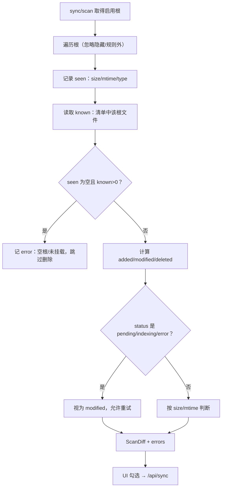

# STEP-05 清单与增量扫描

> 扫描默认跳过 `build/`、`.git/`、`node_modules/`、`.venv/` 等构建/依赖目录；如需索引名为 `build` 的业务目录，需调整 `app/manifest.py::IGNORED_DIRS`。
>
> 清掉“文件仍在磁盘、但已被忽略规则排除”的旧索引：
>
> ```bash
> python -m app.cli index --root "/path/to/root" --delete-ignored
> ```
>
> 支持两级 `.searchignore`：索引根下和 `data/.searchignore`。
> 每行一个 glob；当前用它先排除了 3 个需要密码的 OkHttp PDF。
> 原文件保留，不删除；解密后删除对应行再重建即可。

> 状态：已完成（2026-10-21）  
> 依赖：[STEP-00](STEP-00-项目骨架与环境校验.md)  
> 预估：1.0 人日  
> 对应总方案：[DOC-00](../00-总体方案.md) §8  
> 对应代码：`app/manifest.py`、`app/ids.py`、`tests/test_manifest.py`  
> 验收命令：见 §7

---

## 1. 目标

建立“文件清单 + 增量扫描”能力：

- 用 SQLite 记录索引根、已索引文件、扫描/同步任务；
- 扫描只做 `stat`，快速发现新增/修改/删除；
- 扫描结果**不自动写 LanceDB**，交给用户勾选；
- 维护文件状态机，支持中断恢复；
- 为 UI 提供结构化的 `ScanDiff`。

---

## 2. 前置条件

- STEP-00 的 `Settings` 可用；
- 已确定扩展名白名单与忽略规则；
- 不需要模型，不需要 LanceDB。

---

## 3. 交付物

| 文件 | 内容 |
|---|---|
| `app/ids.py` | `sha256_bytes/text/file`、`make_doc_id`、`make_chunk_id`、`make_content_hash` |
| `app/manifest.py` | `Manifest`、`RootRecord`、`FileRecord`、`ScanDiff`、`Scanner` |
| `tests/test_manifest.py` | 扫描/状态/恢复测试 |

---

## 4. 数据库与状态

### 4.1 初始化

```python
conn = sqlite3.connect(path, check_same_thread=False)
conn.row_factory = sqlite3.Row
conn.execute("PRAGMA journal_mode=WAL")
conn.execute("PRAGMA busy_timeout=5000")
conn.execute("PRAGMA foreign_keys=ON")
```

表结构见 [DOC-00 §5.2](../00-总体方案.md#52-sqlite-清单-datamanifestsqlite)。`init_schema()` 使用 `executescript`，幂等。

### 4.2 状态机

```text
pending ──成功──> indexed
   │                 │
   │失败             │文件变更
   ▼                 ▼
 error <──────── reindex
   │
   └── 用户删除 ──> deleted
```

规则：

- 同一路径只保留一行；
- `error` 不清空旧 chunk（查询仍可能命中旧内容，UI 标记“索引失败”）；
- `deleted` 表示 LanceDB 已清理；若清理失败，保持 `error` 并记录；
- `indexing` 是瞬时状态，崩溃后启动恢复。

### 4.3 `roots`

- `path` 唯一；添加时 `resolve()`；
- 必须是已存在目录；
- 移除时可选 `delete_files`：
  - `false`：只置 `enabled=0`，保留历史；
  - `true`：删除该 root 下 `files` 行，并交给 ingest 清理 LanceDB。

### 4.4 `files`

- `path` 为主键（绝对路径）；
- `doc_id` 在首次发现时写入；
- `size/mtime` 用于快速 diff；
- `doc_hash` 在同步时计算，用于判断“仅 mtime 变化”；
- `last_error` 存错误码 + 简短信息，不存堆栈。

---

## 5. 扫描算法

### 5.1 遍历

```python
def iter_files(root: Path, settings) -> Iterator[Path]:
    for dirpath, dirnames, filenames in os.walk(root, followlinks=False):
        dirnames[:] = [d for d in dirnames if not should_skip_dir(d)]
        for name in filenames:
            if should_skip_file(name):
                continue
            p = Path(dirpath) / name
            if p.suffix.lower() not in SUPPORTED_EXTENSIONS:
                continue
            if p.is_symlink():
                continue
            yield p
```

忽略：

| 类型 | 规则 |
|---|---|
| 隐藏 | 名称以 `.` 开头（`.well-known` 也跳过） |
| 目录 | `.git`, `node_modules`, `Library`, `Applications`, `__pycache__`, `.venv`, `.Trash` |
| 包 | `*.app` 目录 |
| 临时 | `*.tmp`, `~$*`, `.DS_Store` |
| 符号链接 | 全部跳过，避免循环 |
| 超限 | 单文件 > `MAX_FILE_MB` 记录 error，不加入待同步 |

### 5.2 Diff

```python
@dataclass
class ScanDiff:
    added: list[FileCandidate]
    modified: list[FileCandidate]
    deleted: list[str]
    unchanged: int
    errors: list[ScanError]
    duration_ms: int
```

流程：

1. 对每个启用的 root 遍历，得到 `seen: dict[path, (size, mtime)]`；
2. 查 `files` 中该 root 下的所有行；
3. 对 `seen`：
   - 不在 DB → `added`；
   - `size` 或 `mtime` 变 → `modified`；
   - 否则 `unchanged += 1`；
4. 对 DB 中该 root 下、但 `seen` 没有的路径 → `deleted`；
5. 遍历中的 `PermissionError` / `OSError` 加入 `errors`，并**跳过该 root 的删除判定**（避免误删）。

**注意：**

- 扫描阶段**不计算 doc_hash**；
- 只返回差异列表 + 计数，避免大目录把 JSON 撑爆；
- `modified` 只是“可能变化”，同步时用 `doc_hash` 二次确认。

### 5.3 同步前二次确认

```python
def needs_reindex(record: FileRecord, path: Path) -> bool:
    if record.doc_hash is None:
        return True
    new_hash = sha256_file(path)
    return new_hash != record.doc_hash
```

- 若 `size/mtime` 变但 `doc_hash` 相同 → 只更新 `mtime/size`，不重嵌入；
- 这避免 `touch` 导致全量重建。

### 5.4 删除判定

- 只有 `enabled=1` 的 root 参与；
- 若 root 在遍历中出错，跳过该 root 的删除；
- 删除是“候选”，用户需在 UI 勾选“同时删除缺失文件”才真正清理 LanceDB。

---

## 6. 接口/契约

| 符号 | 签名 | 说明 |
|---|---|---|
| `Manifest.__init__` | `(path: Path)` | 连接 + 建表 |
| `add_root` | `(path: Path) -> RootRecord` | 添加索引根 |
| `remove_root` | `(root_id: int, delete_files: bool = False) -> list[str]` | 停用索引根；delete_files=True 时返回待异步清理的路径 |
| `list_roots` | `() -> list[RootRecord]` | 列表 |
| `scan` | `(settings) -> ScanDiff` | 全量 diff |
| `get_file` | `(path: str) -> FileRecord \| None` | 查询 |
| `mark_indexing` | `(path: str, run_id: str) -> None` | 状态 |
| `mark_indexed` | `(path: str, chunk_count: int, doc_hash: str, size: int, mtime: float) -> None` | 成功 |
| `mark_error` | `(path: str, code: str, message: str) -> None` | 失败 |
| `mark_deleted` | `(path: str) -> None` | 删除 |
| `recover_indexing` | `() -> list[str]` | 启动恢复 |
| `stats` | `() -> dict` | 文档数/状态分布 |

### 6.1 数据结构

```python
@dataclass
class FileCandidate:
    path: str
    root_id: int
    size: int
    mtime: float
    file_type: str

@dataclass
class FileRecord:
    path: str
    doc_id: str
    root_id: int
    file_type: str
    size: int
    mtime: float
    doc_hash: str | None
    status: str
    chunk_count: int
    last_indexed_at: str | None
    last_error: str | None
```

---

## 7. 测试与验收

### 7.1 单元测试

```bash
.venv/bin/python -m pytest tests/test_manifest.py -q
```

覆盖：

- 添加/移除 root；
- 扫描发现新增 2 个、忽略隐藏/不支持类型；
- 修改 `mtime` → `modified`；
- 删除文件 → `deleted`；
- 遍历出错时不误判删除；
- 状态机 `pending → indexed → error → indexed`；
- `recover_indexing()` 返回中断文件；
- `sha256_file` 对同一内容稳定，对修改敏感。

### 7.2 手工验收

```bash
.venv/bin/python - <<'PY'
from pathlib import Path
from app.config import load_settings
from app.manifest import Manifest

s = load_settings()
m = Manifest(s.manifest_path)
m.add_root(Path("tests/fixtures"))
diff = m.scan(s)
print("added:", [c.path for c in diff.added])
print("modified:", len(diff.modified), "deleted:", len(diff.deleted), "unchanged:", diff.unchanged)
print(m.stats())
PY
```

期望：首次扫描 `added` 覆盖 fixtures 中支持的类型；再次扫描 `added=0`。

### 7.3 验收记录

| 日期 | 执行人 | 结果 | 备注 |
|---|---|---|---|
| 2026-10-21 | 实现 | 通过 | 自动化测试通过 |

---

## 8. 代码映射

| 文件 | 符号 | 说明 | 测试 |
|---|---|---|---|
| `app/ids.py` | `sha256_file` | 文件哈希 | `test_config.py::test_sha256_file` |
| `app/manifest.py` | `Manifest.add_root` | 根管理 | `test_manifest.py::test_add_remove_root` |
| `app/manifest.py` | `Manifest.scan` | diff | `test_manifest.py::test_scan_added_modified_deleted` |
| `app/manifest.py` | `Manifest.recover_indexing` | 恢复 | `test_manifest.py::test_recover_indexing` |
| `app/manifest.py` | `Manifest.stats` | 统计 | `test_manifest.py::test_stats_and_remove_files` |

---

## 9. 风险与备注

| 风险 | 处理 |
|---|---|
| 大目录扫描慢 | 只 `stat`，不算哈希；限制 root 数量 |
| 网络盘/外置盘离线 | `errors` 记录；跳过删除判定 |
| mtime 精度/时区 | 用 `st_mtime` 浮点；哈希二次确认 |
| 大小写不敏感文件系统 | 统一 `realpath`；不额外做 casefold |
| 符号链接循环 | `followlinks=False` + 跳过 symlink |
| 用户误删 root | `remove_root(delete_files=False)` 默认只禁用 |
| SQLite 并发 | 单进程 + WAL + busy_timeout |

---

## 10. 完成定义（DoD）

- [ ] 扫描能正确分类 added/modified/deleted/unchanged；
- [ ] 扫描不写 LanceDB；
- [ ] 状态机与恢复可用；
- [ ] `test_manifest.py` 全绿；
- [ ] 本文档 §7.3 已填写。


---

## 流程图


