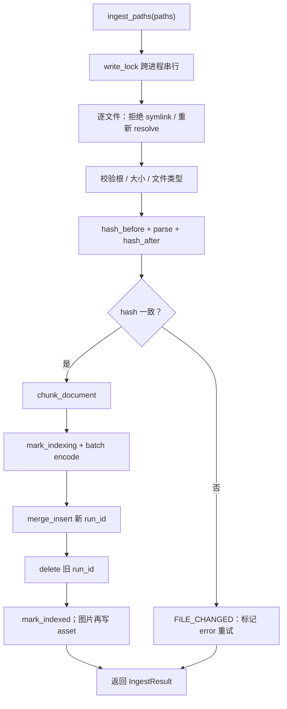

# STEP-06 入库流水线

> 状态：已完成（2026-10-21）  
> 依赖：[STEP-01](STEP-01-数据层与索引.md)、[STEP-02](STEP-02-模型层.md)、[STEP-03](STEP-03-解析层.md)、[STEP-04](STEP-04-切片层.md)、[STEP-05](STEP-05-清单与增量扫描.md)  
> 预估：1.5 人日  
> 对应总方案：[DOC-00](../00-总体方案.md) §4.2、§8.4–8.5  
> 对应代码：`app/ingest.py`、`app/jobs.py`、`app/cli.py`、`tests/test_ingest.py`  
> 验收命令：见 §8

---

## 1. 目标

把“解析 → 切片 → 嵌入 → 写 LanceDB → 更新清单”串成可恢复的流水线：

- 单文件失败不影响整批；
- 支持新增/更新/删除；
- 先插新数据再删旧数据，避免中断丢文档；
- 进度可上报、任务可取消；
- 入库完成后 FTS 自动可查（LanceDB 原生 FTS 会覆盖新 fragment）。

---

## 2. 前置条件

- STEP-01 表与 FTS 可用；
- STEP-02 模型可编码；
- STEP-03/04 可产出 `ChunkDraft`；
- STEP-05 清单可读写。

---

## 3. 交付物

| 文件 | 内容 |
|---|---|
| `app/ingest.py` | `IngestService`、`IngestResult`、`ingest_paths()`、`delete_paths()` |
| `app/jobs.py` | `JobManager`、`Job`、进度/取消 |
| `app/cli.py` | `scan` / `index` / `status` 子命令 |
| `tests/test_ingest.py` | 入库/更新/删除/失败/恢复测试 |

---

## 4. 单文件流程

```text
1. 校验：存在、大小、扩展名
2. parse(path) -> ParsedDocument
3. chunk_document(doc) -> list[ChunkDraft]
4. doc_id = make_doc_id(path)
   doc_hash = sha256_file(path)
   run_id = uuid4().hex
5. 空 chunks → 删除该 doc 旧数据，标记 empty/deleted
6. 分批（32）encode_documents -> vectors
7. 组装 rows，merge_insert("id") 写入
8. delete where doc_id = ? and run_id != ?
9. manifest.mark_indexed(...)
```

### 4.1 行组装

```python
row = {
    "id": make_chunk_id(doc_id, c.chunk_index, c.content_hash),
    "doc_id": doc_id,
    "root_id": root_id,
    "chunk_index": c.chunk_index,
    "text": c.text,
    "vector": vec,
    "display_text": c.display_text,
    "file_name": path.name,
    "file_path": str(path),
    "file_type": doc.file_type,
    "title": doc.title,
    "heading": c.heading,
    "page": c.page,
    "slide": c.slide,
    "char_start": c.char_start,
    "char_end": c.char_end,
    "content_hash": c.content_hash,
    "doc_hash": doc_hash,
    "run_id": run_id,
    "indexed_at": time.time(),
    "source_kind": c.source_kind,
    "meta_json": json.dumps({"warnings": doc.warnings}, ensure_ascii=False),
}
```

要求：

- `vector` 用 `float32` 列表；
- `text` 已含 heading 前缀；
- `display_text` 是正文；
- `page/slide` 用 0 表示无；
- `meta_json` 不放大段正文。

### 4.2 写入策略（先插后删）

```python
builder = table.merge_insert("id")
builder = builder.when_matched_update_all().when_not_matched_insert_all()
builder.execute(rows)

table.delete(f"doc_id = '{doc_id}' AND run_id != '{run_id}'")
```

理由：

- 若先删后插，插入失败会丢旧数据；
- 先插后删，最坏情况是短暂重复，查询端可按 `id` 去重；
- `run_id` 区分新旧；删除条件不会误伤本次新块；
- `doc_id/run_id` 均为十六进制，仍需 `escape_sql_literal()` 统一处理。

### 4.3 分批嵌入

- 每批 `EMBED_BATCH_SIZE=32`；
- 每批完成上报进度；
- 任一批失败：整个文件失败，manifest 记 `error`，**不执行第 8 步删除**；
- 已完成写入的新块保留，下次重试会按 `id` 更新并清理旧 `run_id`。

### 4.4 删除

```python
table.delete(f"doc_id = '{doc_id}'")
manifest.mark_deleted(path)
```

- 文件不存在时也可按 `doc_id` 删除；
- 删除后不立即 `optimize()`，由任务末尾统一处理。

### 4.5 空文档

- `chunks == []`：删除旧数据，manifest 标记 `error`（`EMPTY_DOCUMENT`）或 `deleted`（视产品选择）；
- v1 建议 `error` + `last_error="EMPTY_DOCUMENT"`，UI 可见但不算崩溃。

### 4.6 批量任务

```python
@dataclass
class IngestResult:
    total: int
    indexed: int
    failed: int
    skipped: int
    chunks: int
    duration_ms: int
    errors: list[IngestError]
```

- 串行处理每个文件；
- 单文件异常捕获，记录到 `errors`，继续下一个；
- 取消：每个文件开始、每批嵌入前检查 `cancel_event`；
- 进度：`processed/total` + 当前文件名。

### 4.7 任务结束

- 若本次写入/删除数 > 阈值（如 50），执行 `table.optimize()`；
- 更新 `sync_runs` 汇总；
- 不清空 FTS；LanceDB 原生 FTS 对新 fragment 可查（实测），无需每文件重建；
- 若 FTS 索引缺失，调用 `ensure_fts()`。

### 4.8 启动恢复

```python
stale = manifest.recover_indexing()
for path in stale:
    manifest.mark_error(path, "INTERRUPTED", "上次入库中断")
# 或直接加入待同步队列，由用户确认后重跑
```

- `recover_indexing()` 把 `status='indexing'` 改为 `error`，并返回路径；
- UI 显示“N 个文件上次中断，是否重试”；
- 不自动重跑，避免启动时长时间占用 GPU。

---

## 5. JobManager

```python
@dataclass
class Job:
    id: str
    kind: str                 # scan / sync / reindex / optimize
    status: str               # queued/running/done/failed/cancelled
    progress: float
    message: str
    processed: int
    total: int
    result: dict | None
    error: str | None
    created_at: float
    finished_at: float | None
```

要求：

- `ThreadPoolExecutor(max_workers=1)`，所有写任务串行；
- `submit(kind, fn, *args)` 返回 job_id；
- `fn` 接收 `progress_cb` 与 `cancel_event`；
- 任务结果只保留最近 50 个；
- 同一时刻只允许一个 sync；重复提交返回 `BUSY`。

---

## 6. CLI

```bash
python -m app.cli scan  --root ~/Downloads
python -m app.cli index --paths a.pdf b.docx   # 或 --root
python -m app.cli status
```

- `scan` 打印 added/modified/deleted 计数；
- `index` 执行同步并打印进度；
- `status` 打印文档/chunk/状态分布；
- 用于 STEP-07 之前的端到端验证。

---

## 7. 代码映射

| 文件 | 符号 | 说明 | 测试 |
|---|---|---|---|
| `app/ingest.py` | `IngestService.ingest_paths` | 批量入库 | `test_ingest.py::test_ingest_two_docs` |
| `app/ingest.py` | `IngestService._ingest_one` | 单文件 | `test_ingest.py::test_update_replaces_chunks` |
| `app/ingest.py` | `IngestService.delete_paths` | 删除 | `test_ingest.py::test_delete` |
| `app/ingest.py` | `_build_rows` | 行组装 | `test_ingest.py::test_row_fields` |
| `app/jobs.py` | `JobManager.submit` | 任务 | `test_ingest.py::test_job_progress` |
| `app/cli.py` | `main` | CLI | 手工 |

---

## 8. 测试与验收

### 8.1 单元/集成测试

```bash
.venv/bin/python -m pytest tests/test_ingest.py -q
```

使用 Fake Embedding（1024 维确定性向量）避免加载真模型。覆盖：

- 两个文档入库，`count_rows()` 正确；
- 重复入库同一文档不产生重复行；
- 修改内容后旧 chunk 被清理，数量正确；
- 删除文档后行数为 0；
- 一个文件解析失败，另一个仍成功；
- `status` 正确流转；
- 模拟中断（手动写 `indexing`）后 `recover_indexing()` 生效；
- 进度回调单调递增；
- 取消任务后状态为 `cancelled`。

### 8.2 手工验收

```bash
.venv/bin/python -m app.cli index --root tests/fixtures
.venv/bin/python - <<'PY'
from app.config import load_settings
from app.db import connect_db
s = load_settings()
t = connect_db(s).open_table(s.table_name)
print("rows:", t.count_rows())
print(t.search("混合检索", query_type="fts").limit(3).to_list())
PY
```

期望：`rows > 0`；中文 FTS 能命中 fixtures 中的内容。

### 8.3 验收记录

| 日期 | 执行人 | 结果 | 备注 |
|---|---|---|---|
| 2026-10-21 | 实现 | 通过 | 自动化测试通过 |

---

## 9. 风险与备注

| 风险 | 处理 |
|---|---|
| 嵌入中途失败 | 不删旧数据；manifest error；重试幂等 |
| LanceDB 写入锁 | 单 worker；任务串行 |
| GPU 内存峰值 | batch 32；可降到 8 |
| 大文件耗时 | 进度 + 取消；单文件上限 |
| FTS 新数据不可查 | 实测可查；若版本变化，任务末尾 `ensure_fts()` |
| 重复 chunk | `merge_insert("id")` + `run_id` 清理 |
| 清单与库不一致 | 启动恢复 + 重同步；提供 `rebuild` 命令（P2） |

---

## 10. 完成定义（DoD）

- [ ] 新增/更新/删除均正确；
- [ ] 重复入库幂等；
- [ ] 单文件失败不影响整批；
- [ ] 任务进度/取消可用；
- [ ] 中断可恢复；
- [ ] `tests/test_ingest.py` 通过；
- [ ] 本文档 §8.3 已填写。


---

## 流程图


