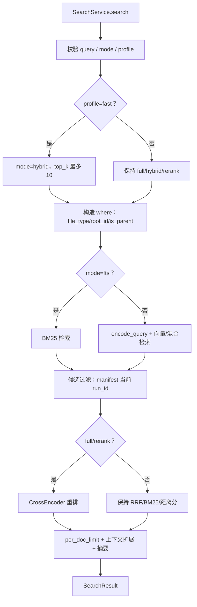

# STEP-07 检索与重排

> 状态：已完成（2026-10-21）  
> 依赖：[STEP-01](STEP-01-数据层与索引.md)、[STEP-02](STEP-02-模型层.md)、[STEP-04](STEP-04-切片层.md)、[STEP-06](STEP-06-入库流水线.md)  
> 预估：1.5 人日  
> 对应总方案：[DOC-00](../00-总体方案.md) §7  
> 对应代码：`app/search.py`、`app/cli.py`、`tests/test_search.py`  
> 验收命令：见 §8

---

## 1. 目标

实现桌面端的核心查询链路：

1. 查询向量化（带 BGE 指令）；
2. LanceDB `hybrid` 双路召回 + RRF；
3. `bge-reranker-large` 对 top_k 精排；
4. 每文档去重 + 相邻上下文扩展；
5. 返回可解释的分数与字段；
6. 重排失败显式返回 RERANK_FAILED，不返回伪精排结果。

---

## 2. 前置条件

- 库中已有数据（STEP-06）；
- FTS(ICU) 索引存在；
- 模型可加载；
- 已确认 `query_type="hybrid"` 在本机可用。

---

## 3. 交付物

| 文件 | 内容 |
|---|---|
| `app/search.py` | `SearchService`、`SearchQuery`、`SearchHit`、`SearchResult` |
| `app/cli.py` | 增加 `search` 子命令 |
| `tests/test_search.py` | 召回/重排/去重/过滤/显式失败测试 |

---

## 4. 查询流程

```text
query 规范化
  → EmbeddingService.encode_query(instruction + query)
  → table.search(query_type="hybrid")
        .vector(qvec).text(query)
        .rerank(RRFReranker())
        .where(filters, prefilter=True)
        .select(fields)
        .limit(top_k)
  → candidates
  → RerankerService.score(query, texts)
  → 合并分数、排序
  → 每文档限流
  → 上下文扩展
  → final_k
```

### 4.0 服务签名

```python
class SearchService:
    def search(
        self,
        query: str,
        top_k: int = 20,
        final_k: int = 5,
        file_types: list[str] | None = None,
        root_id: int | None = None,
        doc_ids: list[str] | None = None,
        file_paths: list[str] | None = None,
        mode: str = "full",          # 服务层默认 full；API/CLI 默认 auto
        profile: str | None = None,
        doc_level: bool = False,
    ) -> SearchResult: ...
```

- 服务层不依赖 API DTO，便于评测复用；
- API/UI/CLI 默认 `auto`：无 scope 用 `full`，有 scope 用 `hybrid`；
- 手动传 `full/hybrid` 时覆盖 auto；
- v1.1 最终策略即 `auto`，不再按领域硬编码；
- scoped 文件级 benchmark 中 rerank 单因导致 MRR 0.6509→0.5349，`full` 不作为 scoped 默认；
- `SearchService.search` 签名保留 `full` 默认以兼容内部/测试调用；
- API 层负责把 `SearchRequest` 映射为参数。

### 4.1 查询规范化

- 去除首尾空白；连续空白合并；
- 长度 1–500 字；空 query 抛 `INVALID_QUERY`；
- 不做中文分词（FTS 由 ICU 处理）；
- 不自动改写 query（v1 保持用户原意）。

### 4.2 召回

```python
builder = (
    table.search(query_type="hybrid")
    .vector(qvec)
    .text(query)
    .rerank(RRFReranker())
    .select([
        "id", "doc_id", "chunk_index", "text", "display_text",
        "file_name", "file_path", "file_type", "title", "heading",
        "page", "slide", "source_kind",
    ])
    .limit(top_k)
)
if where:
    builder = builder.where(where, prefilter=True)
candidates = builder.to_list()
```

要求：

- 必须显式 `.vector(qvec)`，避免查询时重建 embedding 函数；
- `.text(query)` 供 FTS 腿使用；
- `.rerank(RRFReranker())` 显式声明 RRF（默认也是）；
- `.select` 排除 `vector`，减少传输；
- `top_k` 默认 20，可配置 10–50。

### 4.3 过滤

支持的过滤：

| 过滤 | 生成条件 |
|---|---|
| `file_types` | `file_type IN ('pdf','docx')` |
| `root_id` | `root_id = 3` |
| `doc_ids` | `doc_id IN (...)` |
| `file_paths` | `file_path IN (...)`（路径规范化后） |

- 值必须白名单校验/转义；
- `prefilter=True`，先过滤再检索；
- 不要拼接用户原始字符串。

### 4.4 重排

```python
try:
    contexts = self._context_maps([c["doc_id"] for c in candidates])
    passages = [
        self._rerank_text(c, contexts, query) if settings.rerank_parent_context
        else c["text"]
        for c in candidates
    ]
    scores = reranker.score(query, passages)
except RerankerUnavailable as exc:
    raise SearchError("RERANK_FAILED", f"重排失败：{exc}")
```

- 分数 0–1；
- `RERANK_PARENT_CONTEXT=true` 时，把同 heading/page/slide 的 parent 文本拼给 reranker；
- 默认关闭；A/B 显示它提升 Chunk R@5，但可能降低 R@10/MRR/nDCG，且延迟更高；
- `rank_before` 为 RRF 名次（1 起）；
- 重排后按 `rerank_score` 降序；
- 失败时显式报错，不静默退回 RRF；
- 记录重排耗时，便于性能面板。

### 4.5 去重

- `full`：按 `doc_id` 计数，每文档最多 `PER_DOC_LIMIT=2`；
- `hybrid`：默认保留 chunk 级结果，不做 per-doc limit；
- 单文件 scope 的 `full`：不强制 per-doc limit，允许该文件多个 chunk；
- 若最终结果不足 `final_k`，放宽到 3；
- v1 不做 MMR（需要向量，成本高）；P2 可选；
- 同一 `id` 重复（异常数据）直接去重。

### 4.6 上下文扩展

对每条命中：

1. 取同 `doc_id` 的 `chunk_index-1`、`chunk_index`、`chunk_index+1`；
2. 拼接 `display_text`，总长 ≤ 1200 字；
3. 当前 chunk 放中间，前后各截断；
4. 结果字段 `snippet` 用扩展后的文本；
5. 邻居查询失败显式报 `CONTEXT_FAILED`，不退回当前 chunk。

实现建议：

- 先收集 Top 结果涉及的 `doc_id`；
- 每个 doc 一次查询该 doc 的所有 chunk（select `chunk_index, display_text`），内存中取邻居；
- 避免 N+1 查询。

### 4.7 分数与字段

```python
@dataclass
class SearchHit:
    chunk_id: str
    doc_id: str
    score: float              # rerank_score；失败时显式报错，不用 rrf_score
    rrf_score: float
    rerank_score: float | None
    rank_before: int
    rank_after: int
    file_name: str
    file_path: str
    file_type: str
    title: str
    heading: str
    snippet: str
    page: int
    slide: int
    source_kind: str
    score_kind: str           # rerank/rrf/bm25/distance
```

- `score` 是 UI 主展示分；
- `rrf_score` 单独展示，避免用户把 0.016 当置信度；
- `page/slide` 0 表示无。

### 4.8 高亮

- 服务端只返回纯文本 `snippet`；
- 同时返回 `highlight_terms`（query 的去重词元，长度 ≥ 2）；
- 前端先 `textContent` 转义，再用 DOM 包裹 `<mark>`；
- 不在服务端拼 HTML，避免 XSS。

---

## 4.6 文档级结果（doc_level）

`doc_level=true` 时，每个 `doc_id` 最多返回一个 chunk，用于文件级搜索/候选人筛选。

- 单文件 scope 默认不启用；
- API/UI/CLI 可手动开启；
- 与 `per_doc_limit` 互补：前者强制每个文档一个代表 chunk，后者允许 1–2 个；
- 不足 `final_k` 时不放宽，避免重新变成多 chunk。

## 5. 显式失败与异常

| 场景 | 行为 |
|---|---|
| 查询向量失败 | 抛 `MODEL_NOT_READY`，API 503 |
| FTS 索引缺失 | 尝试 `ensure_fts()`；失败则报 `FTS_NOT_READY` |
| 重排失败 | 显式 `RERANK_FAILED`，不降级 |
| 无候选 | 返回空列表 + `took_ms` |
| 过滤后为空 | 同上，不报错 |
| 上下文查询失败 | 显式 `CONTEXT_FAILED` |

---

## 6. 性能目标

| 指标 | 目标 |
|---|---|
| 查询编码 | ≤ 30ms |
| hybrid top20 | ≤ 50ms |
| 重排 20×400 字 | ≤ 600ms |
| 端到端 p95 | ≤ 1.5s |
| 首查（冷） | ≤ 3s |

实测基线：13ms + 17ms + 308ms ≈ 0.33s（热态）。

---

## 7. 代码映射

| 文件 | 符号 | 说明 | 测试 |
|---|---|---|---|
| `app/search.py` | `SearchService.search` | 主入口 | `test_search.py::test_keyword_hit` |
| `app/search.py` | `_build_where` | 过滤 | `test_search.py::test_filter_file_type` |
| `app/search.py` | `_postprocess` | 重排/去重/上下文/摘要 | `test_search.py` |
| `app/search.py` | `_context_maps` | 上下文查询 | `test_search.py::test_context_neighbors` |
| `app/search.py` | `_highlight_terms` | 高亮词 | `test_search.py::test_terms` |
| `app/cli.py` | `search` 子命令 | CLI | 手工 |

---

## 8. 测试与验收

### 8.1 单元/集成测试

```bash
.venv/bin/python -m pytest tests/test_search.py -q
```

使用 Fake Embedding / Fake Reranker，预置小表。覆盖：

- 关键词 `E1024` 命中正确文档；
- 语义 query 命中；
- `file_type` 过滤生效；
- 每文档最多 2 条；
- 重排改变顺序（Fake Reranker 按规则打分）；
- 重排失败时显式报 `RERANK_FAILED`；
- 空结果不报错；
- 返回字段完整、无 `vector`。

### 8.2 手工验收

```bash
.venv/bin/python -m app.cli search "混合检索的延迟怎么优化" --top-k 20 --final-k 5
```

期望：

- 返回 5 条，含文件名、路径、片段、重排分；
- Top5 至少 3 条与主题相关；
- 同文档不超过 2 条；
- 重排分在 0–1。

### 8.3 10 条 query 人工验收

准备 10 条真实 query（覆盖语义/关键词/混合），记录 Top5 是否相关；不达标时先看失败归因（DOC-03 §7），再调切片/参数。

### 8.4 验收记录

| 日期 | 执行人 | 结果 | 备注 |
|---|---|---|---|
| 2026-10-21 | 实现 | 通过 | 自动化测试通过 |

---

## 9. 风险与备注

| 风险 | 处理 |
|---|---|
| 重排吞掉关键词精确命中 | 保留 `rrf_score`；可加权/混合排序（P2） |
| Top5 全同文档 | 每文档限流 |
| 上下文过长 | 1200 字上限 |
| 过滤导致候选不足 | 放宽 `PER_DOC_LIMIT` 或提示用户 |
| 查询为空/超长 | 400 校验 |
| 模型不可用 | 明确错误码，不静默返回空 |

---

## 10. 完成定义（DoD）

- [ ] hybrid + RRF + rerank 全链路可用；
- [ ] 分数语义清晰（RRF vs 重排）；
- [ ] 每文档去重与上下文扩展生效；
- [ ] 重排失败显式报错；
- [ ] 10 条人工 query 验收通过；
- [ ] 本文档 §8.4 已填写。


---

## 流程图


