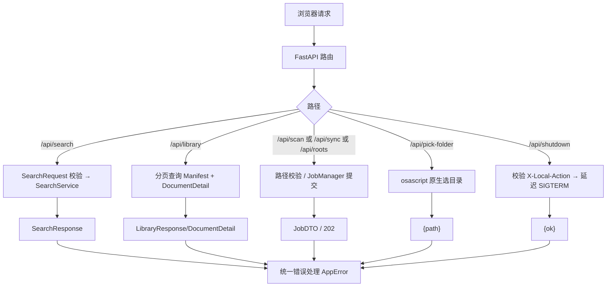

# STEP-08 API 层

> 状态：已完成（2026-10-21）  
> 依赖：[STEP-05](STEP-05-清单与增量扫描.md)、[STEP-06](STEP-06-入库流水线.md)、[STEP-07](STEP-07-检索与重排.md)  
> 预估：1.0 人日  
> 对应总方案：[DOC-00](../00-总体方案.md) §10  
> 对应代码：`app/models.py`、`app/api/*`、`tests/test_api.py`  
> 验收命令：见 §8

---

## 1. 目标

用 FastAPI 暴露本地 API：

- 搜索、资料库、索引根、扫描/同步、任务状态、健康检查；
- 统一错误结构与状态码；
- 异步任务走 `JobManager`，前端轮询；
- 路径校验，禁止越界打开文件；
- 静态托管 Web UI（STEP-09）。

---

## 2. 前置条件

- STEP-05/06/07 的服务类可用；
- 已确认端口 `8765` 未被占用；
- 已安装 `fastapi`、`uvicorn`、`python-multipart`。

---

## 3. 交付物

| 文件 | 内容 |
|---|---|
| `app/models.py` | 全部 Pydantic DTO |
| `app/api/__init__.py` | 导出 `create_app` |
| `app/api/app.py` | 应用工厂、lifespan、静态文件 |
| `app/api/errors.py` | `AppError`、统一异常处理 |
| `app/api/routes_search.py` | `/api/search` |
| `app/api/routes_library.py` | `/api/library`、`/api/documents/{doc_id}`、`/api/open` |
| `app/api/routes_sync.py` | `/api/roots`、`/api/scan`、`/api/sync`、`/api/jobs/{id}` |
| `app/api/routes_system.py` | `/api/health`、`/api/stats` |
| `tests/test_api.py` | 路由/错误/安全测试 |

---

## 4. 应用工厂

```python
def create_app(settings: Settings | None = None) -> FastAPI:
    settings = settings or load_settings()
    app = FastAPI(title="本地内容检索", version=__version__)
    app.state.settings = settings
    app.state.manifest = Manifest(settings.manifest_path)
    app.state.embedder = EmbeddingService(settings)
    app.state.reranker = RerankerService(settings)
    app.state.jobs = JobManager()

    @asynccontextmanager
    async def lifespan(app: FastAPI):
        report = run_preflight(settings)
        if not report.ok:
            raise RuntimeError("preflight failed")
        db = connect_db(settings)
        func = app.state.embedder.func
        table = open_table(db, settings, func)
        app.state.db = db
        app.state.table = table
        stale = app.state.manifest.recover_indexing()
        threading.Thread(target=app.state.embedder.warmup, daemon=True).start()
        yield
        table.optimize()

    app.router.lifespan_context = lifespan
    app.include_router(routes_system.router)
    app.include_router(routes_search.router)
    app.include_router(routes_library.router)
    app.include_router(routes_sync.router)
    app.mount("/static", StaticFiles(directory=settings.web_dir), name="static")

    @app.get("/")
    def home():
        return FileResponse(settings.web_dir / "index.html")

    app.add_exception_handler(AppError, app_error_handler)
    return app
```

启动顺序：

1. preflight（失败则进程退出）；
2. `connect_db` + `open_table`（含 FTS 检查）；
3. `recover_indexing`；
4. 同步预热 embedder + reranker（避免 auto 全局首查与 MPS 竞态）；
5. 接受请求。

关闭：

- 等待运行中任务完成或取消；
- `table.optimize()`（可选，避免每次退出都压缩）。

---

## 5. DTO

```python
class SearchRequest(BaseModel):
    model_config = ConfigDict(extra="forbid")
    query: str = Field(min_length=1, max_length=500)
    top_k: int = Field(default=20, ge=5, le=50)
    final_k: int = Field(default=5, ge=1, le=20)
    file_types: list[Literal["md","txt","pdf","docx","pptx","html","json","csv","image"]] = []
    root_id: int | None = None
```

其余：

| DTO | 字段 |
|---|---|
| `SearchHitDTO` | `chunk_id, doc_id, score, rrf_score, rerank_score, rank_before, rank_after, file_name, file_path, file_type, title, heading, snippet, page, slide, source_kind` |
| `SearchResponse` | `query, took_ms, candidates, results, warnings` |
| `LibraryItem` | `doc_id, file_name, file_path, file_type, size, mtime, chunks, indexed_at, status` |
| `LibraryResponse` | `total, page, page_size, items` |
| `DocumentDetail` | `item, chunks: list[ChunkDTO]` |
| `RootCreate` | `path: str` |
| `RootDTO` | `id, path, enabled, created_at, doc_count` |
| `ScanRequest` | `root_ids: list[int] | None` |
| `ScanDiffDTO` | `added, modified, deleted, unchanged, errors, duration_ms` |
| `SyncRequest` | `paths: list[str], deleted_paths: list[str] = [], delete_missing: bool = False` |
| `ReindexRequest` | `path: str` |
| `JobDTO` | `id, kind, status, progress, message, processed, total, result, error` |
| `HealthDTO` | `status, version, models, db, offline` |
| `StatsDTO` | `docs, chunks, db_size_mb, by_status, last_scan_at` |
| `OpenRequest` | `path: str, reveal: bool = False` |

校验规则：

- `final_k <= top_k`；
- `paths` 最多 1000 条；
- 所有路径必须绝对路径；
- `file_types` 白名单。

---

## 6. 路由

### 6.1 搜索

```python
@router.post("/api/search", response_model=SearchResponse)
def search(req: SearchRequest, request: Request):
    svc = SearchService(request.app.state.settings,
                        request.app.state.table,
                        request.app.state.embedder,
                        request.app.state.reranker)
    return svc.search(
        req.query, req.top_k, req.final_k,
        file_types=req.file_types, root_id=req.root_id,
    )
```

- 同步执行（热态 < 1s）；
- 若正在全量同步，仍允许搜索（LanceDB 读写可并发），但返回 `warning="sync_running"`；
- 错误：`MODEL_NOT_READY` 503、`INVALID_QUERY` 400。

### 6.2 资料库

`GET /api/library`

- 参数：`page`（1 起）、`page_size`（10–100）、`file_type`、`q`；
- 数据源：manifest `files` 表；
- `q` 用 `LIKE` 匹配 `path`，转义 `%`/`_`；
- 返回总数与分页。

`GET /api/documents/{doc_id}`

- manifest 取元数据；
- LanceDB `where doc_id = '...'` 取 chunks，按 `chunk_index` 排序；
- 不存在 → 404。

`POST /api/open`

```python
path = Path(req.path).expanduser().resolve()
if not is_allowed(path, roots, manifest):
    raise AppError("INVALID_PATH", "路径不在索引范围内", status=400)
cmd = ["open", "-R", str(path)] if req.reveal else ["open", str(path)]
subprocess.run(cmd, check=True, timeout=5)
```

- `is_allowed`：路径在任一启用 root 下，或等于某个已索引 `file_path`；
- 禁止 `shell=True`；
- Windows/Linux 不在范围（v1 macOS）。

`POST /api/reindex`

```python
@router.post("/api/reindex", status_code=202)
def reindex(req: ReindexRequest, request: Request):
    path = Path(req.path).expanduser().resolve()
    if not is_allowed(path, roots, manifest):
        raise AppError("INVALID_PATH", "路径不在索引范围内", status=400)
    job_id = request.app.state.jobs.submit(
        "reindex",
        lambda progress, cancel: ingest.ingest_paths([path], progress=progress, cancel=cancel),
    )
    return {"job_id": job_id}
```

- 仅允许已索引文件或索引根下路径；
- 任务完成后 UI 刷新文档 chunk 数。

### 6.3 索引根/扫描/同步

| 方法 | 路径 | 行为 |
|---|---|---|
| GET | `/api/roots` | 列出根 + 文档数 |
| POST | `/api/roots` | 校验目录存在，写入 manifest，返回 201 || DELETE | `/api/roots/{id}?delete_files=false` | 禁用或删除 |
| POST | `/api/scan` | 提交 scan job，返回 202 `{job_id}` |
| POST | `/api/sync` | 提交 sync job；已有任务 → 409 `BUSY` |
| GET | `/api/jobs/{id}` | 查询任务；不存在 404 |

- `POST /api/roots` 先 `Path(req.path).expanduser().resolve()`，必须是已存在目录；
- 重复添加同一路径返回已有记录（不报错）；
- `DELETE` 默认只 `enabled=0`；`delete_files=true` 才删除清单并触发数据清理。

**scan job：**

```python
def run_scan(progress, cancel):
    diff = scanner.scan(settings)
    return asdict(diff)
```

**sync job：**

```python
def run_sync(progress, cancel):
    paths = [Path(p) for p in req.paths]
    result = ingest.ingest_paths(paths, progress=progress, cancel=cancel)
    if req.delete_missing:
        deleted = [Path(p) for p in req.deleted_paths]
        ingest.delete_paths(deleted, progress=progress)
    return asdict(result)
```

- `deleted_paths` 必须来自扫描结果且在 manifest 中，服务端逐条校验；
- 只勾选“同时删除缺失文件”时才执行删除；
- 不允许 `delete_missing=True` 但 `deleted_paths` 为空时“自动删全部缺失”（避免误操作）。

- sync 只接受扫描结果中的路径，服务端再次校验 `is_allowed`；
- 单次最多 1000 个文件；
- 任务进度通过 `JobManager` 更新。

### 6.4 系统

`GET /api/health`

```json
{
  "status": "ok",
  "version": "1.2.0.dev0",
  "models": {
    "embedder": {"ready": true, "device": "mps", "dim": 1024},
    "reranker": {"ready": true}
  },
  "db": {"chunks": 1234, "fts_index": true},
  "offline": true
}
```

- `ready` 只表示“已加载/可加载”，不强制加载模型；
- 若模型缺失，`status="degraded"`，HTTP 200（便于 UI 展示）；
- 启动 preflight 失败则不启动。

`GET /api/stats`

- 文档数（manifest）、chunk 数、库大小、状态分布、最近扫描时间。

---

## 7. 错误处理

```python
class AppError(Exception):
    def __init__(self, code, message, hint="", status=400): ...

@app.exception_handler(AppError)
async def app_error_handler(request, exc):
    return JSONResponse(
        status_code=exc.status,
        content={"detail": {"code": exc.code, "message": exc.message, "hint": exc.hint}},
    )
```

| 异常 | 状态码 | code |
|---|---|---|
| `ModelNotReady` | 503 | `MODEL_NOT_READY` |
| `RerankerUnavailable` | `RERANK_FAILED` | 重排失败，显式 400 |
| `InvalidPath` | 400 | `INVALID_PATH` |
| `Busy` | 409 | `BUSY` |
| `JobNotFound` | 404 | `JOB_NOT_FOUND` |
| `ParseError` | 422 | `PARSE_FAILED` |
| 未捕获异常 | 500 | `INTERNAL_ERROR`（不暴露堆栈） |

日志记录 `request_id`、路径、耗时；不记录正文。

---

## 8. 测试与验收

### 8.1 单元/集成测试

```bash
.venv/bin/python -m pytest tests/test_api.py -q
```

使用 `TestClient` + 临时 Settings + Fake 模型：

- `GET /api/health` 200；
- `POST /api/search` 正常返回；
- 空 query → 422；
- `final_k > top_k` → 422；
- `POST /api/roots` 添加/重复添加；
- `POST /api/scan` 返回 job_id；轮询到 done；
- `POST /api/sync` 后统计增加；
- 重复 sync → 409；
- `POST /api/open` 越界路径 → 400；
- 未知 job → 404。

### 8.2 手工验收

```bash
.venv/bin/python -m app
curl -s http://127.0.0.1:8765/api/health | python -m json.tool
curl -s -X POST http://127.0.0.1:8765/api/search \
  -H 'Content-Type: application/json' \
  -d '{"query":"混合检索","top_k":20,"final_k":5}' | python -m json.tool
```

打开 <http://127.0.0.1:8765/docs> 查看 OpenAPI。

### 8.3 验收记录

| 日期 | 执行人 | 结果 | 备注 |
|---|---|---|---|
| 2026-10-21 | 实现 | 通过 | 自动化测试通过 |

---

## 9. 代码映射

| 文件 | 符号 | 说明 | 测试 |
|---|---|---|---|
| `app/models.py` | `SearchRequest` 等 | DTO | `test_api.py::test_validation` |
| `app/api/app.py` | `create_app` | 工厂 | `test_api.py::test_health` |
| `app/api/routes_search.py` | `search` | 搜索 | `test_api.py::test_search` |
| `app/api/routes_library.py` | `open_path` | 打开文件 | `test_api.py::test_open_outside_roots` |
| `app/api/routes_sync.py` | `scan`, `sync` | 任务 | `test_api.py::test_scan_job` |
| `app/api/routes_system.py` | `health`, `stats` | 系统 | `test_api.py::test_stats` |
| `app/api/errors.py` | `AppError` | 错误结构 | `test_api.py::test_open_outside_roots` |

---

## 10. 风险与备注

| 风险 | 处理 |
|---|---|
| 同步时搜索变慢 | 单 worker；可接受；UI 提示 |
| 大请求体 | 限制 paths 数量；query 长度 |
| 路径穿越 | `resolve` + root 校验 |
| 端口冲突 | 启动失败并提示改 `APP_PORT` |
| 前端缓存旧 JS | 开发期 `Cache-Control: no-store` |
| 任务丢失（重启） | 内存任务；重启后提示重新扫描 |

---

## 11. 完成定义（DoD）

- [ ] 全部端点可用，错误结构统一；
- [ ] 任务轮询可用；
- [ ] 路径安全校验通过；
- [ ] `tests/test_api.py` 全绿；
- [ ] OpenAPI 文档可访问；
- [ ] 本文档 §8.3 已填写。


---

## 流程图


