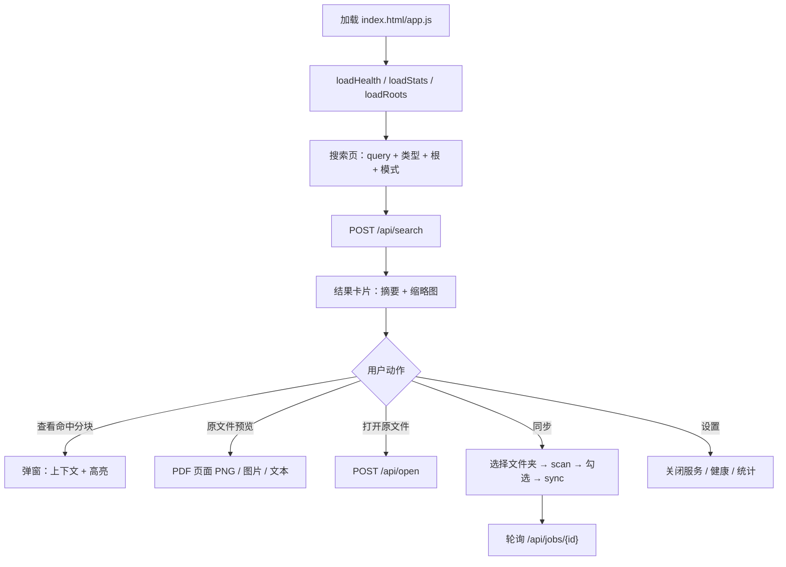

# STEP-09 Web UI

> 状态：已完成（2026-10-21）  
> 依赖：[STEP-08](STEP-08-API层.md)  
> 预估：1.5 人日  
> 对应总方案：[DOC-00](../00-总体方案.md) §9  
> 对应代码：`web/index.html`、`web/app.js`、`web/styles.css`  
> 验收方式：见 §9

---

## 1. 目标

做一个**无需构建、离线可用、中文界面**的本地 Web UI：

- 搜索：输入、过滤、结果卡片、打开文件；
- 资料库：文档列表、分页、详情、单文档重建；
- 同步：索引根管理、检查更新、勾选 diff、手动同步、进度；
- 设置：模型/DB 状态、统计、参数展示、日志路径；
- 全程不依赖 CDN/外部字体/前端框架。

---

## 2. 前置条件

- STEP-08 API 已可用；
- `web/` 目录由 FastAPI `StaticFiles` 托管；
- 浏览器为 Safari/Chrome 最新版。

---

## 3. 交付物

| 文件 | 内容 |
|---|---|
| `web/index.html` | 四页结构 + 状态栏 |
| `web/app.js` | API 封装、状态、渲染、轮询、高亮 |
| `web/styles.css` | 布局、卡片、徽标、深色模式、响应式 |

---

## 4. 页面结构

```text
┌────────────────────────────────────────────────────────────┐
│ 本地内容检索     [搜索] [资料库] [同步] [设置]    ● 就绪     │
│ 文档 128 · Chunk 2,431 · 上次同步 10:32                     │
├────────────────────────────────────────────────────────────┤
│ 搜索页                                                      │
│ ┌ 搜索框 ────────────────────────────────────────────────┐ │
│ │ 混合检索延迟怎么优化                              [搜索] │ │
│ └────────────────────────────────────────────────────────┘ │
│ 类型 [全部▾]  索引根 [全部▾]  top_k [20]  final_k [5]       │
│                                                            │
│ ┌ 结果 1 ────────────────────────────────────────────────┐ │
│ │ [PDF] report.pdf · 第 3 页      重排 85%   RRF 0.016   │ │
│ │ /Users/.../report.pdf                                   │ │
│ │ …命中片段，关键词高亮…                                  │ │
│ │ [打开] [在 Finder 中显示]                               │ │
│ └────────────────────────────────────────────────────────┘ │
└────────────────────────────────────────────────────────────┘
```

### 4.1 导航

- 四个 tab，URL hash 同步（`#search` / `#library` / `#sync` / `#settings`）；
- 刷新后停留在当前 tab；
- 移动端折叠为顶部横向滚动。

### 4.2 状态栏

- 健康状态圆点：绿=ok，黄=degraded，红=error；
- 文档数、chunk 数、上次同步时间；
- 若有未处理变更，显示“发现 N 个变更”徽标，点击跳到同步页；
- 点击状态打开设置页。

---

## 5. 搜索页

### 5.1 交互

1. 输入框回车或点击“搜索”；
2. 校验非空；
3. 显示骨架屏；
4. `POST /api/search`；
5. 渲染结果 / 空状态 / 错误；
6. 结果区顶部显示 `took_ms`、候选数、warning。

### 5.2 结果卡片

| 元素 | 数据 |
|---|---|
| 类型徽标 | `file_type`（PDF/DOCX/PPTX/MD/图片） |
| OCR 徽标 | `source_kind == "ocr"` |
| 文件名 | `file_name` |
| 页码/幻灯片 | `page` / `slide`（0 不显示） |
| 主分数 | `score` 百分比（重排分） |
| 次分数 | `rrf_score`（保留 4 位） |
| 路径 | `file_path`，中间省略 |
| 片段 | `snippet` + 高亮 |
| 操作 | 打开 / Finder |

### 5.3 高亮

```js
function highlight(text, terms) {
  const frag = document.createDocumentFragment();
  // 1. 转义：始终用 textContent 构建文本节点
  // 2. 按 terms 长度降序，找第一个匹配（忽略大小写）
  // 3. 匹配段用 <mark>，其余用文本节点
  return frag;
}
```

- 服务端返回 `highlight_terms`；
- 前端不拼 HTML 字符串，避免 XSS；
- 中文按 2–4 字词元，英文按整词；
- 高亮数量上限 50 处，避免长文卡顿。

### 5.4 过滤

- 类型多选（默认全部）；
- 索引根下拉（来自 `/api/roots`）；
- `top_k` / `final_k` 数字输入，限制范围；
- 过滤变更后不自动搜索，点按钮或回车。

### 5.4.1 动态文件 scope

资料库每行新增复选框：

- 勾选文件 → 搜索请求带 `doc_ids`；
- 不勾选 → 不传 scope，走全局检索；
- 顶部显示“范围：已选 N 个文件”；
- “清空范围”恢复全局；
- 支持当前页全选；
- 搜索模式保持 `auto` 时，后端自动选择：
  ```text
  无 scope → full
  有 scope → hybrid
  ```

UI 验收：

```text
勾选 1 个文件 → 请求体含 doc_ids
清空范围 → 请求体不含 doc_ids
scope 外结果 = 0
```

### 5.4.2 文档级结果

搜索工具栏新增“文档级结果”复选框：

- 勾选后请求带 `doc_level=true`；
- 每个文档最多返回一个代表 chunk；
- 适合按文件/候选人浏览；
- 不勾选保持 chunk 级结果。

### 5.5 空/错误状态

- 空 query：输入框抖动 + 提示；
- 无结果：显示“没有找到，试试更短的关键词或放宽过滤”；
- 503：显示“模型未就绪”，附 hint；
- 网络错误：顶部 toast，可重试。

---

## 6. 资料库页

### 6.1 列表

`GET /api/library?page=&page_size=&file_type=&q=`

| 列 | 说明 |
|---|---|
| 文件名 | 可点击打开详情 |
| 类型 | 徽标 |
| Chunk 数 | `chunks` |
| 状态 | indexed/error/pending/deleted 徽标 |
| 索引时间 | 本地时间 |
| 操作 | 重建 / 打开 |

- 支持按路径搜索；
- 分页 20/50/100；
- 错误文件黄色高亮，hover 显示 `last_error`。

### 6.2 详情抽屉

`GET /api/documents/{doc_id}`

- 顶部：路径、类型、大小、mtime、chunk 数；
- 列表：chunk_index、页码/幻灯片、heading、片段；
- 操作：打开文件、重建该文档；
- 抽屉用 `dialog` 或右侧滑出。

### 6.3 重建

`POST /api/reindex {path}` → job → 轮询 → 完成后刷新。

---

## 7. 同步页

### 7.1 索引根

- 列表：路径、文档数、启用状态、移除按钮；
- 添加：文本输入路径（支持 `~`，默认展示 `~/Downloads` 示例）；
- 服务端 `expanduser().resolve()` 后校验目录存在；
- 浏览器无法直接获取本地绝对路径，v1 用输入框 + 服务端校验；
- 可选“选择文件夹”调用原生对话框留到 P2（`osascript choose folder`）。

### 7.2 检查更新

1. 点击“检查更新” → `POST /api/scan`；
2. 轮询 job；
3. 展示 diff 概览卡片：新增 / 修改 / 删除 / 未变；
4. 三组列表，带复选框（默认全选新增+修改，删除不选）；
5. 错误列表单独展示。

### 7.3 执行同步

- “同步选中” → `POST /api/sync {paths, deleted_paths, delete_missing}`；
- `deleted_paths` 只在勾选“同时删除缺失文件”时带上；
- 进度条 + 当前文件名 + processed/total；
- 运行中禁用按钮，允许“取消”（P2，v1 可只展示）；
- 完成后刷新统计与资料库；
- 失败文件在结果中列出，可单独重试。

### 7.4 变更提醒

- 启动后 3s 可选自动扫描（`AUTO_SCAN=true`）；
- 只更新徽标，不自动同步；
- 用户点击徽标进入同步页；
- 关闭自动扫描时，只保留“检查更新”按钮。

---

## 8. 设置页

| 区块 | 内容 |
|---|---|
| 健康 | `GET /api/health`：模型 ready、device、dim、FTS、DB |
| 统计 | 文档数、chunk 数、库大小、状态分布 |
| 参数 | chunk_size/overlap、top_k/final_k、模型路径（只读） |
| 路径 | 数据目录、日志路径、模型目录 |
| 危险操作 | 重建 FTS（P2）、清空索引（需二次确认，P2） |

v1 不做在线修改切片参数（改配置需重启），避免索引不一致。

---

## 9. 验收清单（手工）

### 9.1 搜索

- [ ] 输入“混合检索”回车，出现结果；
- [ ] 结果含文件名、路径、片段、页码/幻灯片、分数；
- [ ] 关键词高亮；
- [ ] 类型过滤生效；
- [ ] 点击“打开”能用默认应用打开；
- [ ] “在 Finder 中显示”能定位；
- [ ] 空 query 有提示；
- [ ] 后端 503 时显示可操作错误。

### 9.2 资料库

- [ ] 列表分页正常；
- [ ] 点击文件名打开详情；
- [ ] 错误状态可见；
- [ ] 重建单文档后 chunk 数更新。

### 9.3 同步

- [ ] 添加 `~/Downloads` 成功；
- [ ] 检查更新显示新增/修改/删除；
- [ ] 只勾选部分文件可同步；
- [ ] 进度条更新；
- [ ] 完成后统计变化；
- [ ] 删除缺失文件需显式勾选。

### 9.4 设置/通用

- [ ] 健康状态正确；
- [ ] 深色模式可读；
- [ ] 窗口 1024px / 1440px 布局正常；
- [ ] 无外部网络请求（DevTools Network 全为本地）；
- [ ] 刷新后 tab 保持。

---

## 10. 代码映射

| 文件 | 符号/区域 | 说明 |
|---|---|---|
| `web/index.html` | `#search-view` | 搜索页 |
| `web/index.html` | `#library-view` | 资料库 |
| `web/index.html` | `#sync-view` | 同步 |
| `web/index.html` | `#settings-view` | 设置 |
| `web/app.js` | `api()` | fetch 封装 + 错误 toast |
| `web/app.js` | `renderSearch()` | 结果渲染 |
| `web/app.js` | `highlight()` | 安全高亮 |
| `web/app.js` | `pollJob()` | 1s 轮询 |
| `web/app.js` | `renderSync()` | diff/复选框/进度 |
| `web/styles.css` | `:root` | 颜色变量/深色模式 |

---

## 11. 风险与备注

| 风险 | 处理 |
|---|---|
| XSS | 全部 `textContent`/DOM 构建，不用 `innerHTML` 拼数据 |
| 长片段卡顿 | 截断 1200 字；高亮上限 50 |
| 轮询过多 | 仅运行中任务 1s 轮询；完成后停止 |
| 浏览器缓存 | 开发期 `no-store`；静态资源加版本号 |
| 路径输入错误 | 服务端校验 + 明确错误 |
| 无前端构建 | 原生 JS，降低离线安装成本 |
| 移动端 | 非目标，但保证 1024px 可用 |

---

## 12. 完成定义（DoD）

- [ ] 四页可用，核心流程闭环；
- [ ] 搜索/同步/资料库均有空态与错误态；
- [ ] 无外部网络请求；
- [ ] 手验收清单全部通过；
- [ ] 本文档 §9 已勾选。


---

## 流程图


