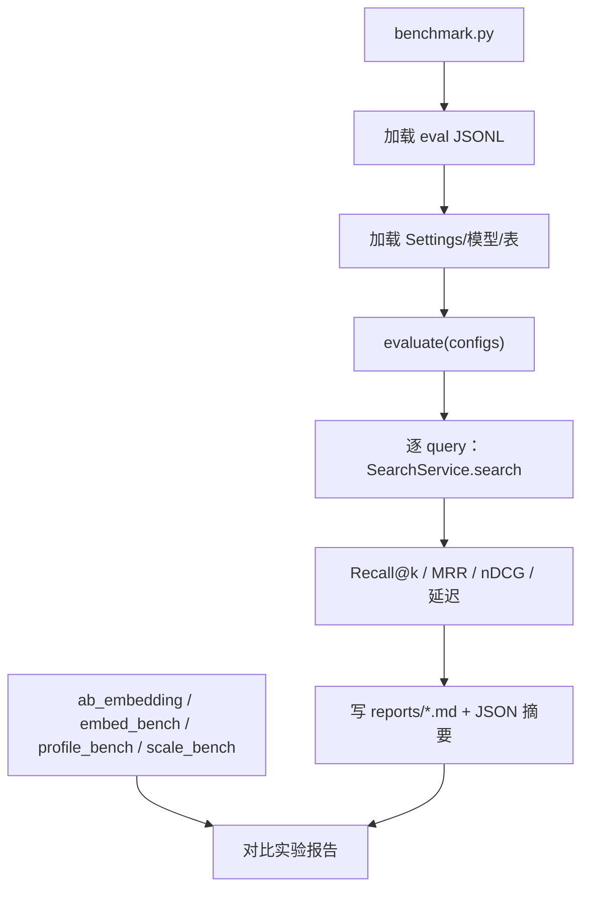

# STEP-10 评测与基准

> 状态：v1.1 基线完成；v1.2 RC 评测/表格/UI 验收已完成（见 `reports/v1.2-acceptance.md`）  
> 依赖：[STEP-06](STEP-06-入库流水线.md)、[STEP-07](STEP-07-检索与重排.md)  
> 预估：1.0 人日  
> 对应总方案：[DOC-00](../00-总体方案.md) §14 · [DOC-03 评测方案](../03-评测方案.md)  
> 对应代码：`app/evaluation.py`、`scripts/benchmark.py`、`tests/test_evaluation.py`  
> 验收命令：见 §8

---

## 1. 目标

用可复现的方式回答：

- 混合检索是否比纯向量好？
- 重排是否带来稳定增益？
- 延迟是否可接受？
- 哪些 query 失败，为什么？

交付：指标实现 + 四/五组对比 + Markdown 报告 + 失败归因。

---

## 2. 前置条件

- 已有可检索的库（个人或临时公共集）；
- 已有 query 集与 qrels（至少 30 条）；
- 模型与 DB 版本固定。

---

## 3. 交付物

| 文件 | 内容 |
|---|---|
| `app/evaluation.py` | 指标、数据集加载、配置运行、报告生成 |
| `scripts/benchmark.py` | CLI |
| `tests/test_evaluation.py` | 指标算例 |
| `reports/eval-YYYYMMDD-HHMM.md` | 运行产物（gitignore） |

---

## 4. 指标实现

```python
def recall_at_k(relevant: set[str], retrieved: list[str], k: int) -> float:
    if not relevant:
        return 0.0
    return len(relevant & set(retrieved[:k])) / len(relevant)

def mrr_at_k(relevant: set[str], retrieved: list[str], k: int) -> float:
    for i, doc_id in enumerate(retrieved[:k], start=1):
        if doc_id in relevant:
            return 1.0 / i
    return 0.0

def ndcg_at_k(relevant: dict[str, int], retrieved: list[str], k: int) -> float:
    # gain = 2^grade - 1; DCG 用 log2(i+1)
    ...
```

要求：

- 文档级去重：同一文档多个 chunk 只取最高分；
- `retrieved` 是去重后的 `doc_id` 列表；
- 空 relevant 的 query 跳过并计数；
- 指标保留 4 位小数；
- 单测用手工算例校验（见 §8）。

---

## 5. 实验配置

| 配置 | 实现 |
|---|---|
| `vector` | `table.search(qvec, query_type="vector").limit(top_k)` |
| `fts` | `table.search(query, query_type="fts").limit(top_k)` |
| `hybrid` | `table.search(query_type="hybrid").vector(qvec).text(query).rerank(RRFReranker()).limit(top_k)` |
| `hybrid_rerank` | hybrid + `RerankerService.score` + 排序 |
| `full` | hybrid_rerank + 每文档去重 + 上下文 |

实现方式：

- 在 `SearchService` 增加 `mode` 参数（API/UI/CLI 默认 `auto`：无 scope 用 full，有 scope 用 hybrid；服务层签名保留 full 兼容）；
- `evaluation.run_config` 复用 `SearchService`，避免两套逻辑；
- 所有配置共用同一 `top_k`、同一模型、同一数据快照。

---

## 6. 数据集加载

### 6.1 个人集

```jsonl
{"qid":"p001","query":"...","relevant":["/abs/a.pdf"],"grade":[2],"type":"semantic"}
```

加载后：

- `path -> doc_id` 由 manifest / `make_doc_id` 映射；
- `grade` 缺省为 1；
- `type` 用于分桶。

### 6.2 公开集

```text
queries.jsonl  {"qid":"...","query":"..."}
corpus.jsonl   {"doc_id":"...","text":"...","title":"..."}
qrels.tsv      qid \t doc_id \t grade
```

- 评测时把 corpus 导入临时 LanceDB（`--rebuild`）；
- `doc_id` 直接使用公开集 ID；
- 只保留 qrels 中出现过的 corpus 子集，控制体量；
- 记录抽样种子与原始版本。

### 6.3 分桶

| 维度 | 值 |
|---|---|
| 类型 | semantic / keyword / mixed |
| 文件类型 | md / pdf / docx / pptx / image |
| OCR | `source_kind=ocr` 的命中 |
| 长度 | query ≤ 10 字 / > 10 字 |

---

## 7. CLI 与报告

```bash
.venv/bin/python scripts/benchmark.py \
  --dataset data/eval/personal/queries.jsonl \
  --configs vector,fts,hybrid,hybrid_rerank,full \
  --top-k 20 --final-k 5 \
  --out reports/eval-$(date +%Y%m%d-%H%M).md
```

参数：

| 参数 | 说明 |
|---|---|
| `--dataset` | query JSONL |
| `--corpus` | 公开集 corpus JSONL（可选） |
| `--qrels` | 公开集 qrels TSV（可选） |
| `--configs` | 逗号分隔 |
| `--top-k` / `--final-k` | 检索参数 |
| `--out` | 报告路径 |
| `--rebuild` | 重建临时评测库 |
| `--limit` | 只跑前 N 条 query（调试） |

报告内容见 [DOC-03 §8](../03-评测方案.md#8-报告模板)。

---

## 8. 测试与验收

### 8.1 单元测试

```bash
.venv/bin/python -m pytest tests/test_evaluation.py -q
```

手工算例：

```python
# relevant={a,b,c}, retrieved=[x,a,y,b], k=3
recall@3 = 1/3
mrr@3 = 1/2
# 分级：a=2,b=1
ndcg@3 手算校验
```

覆盖：

- 空 relevant；
- 重复 retrieved 去重；
- k 大于结果数；
- 分级 nDCG 归一化；
- qrels 映射。

### 8.2 冒烟评测

```bash
.venv/bin/python scripts/benchmark.py \
  --dataset data/eval/smoke.jsonl \
  --configs vector,hybrid,hybrid_rerank \
  --limit 10 \
  --out reports/smoke.md
```

期望：三组都能跑完，报告含指标表与延迟。

### 8.3 正式评测

按 [DOC-03](../03-评测方案.md) 执行：

1. 固定语料快照；
2. 预热；
3. 每配置 3 次取中位数；
4. 记录失败案例；
5. 生成报告；
6. 对照 §6 阈值判断是否达标。

### 8.4 当前结果（2026-10-23）

38 条简历 query，UI 口径：

```bash
python scripts/benchmark.py \
  --dataset examples/eval-resume-38.jsonl \
  --configs hybrid,hybrid_rerank,full \
  --top-k 20 --final-k 5 \
  --out reports/archive/eval-resume-38-ui.md
```

| 配置 | Recall@5 | Recall@10 | MRR@10 | nDCG@10 | p50 |
|---|---|---|---|---|---|
| hybrid | 0.7075 | 0.9605 | 0.6930 | 0.7269 | 27ms |
| hybrid_rerank | 0.6605 | 0.9671 | 0.6478 | 0.6962 | 392ms |
| full | 0.6605 | 0.9671 | 0.6478 | 0.6962 | 413ms |

6 条表格内容 query：

```bash
python scripts/benchmark.py \
  --dataset examples/eval-resume-tables-6.jsonl \
  --configs hybrid,hybrid_rerank,full \
  --top-k 20 --final-k 5 \
  --out reports/archive/eval-resume-tables-6.md
```

| 配置 | Recall@5 | Recall@10 | MRR@10 | nDCG@10 | p50 |
|---|---|---|---|---|---|
| hybrid | 1.0000 | 1.0000 | 1.0000 | 1.0000 | 28ms |
| hybrid_rerank | 1.0000 | 1.0000 | 0.8333 | 0.8770 | 404ms |
| full | 1.0000 | 1.0000 | 0.8333 | 0.8770 | 404ms |

判断：

- rerank 在两组评测上都降低 MRR/nDCG；
- p50 从约 27ms 升到约 400ms；
- 早期因此把默认改为 hybrid；后续按 scope 改为 auto（见 8.4.1）。
- `full` 保留为可选实验模式；
- 表格 query 的 hybrid 全对，但样本只有 6 条，不能过度解读。

报告：

- eval-resume-38-ui.md
- eval-resume-tables-6.md

### 8.4.1 Scope-aware auto 模式（2026-10-23）

同一批 38 条 query，分别跑全局和简历 scope：

| 场景 | 配置 | Recall@5 | Recall@10 | MRR@10 | nDCG@10 | p50 |
|---|---|---|---|---|---|---|
| 全局 | hybrid | 0.6066 | 0.8991 | 0.5531 | 0.6178 | 31ms |
| 全局 | hybrid_rerank | **0.6395** | **0.9145** | **0.6573** | **0.6736** | 321ms |
| 简历 scope | hybrid | 0.6526 | 0.9496 | **0.6412** | **0.6886** | 30ms |
| 简历 scope | hybrid_rerank | 0.6518 | **0.9583** | 0.6156 | 0.6808 | 317ms |

结论：

```text
无 scope：rerank 提升明显
有 scope：rerank 对 MRR/nDCG 反而下降
```

因此默认模式改为 `auto`：

```text
无 doc_ids/file_paths/root_id → full（带重排）
有 scope                     → hybrid（低延迟）
手动选择 full/hybrid          → 尊重手动选择
```

API/UI/CLI 默认均为 `auto`；可用：

```json
{"mode":"hybrid"}
{"mode":"full"}
```

覆盖自动选择。

报告：

- eval-resume-38-global-rerank.md
- eval-resume-38-scoped-both.md

### 8.4.2 版本标签与 top5 坑位（2026-10-23）

同一套 38 条 query，分别使用：

- all-versions：当前版本 + 历史版本；
- current-only：过滤 `/历史版本/` 和 `_副本`，r38 因没有当前版本被排除。

| 标签 | query 数 | Recall@5 | Recall@10 | MRR@10 | nDCG@10 | p50 |
|---|---:|---|---|---|---|---|
| all-versions | 38 | 0.6526 | 0.9496 | 0.6412 | 0.6886 | 30ms |
| current-only | 37 | 0.8378 | 1.0000 | 0.4767 | 0.5975 | 30ms |

解读：

- 历史版本让 Recall@5 看起来更低；
- 但历史版本排得靠前，会把 all-versions 的 MRR/nDCG 抬高；
- 所以不能只用一套“多版本都算相关”的标签判断排序质量。

文档级限流：

- hybrid 现在也应用 `per_doc_limit`；
- 但 38 条结果在 `per_doc_limit=1/2` 下完全一致；
- 说明 top5 的主要问题不是同文档 chunk 刷屏，而是不同相关文件分别排在第 6–10 名。

top50 诊断：

- 6 条 top10 失败中，只有 r19 在 top50 下恢复到 top10；
- r12/r17/r25/r26/r29 的相关文件在第 11–16 名；
- 扩 top_k 有候选收益，但不会自动改善 top5。

报告：

- eval-resume-37-current.md
- eval-resume-38-scoped-perdoc1.md
- top50 诊断

### 8.5 Chunk 级评测（2026-10-23）

数据集：

```text
examples/eval-resume-chunks-10.jsonl
```

10 条 query，标签格式：

```text
path#chunk_index
```

标签基于当前简历索引快照；重建后 chunk_index 可能变化，需要重新核对。

| 配置 | Chunk Recall@5 | Chunk Recall@10 | Chunk MRR@10 | Chunk nDCG@10 | p50 |
|---|---|---|---|---|---|
| hybrid | 0.4583 | 0.7433 | 0.4417 | 0.4756 | 31ms |
| hybrid_rerank | 0.6033 | 0.8617 | 0.6083 | 0.6320 | 370ms |
| full | 0.6033 | 0.7617 | 0.6117 | 0.5839 | 327ms |

解读：

- 文件级 Recall 1.0，但 chunk 级 Recall@5 只有 0.4583；
- 说明“找到文件”不等于“命中正确段落”；
- chunk 级上 rerank 有提升，和文件级结论相反；
- 需要更多 chunk 标签和按 query 类型分析，不能直接用一个小集合决定默认模式。

报告：eval-resume-chunks-10.md

### 8.6 多根 query（2026-10-23）

数据集：

```text
examples/eval-multi-root-8.jsonl
```

覆盖：

```text
network_youhua
Downloads/md文档
享学课程/资料
工作相关/简历
```

| 配置 | Recall@5 | Recall@10 | MRR@10 | nDCG@10 | p50 |
|---|---|---|---|---|---|
| hybrid | 0.8125 | 0.9062 | 0.7262 | 0.7648 | 32ms |
| hybrid_rerank | 0.8750 | 0.9062 | 0.8958 | 0.8623 | 404ms |
| full | 0.8750 | 0.9062 | 0.8958 | 0.8623 | 354ms |

解读：

- 多根/技术文档场景下 rerank 有提升；
- 与简历文件级结果相反，说明领域/标签影响很大；
- 默认按 scope 自动选择（全局 full / scoped hybrid）；full 仍可手动选；
- 8 条样本不足以下结论。

报告：eval-multi-root-8.md

### 8.7 公开集子集（2026-10-23）

数据：

```text
T2Retrieval（C-MTEB）
官方 corpus 118,605 passages / dev queries / qrels
本次子集：50 queries + 3,232 passages
```

来源：[C-MTEB/T2Retrieval](https://huggingface.co/datasets/C-MTEB/T2Retrieval)。数据只放在本地 `data/eval/public/`，使用前需确认数据集许可与引用要求。

构建脚本：

```bash
python scripts/build_public_subset.py --reset --query-limit 50 --negative-count 3000
```

评测：

```bash
DATA_DIR=data/eval/public/t2retrieval/index \
python scripts/benchmark.py \
  --dataset data/eval/public/t2retrieval/queries.jsonl \
  --configs vector,fts,hybrid,hybrid_rerank \
  --top-k 20 --final-k 10 \
  --out reports/eval-public-t2-50.md
```

| 配置 | Recall@5 | Recall@10 | MRR@10 | nDCG@10 | p50 |
|---|---|---|---|---|---|
| vector | 0.8389 | 0.9425 | 0.9900 | 0.9557 | 22ms |
| fts | 0.7313 | 0.8791 | 0.9633 | 0.8873 | 88ms |
| hybrid | 0.8069 | 0.9311 | 0.9900 | 0.9459 | 109ms |
| hybrid_rerank | 0.8074 | 0.9343 | 0.9767 | 0.9328 | 696ms |

注意：

- 这是 3,000 个随机负例 + 相关 passage 的子集，不是官方全量；
- MRR 接近 1 是因为负例较容易，不能当官方成绩；
- 只能用于流程验证和相对比较；
- 正式比较需要官方全量 corpus + qrels。

报告：eval-public-t2-50.md

### 8.8 Anchors 与动态选根（2026-10-23）

旧的 `path#chunk_index` 仍支持固定快照，但新增内容锚点：

```json
"relevant_anchors": [
  {
    "path": "/abs/doc.md",
    "quote": "无障碍节点采集",
    "heading": "项目经验",
    "doc_hash": "可选",
    "chunk_index": 6
  }
]
```

解析规则：

1. 按 path 查当前 chunk；
2. 用 manifest 当前 `run_id` 过滤旧版本；
3. 如果给 `doc_hash`，必须匹配；
4. 如果给 `heading`，按包含匹配；
5. 优先用归一化空白后的 `quote` 匹配 `display_text`；
6. 没有 quote 时才用 `chunk_index` fallback；
7. 匹配不到计入 `anchor_missing`。

数据集：

```text
examples/eval-resume-anchors-10.jsonl
```

10 条 query / 29 个 anchors。  
评测时只选简历根：

```bash
DATA_DIR=data python scripts/benchmark.py \
  --dataset examples/eval-resume-anchors-10.jsonl \
  --configs hybrid,hybrid_rerank \
  --top-k 20 --final-k 5 \
  --root-path "/Users/example/Downloads/工作相关/简历" \
  --out reports/archive/eval-resume-anchors-10.md
```

结果：

| 配置 | Chunk Recall@5 | Chunk Recall@10 | Chunk MRR@10 | Chunk nDCG@10 | p50 |
|---|---|---|---|---|---|
| hybrid | 0.4433 | 0.6150 | 0.4333 | 0.4326 | 30ms |
| hybrid_rerank | 0.5550 | 0.7867 | 0.6083 | 0.6006 | 366ms |

说明：

- 29 个 anchors 全部解析成功，`anchor_missing=0`；
- 动态选根通过 `--root-path` 实现；
- quote 可能命中多个 chunk，所以 chunk 指标和固定 `path#index` 不完全相同；
- 重新切块后只要 quote 仍存在，标签仍可解析；
- 文件内容大改导致 quote 消失时，会报告 anchor missing，而不是静默算错。

报告：eval-resume-anchors-10.md

### 8.9 Scope prefilter 与 Parent rerank（2026-10-23）

动态选文件支持：

```text
SearchRequest.doc_ids
SearchRequest.file_paths
SearchService.search(doc_ids=..., file_paths=...)
CLI: --doc-id / --file-path
评测 JSON: scope_doc_ids / scope_file_paths
```

过滤在 LanceDB `where(..., prefilter=True)` 中完成，不是搜后过滤。

Scoped anchor 数据集：

```text
examples/eval-resume-scoped-4.jsonl
```

结果：

| 配置 | Recall@5 | Chunk R@5 | Chunk MRR | Chunk nDCG | p50 |
|---|---|---|---|---|---|
| hybrid | 1.0000 | 0.8750 | 0.6458 | 0.7255 | 28ms |
| hybrid_rerank | 1.0000 | 1.0000 | 0.6458 | 0.7302 | 468ms |

报告：eval-resume-scoped-4.md

Parent/child rerank 已实现为可选开关：

```text
RERANK_PARENT_CONTEXT=true
```

它把同 heading/page/slide 的 parent 文本拼给 reranker；默认关闭。

Anchor A/B：

| 配置 | Chunk R@5 | Chunk R@10 | Chunk MRR | Chunk nDCG | p50 |
|---|---|---|---|---|---|
| parent off | 0.5550 | 0.7867 | 0.6083 | 0.6006 | 365ms |
| parent on | **0.6300** | 0.7400 | 0.5867 | 0.5711 | 560ms |

结论：

- parent context 提升 Chunk R@5，但 R@10/MRR/nDCG 下降；
- 延迟从 365ms 升到 560ms；
- 当前不作为默认，保留 `RERANK_PARENT_CONTEXT=true` 供实验；
- 下一步应扩大样本并按 query 类型分析，而不是直接开启。

报告：

- eval-anchor-parent-off.md
- eval-anchor-parent-on.md

### 8.10 合成 PDF 动态验证（2026-10-23）

脚本：

```bash
python scripts/make_pdf_fixtures.py --reset
```

生成三组：

```text
data/eval/pdf-synth/root/
├── clean/      # 文本层 PDF
├── header/     # 重复页眉 + 页码
└── scanned/    # 前 2 页图片 PDF，走 OCR
```

选择 5 篇 docs Markdown：

```text
docs/16-数据清洗分块与向量化.md
docs/03-评测方案.md
docs/archive/14-数据清洗与自适应切片.md
docs/steps/STEP-03-解析层.md
docs/steps/STEP-10-评测与基准.md
```

索引：

```bash
DATA_DIR=data/eval/pdf-synth/index \
python -m app.cli index --root data/eval/pdf-synth/root
```

动态 scope 数据集：

```text
examples/eval-docs-pdf-10.jsonl
```

每条 query 通过 `scope_file_paths` 只选目标 PDF + 一个干扰 PDF；标签用 `relevant_anchors`。

结果：

| 配置 | Recall@5 | Recall@10 | MRR@10 | nDCG@10 | Chunk R@5 | Chunk R@10 | Chunk MRR | Chunk nDCG | p50 |
|---|---|---|---|---|---|---|---|---|---|
| hybrid | 1.0000 | 1.0000 | 0.9000 | 0.9262 | 0.6000 | 0.8000 | 0.5476 | 0.5815 | 22ms |
| hybrid_rerank | 1.0000 | 1.0000 | 0.9500 | 0.9631 | 0.7667 | 0.9333 | 0.7569 | 0.7640 | 402ms |

解析验证：

- `header` 版 DOC-16：17 页，移除 34 行页眉/页脚/页码；
- `scanned` 版 DOC-16：2 页，无文本层，走整页 OCR；
- 10 个 anchors 全部解析成功；
- 期间发现一个 anchor quote 在 PDF 中不存在，修正为实际存在的 `top_k` 后 `anchor_missing=0`。

报告：eval-docs-pdf-10.md

注意：

- 这是合成 PDF，不代表真实扫描件/复杂版面；
- 只用于解析、页眉页脚、OCR、动态 scope 回归；
- 不是公开 benchmark，不能对外宣称真实 PDF 成绩。

### 8.11 项目 Markdown 对比（v1.0 基线，2026-10-23）

把当前 `docs/` 下 31 个文件（含 md/图片 OCR）索引成独立评测快照：

```text
数据：data/eval/docs-md/index
规模：31 files / 1126 chunks
数据集：examples/eval-docs-md-10.jsonl
```

和合成 PDF 用同一批 10 条 query / scope / anchor。

结果：

| 配置 | Recall@5 | Recall@10 | MRR@10 | nDCG@10 | Chunk R@5 | Chunk R@10 | Chunk MRR | Chunk nDCG | p50 |
|---|---|---|---|---|---|---|---|---|---|
| hybrid | 0.9500 | 0.9500 | 0.9500 | 0.9244 | 0.5667 | 0.7333 | 0.3833 | 0.4527 | 26ms |
| hybrid_rerank | 0.9500 | 0.9500 | 0.9500 | 0.9244 | 0.6333 | 0.6667 | 0.4917 | 0.5036 | 443ms |

观察：

- Markdown 的文件级结果很好；
- chunk 级 R@5 仍然只有 0.5667（v1.0 基线；v1.1 默认配置为 0.5733，见 8.13）；
- rerank 提升 Chunk R@5/MRR/nDCG，但降低 R@10；
- PDF rerank 对 chunk R@5 的提升更大（0.6000 → 0.7667）；
- 说明“PDF 解析损失”和“chunk 排序”是两个独立问题。

报告：eval-docs-md-10.md

### 8.12 简历 PDF 候选人筛选（2026-10-23）

目录：

```text
/Users/example/Downloads/简历
```

规模：

```text
41 PDF
581 chunks
0 parse/index failure
```

数据集：

```text
examples/eval-resume-candidates-10.jsonl
```

10 条招聘筛选 query，覆盖：

- Flutter 跨端
- 车载音频
- ANR/内存泄漏
- Kotlin 协程
- React Native
- RTC/音视频
- 深圳
- 硕士
- 应届
- Compose

结果：

| 配置 | Recall@5 | Recall@10 | MRR@10 | nDCG@10 | p50 | p95 |
|---|---|---|---|---|---|---|
| hybrid | 0.3378 | 0.6388 | 0.7560 | 0.6155 | 39ms | 129ms |
| hybrid_rerank | **0.4443** | **0.7249** | **0.8167** | **0.7194** | 398ms | 583ms |

解读：

- 这是**候选筛选**，不是单一答案问答；每条 query 有 3–18 个相关候选人；
- Recall@5 天然不会很高，因为一个 query 的相关文件很多；
- rerank 对候选人排序有明显提升；
- 无 scope 时 auto 会使用 full，与该结果方向一致；
- 当前标签由简历文本关键词生成，是**草稿标签**，不是招聘人员最终判断。

报告：eval-resume-candidates-10.md

### 8.13 v1.1 通用覆盖验收（2026-10-23）

本轮新增并通过：

| 能力 | 验证 |
|---|---|
| 文档级结果 | API `doc_level=true` 返回 5 个不同 doc_id |
| 表格/代码短上下文 | `test_table_gets_short_preceding_context` |
| PDF 带线表格 | `test_pdf_table_structure` |
| JSON/CSV/LOG | 临时语料 4 文件 / 4 chunks / 0 失败，HTML 查询命中 |
| HTML 正文容器 | `test_html_prefers_main_content` |
| 文件名精确 boost | 查询完整文件名，目标排第 1 |

全量回归：

```text
pytest 163 passed
ruff All checks passed
app --check 通过
docs links 0 broken
```

v1.1 效果验证报告：[eval-v11-validation.md](../../reports/v1.1-baseline.md)

重建后默认指标与短上下文 A/B 见该报告；短上下文默认关闭。

v1.1 范围明确不含：

- OCR bbox / 阅读顺序；
- 复杂多栏 PDF；
- 图片中的表格结构；
- 领域字段抽取。

这些进入 v1.2。

### 8.14 v1.2 启动记录

v1.2 第一步：OCR 行级 bbox API。

- 新增 `OcrLine` / `ocr_image_lines` / `ocr_image_bytes_lines`；
- 现有整页 OCR 行为不变；
- 尚未接入 PDF 阅读顺序/页眉页脚/表格区域判定；
- 测试：`test_ocr_lines_have_bbox`。

### 8.15 验收记录

| 日期 | 执行人 | 结果 | 备注 |
|---|---|---|---|
| 2026-10-21 | 实现 | 通过 | 5 条 query 冒烟通过；正式评测待 Downloads/公开集 |

---

## 9. 代码映射

| 文件 | 符号 | 说明 | 测试 |
|---|---|---|---|
| `app/evaluation.py` | `recall_at_k` | 召回 | `test_evaluation.py::test_recall` |
| `app/evaluation.py` | `mrr_at_k` | MRR | `test_evaluation.py::test_mrr` |
| `app/evaluation.py` | `ndcg_at_k` | nDCG | `test_evaluation.py::test_ndcg` |
| `app/evaluation.py` | `load_queries` | 加载 | `test_evaluation.py::test_load_jsonl` |
| `app/evaluation.py` | `run_config` | 配置运行 | `test_evaluation.py::test_config_smoke` |
| `app/evaluation.py` | `write_report` | 报告 | 手工 |
| `scripts/benchmark.py` | `main` | CLI | 手工 |

---

## 10. 风险与备注

| 风险 | 处理 |
|---|---|
| 样本少、波动大 | 报告分桶 + 置信区间；不追小数点 |
| Query 泄漏 | 留出集；禁止标题原词 |
| 公开集下载失败 | 镜像/ModelScope；准备小样本兜底 |
| 评测耗时 | `--limit` 先冒烟；固定 3 次 |
| 指标实现错误 | 手工算例单测 |
| 个人数据隐私 | `data/eval/` gitignore；报告不含正文 |

---

## 11. 完成定义（DoD）

- [ ] 指标单测通过；
- [ ] 三组以上配置可跑；
- [ ] 生成一份完整报告（含失败案例）；
- [ ] 对照阈值给出结论；
- [ ] 本文档 §8.4 已填写。


---

## 流程图


