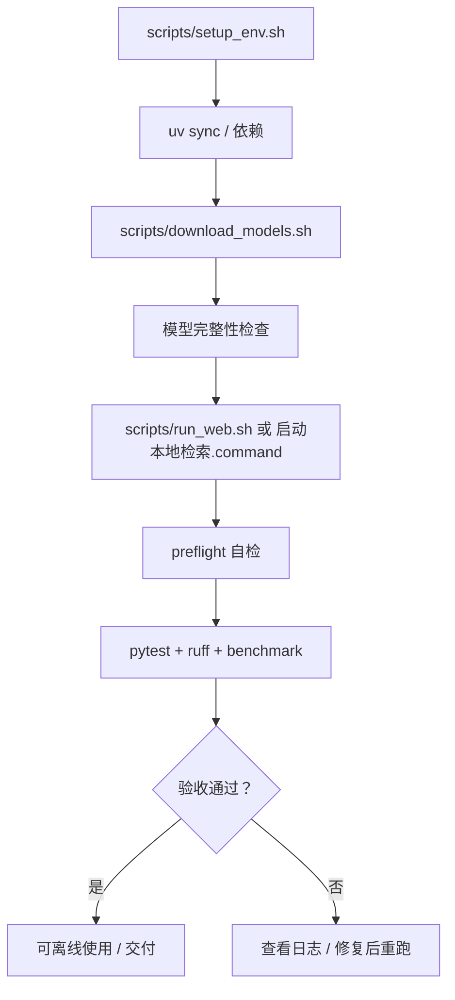

# STEP-11 打包与验收

> 状态：v1.1 已完成；v1.2 RC 验收见 `reports/v1.2-acceptance.md`  
> 依赖：全部前序步骤  
> 预估：0.5 人日  
> 对应总方案：[DOC-00](../00-总体方案.md) §14–§15 · [DOC-04](../04-离线部署与运维.md)  
> 对应代码：`scripts/*`、`README.md`、`.env.example`  
> 验收方式：见 §7

---

## 1. 目标

让系统达到“**换一台同架构 Mac 也能按文档跑起来**”的交付状态：

- 一条命令安装依赖；
- 一条命令校验/下载模型；
- 一条命令启动 Web；
- 有备份/恢复/排障说明；
- 完成功能、性能、质量、鲁棒性验收并留档。

---

## 2. 前置条件

- STEP-00 ~ STEP-10 全部完成；
- 至少一份评测报告；
- 至少 20 个混合格式文件的验收语料。

---

## 3. 交付物

| 文件 | 内容 |
|---|---|
| `README.md` | 快速开始、目录说明、常见问题 |
| `.env.example` | 环境变量样例 |
| `scripts/setup_env.sh` | 创建 venv、安装依赖 |
| `scripts/download_models.sh` | 镜像下载、大小校验、写 READY |
| `scripts/run_web.sh` | 启动并打开浏览器 |
| `scripts/make_fixtures.py` | 生成测试样本（已存在于 STEP-03） |
| `scripts/benchmark.py` | 评测入口（STEP-10） |
| `docs/` | 本套文档 |
| `reports/` | 评测/性能报告；活动报告与 archive 分离 |

---

## 4. 脚本设计

### 4.1 `setup_env.sh`

```bash
#!/usr/bin/env bash
set -euo pipefail
cd "$(dirname "$0")/.."

PYTHON="${PYTHON:-python3.11}"
if ! command -v uv >/dev/null 2>&1; then
  echo "需要 uv：https://docs.astral.sh/uv/"
  exit 1
fi

uv venv --python "$PYTHON" .venv
source .venv/bin/activate
uv pip install -e ".[dev]"

python -m app --check
```

要求：

- 幂等，可重复执行；
- 失败时打印可操作的下一步；
- 不自动下载模型（由单独脚本负责，便于离线机器）。

### 4.2 `download_models.sh`

```bash
#!/usr/bin/env bash
set -euo pipefail
cd "$(dirname "$0")/.."

export HF_ENDPOINT="${HF_ENDPOINT:-https://hf-mirror.com}"
export HF_HUB_DISABLE_XET=1
BASE="$HF_ENDPOINT"
EMBED_DIR=".models/bge-large-zh-v1.5"
RERANK_DIR=".models/bge-reranker-large"

mkdir -p "$EMBED_DIR" "$RERANK_DIR"

fetch() {  # repo file dest
  curl -sSL --retry 3 --retry-delay 2 -o "$3" "$BASE/$1/resolve/main/$2"
}

for f in config.json tokenizer_config.json tokenizer.json vocab.txt \
         special_tokens_map.json sentence_bert_config.json modules.json \
         1_Pooling/config.json pytorch_model.bin; do
  fetch "BAAI/bge-large-zh-v1.5" "$f" "$EMBED_DIR/$f"
done

for f in config.json tokenizer_config.json tokenizer.json \
         sentencepiece.bpe.model special_tokens_map.json pytorch_model.bin; do
  fetch "BAAI/bge-reranker-large" "$f" "$RERANK_DIR/$f"
done

# 大小校验
EMBED_SIZE=$(stat -f%z "$EMBED_DIR/pytorch_model.bin")
RERANK_SIZE=$(stat -f%z "$RERANK_DIR/pytorch_model.bin")
[ "$EMBED_SIZE" -gt 1000000000 ] || { echo "向量模型不完整"; exit 1; }
[ "$RERANK_SIZE" -gt 1500000000 ] || { echo "重排模型不完整"; exit 1; }

cat > .models/READY.json <<'JSON'
{"embed":"bge-large-zh-v1.5","rerank":"bge-reranker-large","dim":1024}
JSON

echo "模型就绪"
```

要求：

- 支持 `HF_ENDPOINT` 覆盖（企业镜像/ModelScope）；
- 支持断点续传（可选 `-C -`）；
- 校验文件大小，防止半截文件；
- 失败时提示手动下载清单。

### 4.3 `run_web.sh`

```bash
#!/usr/bin/env bash
set -euo pipefail
cd "$(dirname "$0")/.."

export HF_HUB_OFFLINE=1
export TRANSFORMERS_OFFLINE=1
export TOKENIZERS_PARALLELISM=false

source .venv/bin/activate
exec uvicorn app.api.app:create_app --factory \
  --host 127.0.0.1 --port "${APP_PORT:-8765}"
```

可选：启动后 `open http://127.0.0.1:8765`。

### 4.4 `.env.example`

```bash
APP_HOST=127.0.0.1
APP_PORT=8765
DATA_DIR=./data
MODELS_DIR=./.models
DEVICE=mps
CHUNK_SIZE=400
CHUNK_OVERLAP=50
TOP_K=20
FINAL_K=5
EMBED_BATCH_SIZE=32
RERANK_BATCH_SIZE=32
OCR_ENABLED=true
LOG_LEVEL=INFO
```

> 不把 `HF_HUB_OFFLINE=1` 写死在这里，便于首次下载；运行脚本中显式设置。

---

## 5. README 结构

```markdown
# 本地内容检索

## 特性
## 快速开始
1. 安装依赖
2. 下载模型
3. 启动
## 使用
- 添加文件夹
- 检查更新 / 手动同步
- 搜索
## 目录结构
## 配置
## 评测
## 常见问题
## 隐私说明
```

要求：

- 快速开始 ≤ 10 行命令；
- 明确“首次需要联网下载 3.3GB 模型，之后可完全离线”；
- 链接到 `docs/` 的详细文档；
- 不写“待定”。

---

## 6. 备份与恢复

见 [DOC-04 §4](../04-离线部署与运维.md#4-备份与恢复)。本步需实测一遍：

1. 停止服务；
2. 备份 `data/`；
3. 删除 `data/lancedb`；
4. 恢复备份；
5. 启动，确认文档数与搜索结果一致。

---

## 7. 最终验收

### 7.1 功能

- [ ] MD/TXT/PDF/DOCX/PPTX/HTML/图片各至少 3 个样本可入库；
- [ ] 中文关键词与语义查询均可用；
- [ ] 扫描发现新增/修改/删除；
- [ ] 只勾选部分文件可同步；
- [ ] 搜索结果显示文件名/路径/片段/页码/分数；
- [ ] 打开文件 / Finder 定位可用；
- [ ] 断网后仍可搜索与入库。

### 7.2 性能

- [ ] 热态搜索 p95 ≤ 1.5s；
- [ ] 入库 ≥ 30 chunk/s；
- [ ] 首查 ≤ 3s；
- [ ] 峰值内存 < 10GB。

记录到 `reports/perf-YYYYMMDD.md`：

| 项 | 数值 |
|---|---|
| 文档数 / chunk 数 | |
| 入库耗时 / 吞吐 | |
| 查询 p50 / p95 | |
| 重排 p50 / p95 | |
| 峰值内存 | |

### 7.3 质量

- [ ] Downloads 样本评测完成；
- [ ] Recall@10 ≥ 0.8（或记录未达原因）；
- [ ] hybrid + rerank 的 nDCG@10 不低于 hybrid；
- [ ] 失败案例 ≥ 5 条并归因。

### 7.4 鲁棒性

- [ ] 损坏 PDF/DOCX 不崩溃；
- [ ] GB18030 TXT 正常；
- [ ] 加密 PDF 明确报错；
- [ ] 模型缺失提示清晰；
- [ ] 入库中断可恢复；
- [ ] 端口冲突提示清晰。

---

## 8. 交付检查清单

- [ ] `README.md` 可按步骤跑通；
- [ ] `docs/` 全部文档状态更新；
- [ ] `reports/` 至少一份评测 + 一份性能；
- [ ] `.gitignore` 排除 `.venv/.models/data/reports`；
- [ ] 没有硬编码个人绝对路径（除 `.env.example` 示例）；
- [ ] 没有 `TODO`/`FIXME` 留在主流程；
- [ ] 依赖版本锁定；
- [ ] 模型下载脚本可重复执行；
- [ ] 备份/恢复实测通过。

---

## 9. 代码映射

| 文件 | 说明 |
|---|---|
| `scripts/setup_env.sh` | 安装 |
| `scripts/download_models.sh` | 模型 |
| `scripts/run_web.sh` | 启动 |
| `README.md` | 使用说明 |
| `.env.example` | 配置样例 |
| `reports/perf-*.md` | 性能记录 |

---

## 10. 风险与备注

| 风险 | 处理 |
|---|---|
| 换机后模型路径不同 | 用 `MODELS_DIR` 环境变量；文档说明 |
| 首次下载失败 | 支持镜像/手动清单；校验大小 |
| 端口被占用 | 提示改 `APP_PORT` |
| 备份时服务未停 | 文档明确要求先停服 |
| 评测报告缺失 | 交付门槛，必须补 |
| 个人路径泄漏 | README 用 `~/Downloads` 示例；报告脱敏 |

---

## 11. 完成定义（DoD）

- [ ] 三个脚本可重复执行；
- [ ] README 从零跑通；
- [ ] 最终验收表全部勾选或有书面例外；
- [ ] 评测/性能报告归档；
- [ ] 文档状态与代码一致。


---

## 流程图


